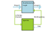
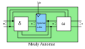
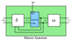
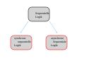



== Sequentielle Logik

Ergänzend zur kombinatorischen Logik enthält die sequentielle Logik eine Art Speicher,
der das Verhalten zustandsabhängig macht. Wir müssen ihr ein Taktsignal zuführen.

=== Mealy- und Moore-Automaten (synchron)
In der digitalen Logik gibt es zwei verschiedene Arten von endlichen Automaten.
Diese sind:

Der Mealy-Automat, der von der Eingabe und dem Zustand abhängig ist.
Der Moore-Automat, der nur vom Zustand abhängig ist

=== Synchrone und asynchrone sequentielle Logik

Es gibt zwei verschiedene Arten sequentieller Logik: die synchrone sequentielle Logik,
bei der alle Speicherelemente von einem gemeinsamen Takt gesteuert werden, und die asynchrone
Logik, die ganz ohne Takt auskommt und sofort auf Änderungen der Eingänge reagiert.

Fügen wir unserem oben gezeigten Automaten einen Takt hinzu, wird aus dem asynchronen ein
synchroner Automat. Wie man solche Automaten entwirft, sehen wir im Kapitel über
link:/de/pages/14_automata/[endliche Automaten].

(translation: 2024-12-29)