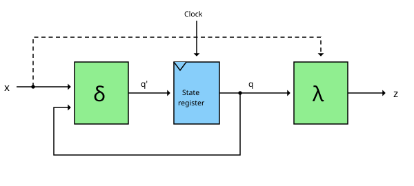
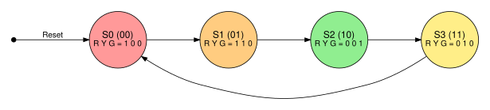
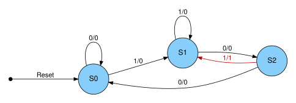
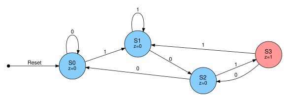



== Endliche Automaten

Im link:/de/pages/11_sequential_logic/[Beitrag über sequenzielle Logik] haben wir den Mealy- und den
Moore-Automaten bereits kurz kennengelernt. Im link:/de/pages/12_clocks_and_registers/[letzten Beitrag]
kamen dann die Bausteine hinzu, mit denen wir sie tatsächlich bauen können: Flipflops und Register.
In diesem Beitrag möchte der Autor beides zusammenführen und zeigen, wie ein endlicher Automat
(englisch: Finite State Machine, FSM) entworfen wird - von der Idee über das Zustandsdiagramm bis zur Schaltung.

Wozu brauchen wir das? Weil Zustandsautomaten überall stecken: in jeder Ampel, in jedem Getränkeautomaten,
in jedem Protokoll wie UART oder SPI - und, wie wir am Ende sehen werden, im Steuerwerk einer CPU.

=== Was ist ein endlicher Automat?

Ein endlicher Automat ist eine Schaltung, die sich zu jedem Zeitpunkt in genau einem von endlich vielen
*Zuständen* befindet. Er besteht aus:

. einer Menge von Zuständen, von denen einer der *Startzustand* ist
. den *Eingängen* x
. den *Ausgängen* z
. der *Übergangsfunktion* δ, die aus dem aktuellen Zustand und den Eingängen den Folgezustand bestimmt
. der *Ausgabefunktion* λ, die die Ausgänge bestimmt

In Hardware sieht das so aus:

Die grünen Blöcke sind kombinatorische Logik, wie wir sie aus Teil 1 kennen. Der blaue Block ist das
Zustandsregister, aufgebaut aus D-Flipflops, wie im letzten Beitrag beschrieben. Mit jeder Taktflanke
übernimmt das Register den von δ berechneten Folgezustand q'. Der aktuelle Zustand q wird an δ
zurückgeführt - diese Rückkopplung gibt der Schaltung ihr Gedächtnis.

Die gestrichelte Verbindung vom Eingang x direkt zur Ausgabelogik λ gibt es nur beim Mealy-Automaten.
Damit sind wir beim Unterschied zwischen den beiden Typen.

=== Mealy vs. Moore

[cols="a,a,a" width="100%"]
|===
| | *Moore-Automat* | *Mealy-Automat*
| Ausgang hängt ab von | nur dem aktuellen Zustand | dem aktuellen Zustand *und* den Eingängen
| Ausgabefunktion | \(z = \lambda(q)\) | \(z = \lambda(q, x)\)
| Reaktion auf einen Eingang | einen Takt später | sofort, im selben Takt
| Ausgang während des Takts stabil | ja | nein - ändert sich, sobald sich der Eingang ändert
| Anzahl der Zustände | meist mehr | meist weniger
|===

Der Moore-Automat ist die robustere Variante: Seine Ausgänge ändern sich nur mit der Taktflanke und bleiben
einen ganzen Takt lang stabil. Der Mealy-Automat reagiert schneller und kommt oft mit weniger Zuständen aus,
seine Ausgänge können aber kurze Störimpulse (Glitches) erzeugen, wenn sich die Eingänge mitten im Takt ändern.

Ein Sonderfall des Moore-Automaten ist der *Medwedew-Automat*: Hier sind die Ausgänge direkt die Ausgänge
des Zustandsregisters, die Ausgabefunktion λ entfällt ganz.
Ein synchroner Zähler, dessen Ausgänge einfach seine Zählerbits sind, ist ein solcher Medwedew-Automat.

=== Von der Idee zur Schaltung

Der Entwurf eines Automaten folgt immer denselben Schritten:

. Verhalten beschreiben und das *Zustandsdiagramm* zeichnen
. aus dem Diagramm die *Zustandstabelle* ableiten
. eine *Zustandscodierung* wählen, also jedem Zustand ein Bitmuster zuordnen
. die *booleschen Gleichungen* für Folgezustand und Ausgänge aufstellen
. die Gleichungen mit Gattern und D-Flipflops umsetzen

Die Schritte 4 und 5 sind genau das, was wir in Teil 1 mit der
link:/de/pages/01_boolean_algebra/[booleschen Algebra] gemacht haben. Sehen wir uns das an einem Beispiel an.

=== Beispiel 1: Eine Ampel (Moore)

Eine deutsche Ampel durchläuft vier Phasen: Rot, Rot-Gelb, Grün, Gelb - und dann wieder Rot.
Jede Phase wird zu einem Zustand, die drei Lampen Rot (R), Gelb (Y, englisch yellow) und Grün (G) sind die Ausgänge.
Da die Lampen nur von der aktuellen Phase abhängen, ist das ein klassischer Moore-Automat.

Für vier Zustände brauchen wir zwei Flipflops \(Q_1 Q_0\). Wir nummerieren die Zustände in ihrer Reihenfolge
als Binärzahlen durch:

[width="70%"]
|===
| Zustand | Phase | \(Q_1 Q_0\) | Folgezustand \(Q_1' Q_0'\) | R | Y | G
| S0 | Rot | 00 | 01 | 1 | 0 | 0
| S1 | Rot-Gelb | 01 | 10 | 1 | 1 | 0
| S2 | Grün | 10 | 11 | 0 | 0 | 1
| S3 | Gelb | 11 | 00 | 0 | 1 | 0
|===

==== Der Folgezustand

Vergleicht man die Spalten \(Q_1 Q_0\) und \(Q_1' Q_0'\), sieht man, dass der Automat einfach hochzählt:
00, 01, 10, 11, 00, ... Die Gleichungen lauten:

\[Q_0' = \overline{Q_0}\]

\[Q_1' = Q_1 \oplus Q_0\]

Wir brauchen also nur einen Inverter und ein link:/de/pages/02_xor/[XOR-Gatter]. Anders als beim
asynchronen Zähler aus dem letzten Beitrag werden hier beide Flipflops vom selben Taktsignal getaktet -
das ist ein *synchroner* Zähler.

==== Die Ausgänge

Die Gleichungen für die Ausgänge lassen sich direkt aus der Tabelle ablesen:

\[R = \overline{Q_1}\]

\[Y = Q_0\]

\[G = Q_1 \cdot \overline{Q_0}\]

Rot leuchtet in beiden Zuständen mit \(Q_1 = 0\), Gelb in beiden Zuständen mit \(Q_0 = 1\) und Grün nur im Zustand S2.
Die ganze Ampel besteht also aus zwei D-Flipflops, zwei Invertern, einem XOR- und einem UND-Gatter.

Die günstige Codierung ist kein Zufall: Mit einer anderen Zuordnung der Bitmuster zu den Zuständen würden
die Gleichungen länger. Die Wahl der Zustandscodierung hat direkten Einfluss auf die Größe der Schaltung.

NOTE: Echte Ampeln bleiben in der Grünphase deutlich länger als in der Rot-Gelb-Phase.
Dafür bekommt der Automat einen zusätzlichen Eingang T (Zeit abgelaufen) von einem Timer: Solange T = 0 ist,
bleibt der Automat in seinem aktuellen Zustand. In Hardware ist das ein Multiplexer vor jedem Flipflop,
der zwischen dem aktuellen Zustand q und dem Folgezustand q' wählt.

=== Beispiel 2: Ein Sequenzdetektor (Mealy und Moore)

Den Unterschied zwischen Mealy und Moore sieht man am besten an einem zweiten Beispiel.
Unser Automat erhält pro Takt ein Bit x und soll z = 1 ausgeben, sobald die Bitfolge *101* empfangen wurde.
Überlappende Folgen zählen mit: Die Eingabe 10101 enthält die Folge zweimal.

==== Als Mealy-Automat

Wir brauchen drei Zustände: S0 (noch nichts Brauchbares empfangen), S1 (das letzte Bit war eine 1) und
S2 (die letzten Bits waren 10). Die Kanten sind mit Eingang/Ausgang beschriftet:

[width="70%"]
|===
| Zustand | x = 0 | x = 1
| S0 | S0 / 0 | S1 / 0
| S1 | S2 / 0 | S1 / 0
| S2 | S0 / 0 | S1 / *1*
|===

Ist der Automat im Zustand S2 und empfängt eine 1, ist der Ausgang 1 - im selben Takt.
Danach springt er nach S1, weil die abschließende 1 bereits der Anfang der nächsten Folge sein kann.

==== Als Moore-Automat

Da der Ausgang eines Moore-Automaten nur vom Zustand abhängen darf, brauchen wir einen zusätzlichen
Zustand S3, der „101 empfangen“ bedeutet. Der Ausgang steht in den Zuständen:

[width="70%"]
|===
| Zustand | x = 0 | x = 1 | z
| S0 | S0 | S1 | 0
| S1 | S2 | S1 | 0
| S2 | S0 | S3 | 0
| S3 | S2 | S1 | *1*
|===

Der Moore-Automat braucht also einen Zustand mehr, und sein Ausgang reagiert erst einen Takt später -
dafür ist er einen vollen Takt lang stabil.

=== Zustandscodierung

Im Ampel-Beispiel haben wir die Zustände einfach als Binärzahlen durchnummeriert. Es gibt aber weitere Varianten:

[width="100%"]
|===
| Codierung | Beispiel für 4 Zustände | Flipflops für n Zustände | Eigenschaften
| binär | 00, 01, 10, 11 | \(\lceil \log_2 n \rceil\) | wenigste Flipflops
| Gray-Code | 00, 01, 11, 10 | \(\lceil \log_2 n \rceil\) | pro Übergang ändert sich nur ein Bit
| One-Hot | 0001, 0010, 0100, 1000 | n | einfache Logik, beliebt in FPGAs
|===

Bei der One-Hot-Codierung ist pro Zustand genau ein Flipflop gesetzt. Das braucht mehr Flipflops,
dafür wird die Logik für Folgezustand und Ausgänge oft sehr einfach. Da FPGAs Flipflops im Überfluss haben,
wählen Synthesewerkzeuge diese Codierung häufig automatisch.

=== Stolperfallen

Ein paar Dinge gilt es zu beachten:

. *Reset:* Nach dem Einschalten enthalten die Flipflops zufällige Werte. Es braucht ein Reset-Signal,
  das den Automaten in einen definierten Startzustand versetzt.
. *Unbenutzte Zustände:* Der Mealy-Sequenzdetektor hat drei Zustände, zwei Flipflops können aber vier speichern.
  Das unbenutzte Muster 11 muss in einen gültigen Zustand zurückführen - sonst bleibt der Automat dort womöglich für immer hängen.
. *Asynchrone Eingänge:* Ist ein Eingang (z. B. ein Taster) nicht mit dem Takt synchronisiert, kann er sich genau
  an der Taktflanke ändern und das Flipflop in einen undefinierten (metastabilen) Zustand bringen.
  Abhilfe schafft ein Synchronisierer aus zwei hintereinandergeschalteten Flipflops vor dem Automaten.

=== Ausblick: Das Steuerwerk als Automat

Im Beitrag über den link:/de/pages/16_datapath/[Datenpfad] werden wir sehen, dass jeder Befehl die Phasen
Befehl holen, Dekodieren, Ausführen, Speicherzugriff und Zurückschreiben durchläuft. In einer *Multi-Cycle-CPU*, 
die pro Phase einen Takt verwendet, ist das Steuerwerk genau so ein Automat: Jede Phase ist ein Zustand, und die
Ausgänge sind die Steuersignale für Multiplexer, ALU, Registerdatei und Speicher. Der Opcode des Befehls ist der 
Eingang, der bestimmt, welcher Zustand als nächstes folgt.

In unserer ersten CPU gehen wir den einfacheren Weg: In einer Single-Cycle-CPU werden alle Phasen in einem Takt
durchlaufen, und das Steuerwerk wird zu reiner kombinatorischer Logik. Das sehen wir uns im Kapitel über das
link:/de/pages/17_cpu_control/[Steuerwerk] an.

Zum Weiterlesen: David Money Harris und Sarah L. Harris, „Digital Design and Computer Architecture - RISC-V Edition“,
Kapitel 3, behandelt Zustandsautomaten ausführlich.

(Erstellt von Claude AI)