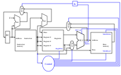



== Digitales Design trifft auf Computerarchitektur

Bis hierhin haben wir die einzelnen Bausteine eines Prozessors kennengelernt: Logikgatter,
Addierer und die ALU aus Teil 1 sowie Flipflops, Register und Speicher aus Teil 2.
In diesem Kapitel setzen wir diese Bausteine zu einer einfachen CPU zusammen.
Bevor wir das tun, müssen wir festlegen, *welche* Befehle diese CPU überhaupt verstehen soll.
Diese Festlegung nennt man die **Befehlssatzarchitektur** (Instruction Set Architecture, ISA).
Sie ist die Schnittstelle zwischen Software und Hardware: Der Programmierer (oder Compiler)
sieht nur die Befehle, die Hardware muss sie ausführen können.

== RISC vs. CISC und die RISC-V-Architektur

Prozessoren lassen sich nach ihrem Befehlssatz grob in zwei Gruppen einteilen:
Computer mit reduziertem Befehlssatz (RISC) und Computer mit komplexem Befehlssatz (CISC).
Typische RISC-Architekturen sind ARM und RISC-V, die vor allem in eingebetteten Systemen und Mobilgeräten
verbreitet sind. Die x86-Architektur (x86, x86_64) heutiger PCs und Server ist dagegen eine CISC-Architektur;
moderne x86-Prozessoren zerlegen ihre komplexen Befehle intern allerdings in einfachere, RISC-ähnliche Mikrooperationen.

Die Idee eines reduzierten Befehlssatzes besteht darin, große, komplexe Befehle und viele unterschiedliche
Adressierungsarten (wie sie typisch für x86 sind) zu vermeiden. Stattdessen gilt:

* Alle Befehle haben dieselbe Länge (bei RISC-V 32 Bit).
* Nur spezielle Lade- und Speicherbefehle greifen auf den Speicher zu; alle Rechenbefehle arbeiten
  ausschließlich mit Registern. Man spricht von einer **Load/Store-Architektur**.
* Die Befehlsformate sind einfach und regelmäßig aufgebaut.

Dadurch lassen sich die Befehle leicht dekodieren, und die Ausführung lässt sich gut in gleichartige Schritte
zerlegen – eine wichtige Voraussetzung für Pipelining und hohe Taktraten.
Jeder Befehl durchläuft dabei dieselben Phasen:
„Befehl holen -> Dekodieren und Register lesen -> Ausführen -> Speicherzugriff -> Zurückschreiben“.

RISC-V ist ein offener, lizenzfreier Standard für eine solche Befehlssatzarchitektur.
Der größte Teil dieses Beitrags orientiert sich an dem Buch
„Computer Organization and Design – RISC-V Edition: The Hardware/Software Interface“
von David A. Patterson und John L. Hennessy.

== RISC-V-Assembler

Hier stellen wir den RISC-V-Assembler vor.
Die hier gezeigte Teilmenge ist etwas größer als die, die wir später implementieren werden.
So verwenden wir zum Beispiel den Immediate-Befehl `addi`, mit dem sich Konstanten in Register laden lassen.

Das folgende Beispielprogramm zählt in einer Schleife von 0 bis 10 und schreibt den aktuellen Zählerstand
nach jedem Schritt in den Datenspeicher (an die Adresse 4):

----
        addi x1, x0, 0       # x1 = 0   (Zähler)
        addi x2, x0, 1       # x2 = 1   (Schrittweite)
        addi x3, x0, 10      # x3 = 10  (Endwert)

loop:
        add  x1, x1, x2      # x1 = x1 + x2
        sw   x1, 4(x0)       # Speicher[x0 + 4] = x1
        bne  x1, x3, loop    # solange x1 != x3: springe zu loop

done:
        j    done            # Endlosschleife: Programm ist fertig
----

Einige Anmerkungen dazu:

* Das Register `x0` ist bei RISC-V fest mit dem Wert 0 verdrahtet. `addi x2, x0, 1` bedeutet also einfach
  „lade die Konstante 1 in x2“.
* `bne` (branch if not equal) ist das Gegenstück zu `beq` (branch if equal). Unsere minimale
  Implementierung unterstützt nur `beq`; sie ließe sich aber mit wenig Aufwand um `bne` erweitern.
* Einen Befehl zum Anhalten des Prozessors (wie `HLT` bei x86) gibt es in RISC-V nicht. Ein Programm
  endet entweder mit einem Systemaufruf (`ecall`), mit `ebreak` (Übergabe an einen Debugger) oder – wie hier –
  mit einer Endlosschleife. `j done` ist ein sogenannter Pseudobefehl, den der Assembler in `jal x0, done` übersetzt.

Wer das Programm selbst ausprobieren möchte, kann einen RISC-V-Simulator wie Ripes, RARS oder Venus verwenden.
Ripes zeigt dabei sogar den Datenpfad an, den wir weiter unten besprechen.

Die Befehle, die wir verwenden, folgen diesen Formaten:

[options="header"]
|==================
| Typ | Schreibweise | Beispiel | Bedeutung
| Register (R-Typ) | `befehl rd, rs1, rs2` | `add x1, x1, x2` | rd = rs1 + rs2
| Immediate (I-Typ) | `befehl rd, rs1, imm` | `addi x2, x0, 1` | rd = rs1 + imm
| Laden (I-Typ) | `lw rd, offset(rs1)` | `lw x5, 8(x6)` | rd = Speicher[rs1 + offset]
| Speichern (S-Typ) | `sw rs2, offset(rs1)` | `sw x1, 4(x0)` | Speicher[rs1 + offset] = rs2
| Verzweigung (B-Typ) | `befehl rs1, rs2, marke` | `beq x1, x3, loop` | wenn rs1 = rs2: springe zu marke
|==================

Dabei steht `rd` für das Zielregister (destination), `rs1` und `rs2` für die Quellregister (source)
und `imm` für einen konstanten Wert, der direkt im Befehl steht (immediate).
Speicher- und Verzweigungsbefehle haben kein Zielregister: Sie schreiben in den Speicher bzw. verändern den Programmzähler.

Bei den Lade- und Speicherbefehlen enthält `rs1` eine Basisadresse. Der Offset ist ein Versatz in Byte,
der zu dieser Basisadresse addiert wird; die Summe ist die Speicheradresse, auf die zugegriffen wird.
Die Größe des gelesenen bzw. geschriebenen Wertes ergibt sich dagegen aus dem Befehl selbst:
`lw`/`sw` (load/store word) übertragen ein Wort mit 32 Bit, also 4 Byte; für einzelne Bytes oder Halbwörter
gibt es eigene Befehle wie `lb`/`sb` und `lh`/`sh`.

Nachfolgend eine Übersicht über die Bitfelder der verschiedenen Befehlsformate:

image:./instruction_types.png[width="140%"]

== Eine minimale Implementierung

Die minimale funktionsfähige Teilmenge einer RISC-V-Implementierung enthält die folgenden Befehle:

* die arithmetisch-logischen Befehle `add`, `sub`, `and` und `or` [R-Typ]
* die Speicherbefehle load word (`lw`) und store word (`sw`) [I- bzw. S-Typ]
* den bedingten Sprungbefehl branch if equal (`beq`) [B-Typ]

Wir werden sehen, wie sich die gewählte Befehlssatzarchitektur auf wichtige Leistungsmerkmale wie
Taktrate und Zyklen pro Befehl (CPI) auswirkt.
Wir werden außerdem sehen, dass sich die verschiedenen Befehlstypen erst in den späteren Phasen
der Ausführung unterscheiden.

Die ersten beiden Schritte sind für jeden Befehl gleich:

  1. Der Programmzähler (PC) enthält die Adresse des aktuellen Befehls. Diese Adresse wird an den
     Befehlsspeicher gesendet, der den Befehl liefert.

  2. Aus der Registerdatei werden ein oder zwei Register gelesen; die Registernummern stehen in den Feldern
     des Befehls. `lw` und `addi` lesen nur ein Register (`rs1`), alle anderen Befehle unserer Teilmenge
     lesen zwei (`rs1` und `rs2`).

Die nächsten Schritte hängen vom Befehlstyp ab, nutzen aber weiterhin dieselben Ressourcen.
So verwenden R-Typ-Befehle die ALU zur Berechnung des Ergebnisses, Speicherbefehle zur Berechnung
der Adresse und Verzweigungsbefehle für den Gleichheitstest.
Erst nach der ALU unterscheiden sich die verschiedenen Befehlstypen wirklich.

Dieses abstrakte Schema erklärt jedoch noch nicht alle Fälle: Es zeigt zum Beispiel nicht, woher die ALU weiß,
welche Operation sie ausführen soll, oder wann in die Registerdatei geschrieben wird.
Dafür benötigen wir ein erweitertes Schema, das zusätzlich die Steuerung zeigt.

== Die Ausführungsphasen für die verschiedenen Befehlstypen

Wir beginnen mit den fünf klassischen Phasen eines RISC-Prozessors
und zeigen, was in jeder Phase für die typischen Befehle passiert:

Befehl holen (IF) -> Dekodieren und Register lesen (ID) -> Ausführen (EX) -> Speicherzugriff (MEM) -> Zurückschreiben (WB)

[options="header"]
|==================
| Typ | Befehl | Befehl holen (IF) | Dekodieren (ID) | Ausführen (EX) | Speicherzugriff (MEM) | Zurückschreiben (WB)
| Register | `add`, `sub`, `and`, `or` | Befehl holen, PC + 4 berechnen | Befehl dekodieren, rs1 und rs2 lesen | ALU berechnet rs1 op rs2 | – | Ergebnis in rd schreiben
| Laden | `lw` | Befehl holen, PC + 4 berechnen | Befehl dekodieren, rs1 lesen | ALU berechnet Adresse rs1 + Offset | Wort aus dem Datenspeicher lesen | gelesenes Wort in rd schreiben
| Speichern | `sw` | Befehl holen, PC + 4 berechnen | Befehl dekodieren, rs1 und rs2 lesen | ALU berechnet Adresse rs1 + Offset | rs2 in den Datenspeicher schreiben | –
| Verzweigung | `beq` | Befehl holen, PC + 4 berechnen | Befehl dekodieren, rs1 und rs2 lesen | ALU vergleicht rs1 und rs2; zweiter Addierer berechnet Sprungziel PC + Offset | – | PC = Sprungziel, falls gleich, sonst PC + 4
|==================

In der Phase „Befehl holen“ wird also bei *jedem* Befehl zunächst nur PC + 4 berechnet.
Ob stattdessen gesprungen wird, steht bei `beq` erst fest, nachdem die ALU die beiden Register verglichen hat.
Ein Multiplexer wählt dann zwischen PC + 4 und dem Sprungziel als neuem Wert für den Programmzähler.

In unserer ersten, einfachen Implementierung werden alle fünf Phasen innerhalb eines einzigen Taktzyklus
durchlaufen (Single-Cycle-Prozessor). Die Aufteilung in Phasen hilft trotzdem beim Verständnis –
und sie ist die Grundlage für Pipelining, bei dem mehrere Befehle gleichzeitig in verschiedenen Phasen bearbeitet werden.

=== Der Befehlsteil

Um eine CPU auf dieser abstrakten Ebene zu erklären, benötigen wir noch einige Begriffe.
Ein **Befehl** ist im Speicher abgelegt und unter einer bestimmten Adresse erreichbar.
Eine **Adresse** ist bei RISC-V (in der 32-Bit-Variante RV32) ein 32 Bit langer Wert, der auf ein bestimmtes Byte
im Speicher zeigt.
Der **Programmzähler (PC)** ist ein Register, das die Adresse des aktuellen Befehls im Befehlsspeicher enthält.
Der Programmzähler ist mit dem ersten Addierer verbunden, der zu ihm die Konstante 4 addiert:
Ein Befehl ist 32 Bit = 4 Byte lang, der nächste Befehl liegt also 4 Adressen weiter.

Ist der Befehl ein Verzweigungsbefehl, addiert ein zweiter Addierer den im Befehl enthaltenen Offset zum
Programmzähler. Auf diese Weise entstehen **Sprünge**: Ist die Sprungbedingung erfüllt, wird dieses Ergebnis
statt PC + 4 in den Programmzähler übernommen.

=== Der Datenpfad

Der Datenpfad zeigt Elemente, die wir bereits kennen: die ALU und die beiden Speicherblöcke –
links die Registerdatei, rechts der Datenspeicher.
Der erste Eingang der ALU ist mit dem ersten Leseport der Registerdatei (`rs1`) verbunden.
Der zweite Eingang erhält entweder den Wert des zweiten Leseports (`rs2`) oder eine Konstante aus dem Befehl,
etwa den Offset bei `lw` und `sw`.
Das Ergebnis der ALU dient je nach Befehl als Wert für die Registerdatei oder als Adresse für den Datenspeicher;
bei `lw` wird der aus dem Datenspeicher gelesene Wert in die Registerdatei zurückgeschrieben.

=== Der Steuerteil

Der Steuerteil ist das Element, das in unseren Schemata bisher am meisten Blackbox ist.
Wie Multiplexer funktionieren, wissen wir bereits, und wir sehen auch schon die Rückkopplung,
mit der eine Verzweigung den Programmzähler beeinflusst.
Offen ist aber noch die zentrale Frage: Woher wissen Multiplexer, ALU, Registerdatei und Datenspeicher,
was sie bei einem bestimmten Befehl tun sollen?
Die Antwort liefert das Steuerwerk, das aus dem Opcode des Befehls die passenden Steuersignale erzeugt.

NOTE: Fortsetzung folgt: Im nächsten Kapitel sehen wir uns das Steuerwerk im Detail an
und verfolgen unser Beispielprogramm Takt für Takt durch die CPU.

(translation: 2024-12-29)
