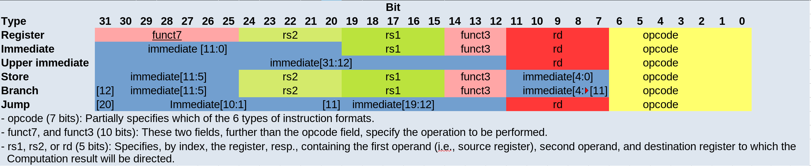



== Digitales Design trifft auf Computerarchitektur

Bis hierhin haben wir die einzelnen Bausteine eines Prozessors kennengelernt: Logikgatter,
Addierer und die ALU aus Teil 1 sowie Flipflops, Register und Speicher aus Teil 2.
In den nächsten drei Kapiteln setzen wir diese Bausteine zu einer einfachen CPU zusammen.
Zuerst müssen wir aber festlegen, *welche* Befehle diese CPU überhaupt verstehen soll.
Diese Festlegung nennt man die **Befehlssatzarchitektur** (Instruction Set Architecture, ISA).
Sie ist die Schnittstelle zwischen Software und Hardware: Der Programmierer (oder Compiler)
sieht nur die Befehle, die Hardware muss sie ausführen können.

== RISC vs. CISC und die RISC-V-Architektur

Prozessoren lassen sich nach ihrem Befehlssatz grob in zwei Gruppen einteilen:
Computer mit reduziertem Befehlssatz (RISC) und Computer mit komplexem Befehlssatz (CISC).
Typische RISC-Architekturen sind ARM und RISC-V, die vor allem in eingebetteten Systemen und Mobilgeräten
verbreitet sind. Die x86-Architektur (x86, x86_64) heutiger PCs und Server ist dagegen eine CISC-Architektur;
moderne x86-Prozessoren zerlegen ihre komplexen Befehle intern allerdings in einfachere, RISC-ähnliche Mikrooperationen.

Die Idee eines reduzierten Befehlssatzes besteht darin, große, komplexe Befehle und viele unterschiedliche
Adressierungsarten (wie sie typisch für x86 sind) zu vermeiden. Stattdessen gilt:

* Alle Befehle haben dieselbe Länge (bei RISC-V 32 Bit).
* Nur spezielle Lade- und Speicherbefehle greifen auf den Speicher zu; alle Rechenbefehle arbeiten
  ausschließlich mit Registern. Man spricht von einer **Load/Store-Architektur**.
* Die Befehlsformate sind einfach und regelmäßig aufgebaut.

Dadurch lassen sich die Befehle leicht dekodieren, und die Ausführung lässt sich gut in gleichartige Schritte
zerlegen – eine wichtige Voraussetzung für Pipelining und hohe Taktraten.
Jeder Befehl durchläuft dabei dieselben Phasen:
„Befehl holen -> Dekodieren und Register lesen -> Ausführen -> Speicherzugriff -> Zurückschreiben“.

RISC-V ist ein offener, lizenzfreier Standard für eine solche Befehlssatzarchitektur.
Der größte Teil dieses Beitrags orientiert sich an dem Buch
„Computer Organization and Design – RISC-V Edition: The Hardware/Software Interface“
von David A. Patterson und John L. Hennessy.

== RISC-V-Assembler

Hier stellen wir den RISC-V-Assembler vor.
Die hier gezeigte Teilmenge ist etwas größer als die, die wir später implementieren werden.
So verwenden wir zum Beispiel den Immediate-Befehl `addi`, mit dem sich Konstanten in Register laden lassen.

Das folgende Beispielprogramm zählt in einer Schleife von 0 bis 10 und schreibt den aktuellen Zählerstand
nach jedem Schritt in den Datenspeicher (an die Adresse 4):

----
        addi x1, x0, 0       # x1 = 0   (Zähler)
        addi x2, x0, 1       # x2 = 1   (Schrittweite)
        addi x3, x0, 10      # x3 = 10  (Endwert)

loop:
        add  x1, x1, x2      # x1 = x1 + x2
        sw   x1, 4(x0)       # Speicher[x0 + 4] = x1
        bne  x1, x3, loop    # solange x1 != x3: springe zu loop

done:
        j    done            # Endlosschleife: Programm ist fertig
----

Einige Anmerkungen dazu:

* Das Register `x0` ist bei RISC-V fest mit dem Wert 0 verdrahtet. `addi x2, x0, 1` bedeutet also einfach
  „lade die Konstante 1 in x2“.
* `bne` (branch if not equal) ist das Gegenstück zu `beq` (branch if equal). Unsere minimale
  Implementierung unterstützt nur `beq`; sie ließe sich aber mit wenig Aufwand um `bne` erweitern.
* Einen Befehl zum Anhalten des Prozessors (wie `HLT` bei x86) gibt es in RISC-V nicht. Ein Programm
  endet entweder mit einem Systemaufruf (`ecall`), mit `ebreak` (Übergabe an einen Debugger) oder – wie hier –
  mit einer Endlosschleife. `j done` ist ein sogenannter Pseudobefehl, den der Assembler in `jal x0, done` übersetzt.

Wer das Programm selbst ausprobieren möchte, kann einen RISC-V-Simulator wie Ripes, RARS oder Venus verwenden.
Ripes zeigt dabei sogar den Datenpfad an, den wir im nächsten Kapitel besprechen.

Die Befehle, die wir verwenden, folgen diesen Formaten:

[options="header"]
|==================
| Typ | Schreibweise | Beispiel | Bedeutung
| Register (R-Typ) | `befehl rd, rs1, rs2` | `add x1, x1, x2` | rd = rs1 + rs2
| Immediate (I-Typ) | `befehl rd, rs1, imm` | `addi x2, x0, 1` | rd = rs1 + imm
| Laden (I-Typ) | `lw rd, offset(rs1)` | `lw x5, 8(x6)` | rd = Speicher[rs1 + offset]
| Speichern (S-Typ) | `sw rs2, offset(rs1)` | `sw x1, 4(x0)` | Speicher[rs1 + offset] = rs2
| Verzweigung (B-Typ) | `befehl rs1, rs2, marke` | `beq x1, x3, loop` | wenn rs1 = rs2: springe zu marke
|==================

Dabei steht `rd` für das Zielregister (destination), `rs1` und `rs2` für die Quellregister (source)
und `imm` für einen konstanten Wert, der direkt im Befehl steht (immediate).
Speicher- und Verzweigungsbefehle haben kein Zielregister: Sie schreiben in den Speicher bzw. verändern den Programmzähler.

Bei den Lade- und Speicherbefehlen enthält `rs1` eine Basisadresse. Der Offset ist ein Versatz in Byte,
der zu dieser Basisadresse addiert wird; die Summe ist die Speicheradresse, auf die zugegriffen wird.
Die Größe des gelesenen bzw. geschriebenen Wertes ergibt sich dagegen aus dem Befehl selbst:
`lw`/`sw` (load/store word) übertragen ein Wort mit 32 Bit, also 4 Byte; für einzelne Bytes oder Halbwörter
gibt es eigene Befehle wie `lb`/`sb` und `lh`/`sh`.

Nachfolgend eine Übersicht über die Bitfelder der verschiedenen Befehlsformate:

== Wie geht es weiter?

Jetzt wissen wir, *was* unsere CPU können soll: Wir kennen den Befehlssatz, die Befehlsformate und haben
ein erstes Programm geschrieben. Im nächsten Kapitel schauen wir uns an, *wie* die Hardware diese Befehle
ausführt: link:/de/pages/16_datapath/[Der Datenpfad].

(translation: 2024-12-29)

(Gegengelesen mit Claude AI)