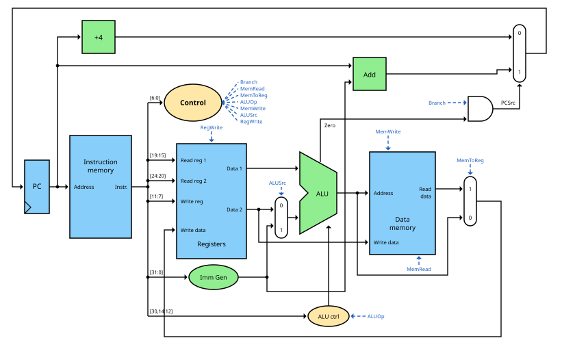



== Das Steuerwerk

Am Ende des link:/de/pages/15_risc_v/[RISC-V-Beitrags] blieb eine Frage offen:
Woher wissen Multiplexer, ALU, Registerdatei und Datenspeicher, was sie bei einem bestimmten Befehl
tun sollen? In diesem Beitrag möchte der Autor diese Frage beantworten und dafür das letzte fehlende
Teil unserer CPU bauen - das Steuerwerk.

Im link:/de/pages/14_automata/[Beitrag über endliche Automaten] haben wir gesehen, dass das Steuerwerk
einer Multi-Cycle-CPU ein Automat ist. Unsere erste CPU ist aber eine Single-Cycle-CPU, die jeden Befehl
innerhalb eines Takts ausführt. Hier braucht das Steuerwerk überhaupt keinen Zustand: Es ist reine
kombinatorische Logik, wie wir sie aus Teil 1 kennen. Sein Eingang ist der Befehl, seine Ausgänge sind die Steuersignale.

=== Der Befehl als Eingang

Jeder RISC-V-Befehl ist 32 Bit lang. Die Felder des Befehls liegen unabhängig vom Befehlsformat
immer an denselben Positionen:

[width="100%"]
|===
| Bits | 31..25 | 24..20 | 19..15 | 14..12 | 11..7 | 6..0
| Feld | funct7 | rs2 | rs1 | funct3 | rd | opcode
|===

Diese Regelmäßigkeit ist ein großer Vorteil: Die Registerdatei kann rs1 und rs2 schon lesen, während das Steuerwerk
den Befehl noch dekodiert - auch wenn sich später herausstellt, dass eines der Register gar nicht gebraucht wird.

Das Steuerwerk schaut vor allem auf die unteren 7 Bit, den *Opcode*. Für unsere minimale Teilmenge sind das:

[width="70%"]
|===
| Befehl(e) | Typ | Opcode
| `add`, `sub`, `and`, `or` | R-Typ | 0110011
| `lw` | I-Typ | 0000011
| `sw` | S-Typ | 0100011
| `beq` | B-Typ | 1100011
|===

Die Felder funct3 und funct7 unterscheiden Befehle mit gleichem Opcode, also zum Beispiel `add` von `sub`.
Wir brauchen sie später für die ALU-Steuerung.

=== Der Datenpfad mit Steuerung

Das folgende Bild zeigt unsere komplette Single-Cycle-CPU. Es erweitert den Datenpfad aus dem letzten Beitrag
um das Steuerwerk, die ALU-Steuerung, den Immediate-Generator und drei Multiplexer.
Die Steuersignale sind blau gezeichnet: Sie verlassen das Steuerwerk rechts und sind an ihren Zielen
als kurze Stummel mit demselben Namen eingezeichnet, damit das Bild übersichtlich bleibt.

Befehlsspeicher und Datenspeicher sind hier zwei getrennte Speicher. Das ist notwendig,
weil wir innerhalb eines einzigen Takts einen Befehl lesen *und* auf den Datenspeicher zugreifen müssen.

=== Die Steuersignale

[width="100%"]
|===
| Signal | wirkt auf | bei 0 | bei 1
| RegWrite | Registerdatei | nichts passiert | der Wert an „Write data“ wird in das Register rd geschrieben
| ALUSrc | Multiplexer vor der ALU | 2. Operand = Register rs2 | 2. Operand = Konstante aus dem Immediate-Generator
| MemRead | Datenspeicher | nichts passiert | das Wort an der Adresse wird gelesen
| MemWrite | Datenspeicher | nichts passiert | rs2 wird an die Adresse geschrieben
| MemToReg | Multiplexer hinter dem Datenspeicher | das ALU-Ergebnis wird zurückgeschrieben | der aus dem Speicher gelesene Wert wird zurückgeschrieben
| Branch | UND-Gatter vor dem PC-Multiplexer | PC = PC + 4 | PC = Sprungziel, falls die ALU Zero = 1 meldet
| ALUOp (2 Bit) | ALU-Steuerung | siehe unten | siehe unten
|===

=== Die Haupttabelle

Jetzt können wir für jeden Befehl festlegen, welchen Wert jedes Steuersignal haben muss.
Diese Tabelle ist das Herzstück des Steuerwerks:

[width="100%"]
|===
| Befehl | RegWrite | ALUSrc | MemToReg | MemRead | MemWrite | Branch | ALUOp
| R-Typ | 1 | 0 | 0 | 0 | 0 | 0 | 10
| `lw` | 1 | 1 | 1 | 1 | 0 | 0 | 00
| `sw` | 0 | 1 | X | 0 | 1 | 0 | 00
| `beq` | 0 | 0 | X | 0 | 0 | 1 | 01
|===

Das X steht für „don't care“ (egal): Bei `sw` und `beq` spielt der Wert von MemToReg keine Rolle,
weil RegWrite = 0 ist und ohnehin nichts in die Registerdatei geschrieben wird.
Solche Don't-Cares geben uns Freiheit, die Logik kleiner zu machen.

Gehen wir die Zeilen durch:

* *R-Typ:* Beide Operanden kommen aus Registern (ALUSrc = 0), das ALU-Ergebnis (MemToReg = 0) wird in rd geschrieben (RegWrite = 1).
  Die ALU-Operation ergibt sich aus funct3 und funct7 (ALUOp = 10).
* *lw:* Die ALU addiert Basisregister und Offset (ALUSrc = 1, ALUOp = 00), der Datenspeicher wird gelesen
  (MemRead = 1) und der gelesene Wert in rd geschrieben (MemToReg = 1, RegWrite = 1).
* *sw:* Die Adresse wird wie bei `lw` berechnet, aber rs2 wird in den Datenspeicher geschrieben (MemWrite = 1).
* *beq:* Die ALU subtrahiert rs2 von rs1 (ALUOp = 01). Ist das Ergebnis null, sind beide Register gleich, und der Sprung wird ausgeführt (Branch = 1).

==== Von der Tabelle zu den Gattern

Wie wird aus dieser Tabelle eine Schaltung? Am einfachsten mit einem Decoder - wie in unserem
link:/de/pages/06_priority_encoder_and-decoder/[Exkurs zu Decodern] -, der die vier Opcodes erkennt und genau eine
der vier Leitungen R, LW, SW und BR aktiviert. Dann ist jedes Steuersignal einfach ein ODER der Leitungen,
in denen es 1 ist:

\[RegWrite = R + LW\]

\[ALUSrc = LW + SW\]

\[MemToReg = MemRead = LW\]

\[MemWrite = SW\]

\[Branch = BR\]

\[ALUOp_1 = R \qquad ALUOp_0 = BR\]

Das komplette Hauptsteuerwerk besteht also aus einem Decoder für 7 Bit und zwei ODER-Gattern.
In echten Prozessoren wird das oft als PLA (programmierbares Logik-Array) umgesetzt oder einfach in einer
Hardwarebeschreibungssprache formuliert und dem Synthesewerkzeug überlassen.

=== Die ALU-Steuerung

Die ALU aus link:/de/pages/05_alu/[Teil 1] wird über die Signale Ainvert, Binvert und Operation gesteuert.
Zusammen sind das 4 Steuerbits. Für unsere Befehle brauchen wir:

[width="60%"]
|===
| Funktion | Ainvert | Binvert | Operation | ALU-Steuerung
| und | 0 | 0 | 00 | 0000
| oder | 0 | 0 | 01 | 0001
| add | 0 | 0 | 10 | 0010
| sub | 0 | 1 | 10 | 0110
|===

Die ALU-Steuerung erzeugt diese 4 Bit aus dem 2 Bit breiten ALUOp des Hauptsteuerwerks und,
bei R-Typ-Befehlen, aus funct7 (davon zählt nur Bit 30 des Befehls) und funct3:

[width="100%"]
|===
| ALUOp | funct7 | funct3 | Befehl | Funktion | ALU-Steuerung
| 00 | X | X | `lw`, `sw` | add | 0010
| 01 | X | X | `beq` | sub | 0110
| 10 | 0000000 | 000 | `add` | add | 0010
| 10 | 0100000 | 000 | `sub` | sub | 0110
| 10 | 0000000 | 111 | `and` | und | 0000
| 10 | 0000000 | 110 | `or` | oder | 0001
|===

Warum zwei Stufen? Das Hauptsteuerwerk muss nur grob entscheiden („Adressberechnung“, „Vergleich“ oder
„schau auf funct“), die Feindekodierung übernimmt die ALU-Steuerung. Beide Blöcke bleiben klein, und jeder
hat nur wenige Eingänge. Dieses Prinzip der mehrstufigen Dekodierung hält die Logik klein und schnell.

=== Der Immediate-Generator

Manche Befehle enthalten eine Konstante (Immediate). Der Immediate-Generator holt sie aus den Befehlsbits heraus
und erweitert sie auf 32 Bit. Je nach Format liegen die Bits an unterschiedlichen Stellen:

[width="100%"]
|===
| Format | verwendet von | Bits der Konstante
| I-Typ | `lw`, `addi` | imm[11:0] = inst[31:20]
| S-Typ | `sw` | imm[11:5] = inst[31:25], imm[4:0] = inst[11:7]
| B-Typ | `beq`, `bne` | imm[12] = inst[31], imm[11] = inst[7], imm[10:5] = inst[30:25], imm[4:1] = inst[11:8], imm[0] = 0
|===

Das sieht zunächst etwas wirr aus, hat aber einen Grund: Wo immer es geht, liegt ein Bit der Konstante in allen
Formaten an derselben Stelle. Und das Vorzeichenbit ist *immer* inst[31]. So kann die Vorzeichenerweiterung
sofort beginnen, noch bevor das Format überhaupt bekannt ist.

Bei Verzweigungen ist das niederwertigste Bit imm[0] immer 0, weil Sprungziele immer an einer geraden Byteadresse
liegen. Es wird deshalb gar nicht erst im Befehl gespeichert - das verdoppelt die Reichweite des Sprungs.

Die *Vorzeichenerweiterung* füllt die oberen Bits mit Kopien des Vorzeichenbits. So bleibt ein negativer Offset wie -8
auch nach der Erweiterung negativ (das link:/de/pages/04_signs/[Zweierkomplement] lässt grüßen).

=== Die Sprungentscheidung

Bei einer Verzweigung berechnet die ALU rs1 - rs2. Ihr Zero-Ausgang ist 1, wenn das Ergebnis 0 ist -
also wenn beide Register gleich sind. Gleichzeitig berechnet der zweite Addierer das Sprungziel PC + Offset.
Der Multiplexer vor dem PC wird gesteuert durch:

\[PCSrc = Branch \cdot Zero\]

Nur wenn der Befehl eine Verzweigung ist *und* die Register gleich sind, wird das Sprungziel in den PC übernommen.
In allen anderen Fällen geht der PC einfach zu PC + 4 weiter.

=== Ein Befehl auf seinem Weg durch die CPU

Verfolgen wir den Befehl `lw x5, 8(x6)` durch das Bild oben:

. Der PC schickt die Adresse des Befehls an den Befehlsspeicher, der den Befehl liefert.
  Gleichzeitig berechnet der erste Addierer PC + 4.
. Das Steuerwerk erkennt den Opcode 0000011 und setzt RegWrite = 1, ALUSrc = 1, MemToReg = 1,
  MemRead = 1, MemWrite = 0, Branch = 0 und ALUOp = 00.
. Die Registerdatei liest x6 (rs1). Der Immediate-Generator liefert die Konstante 8.
. Da ALUSrc = 1 ist, erhält die ALU x6 und 8. Die ALU-Steuerung sieht ALUOp = 00 und wählt die Addition.
. Das ALU-Ergebnis x6 + 8 ist die Adresse für den Datenspeicher, der das dort gespeicherte Wort liefert.
. Da MemToReg = 1 ist, kommt dieses Wort am Eingang „Write data“ der Registerdatei an.
. Branch = 0, also ist PCSrc = 0, und am Eingang des PC liegt PC + 4 an.

All das passiert innerhalb eines Takts, als reine kombinatorische Logik. Erst mit der nächsten steigenden Taktflanke
werden die neuen Werte übernommen: Die Registerdatei schreibt x5, und der PC übernimmt PC + 4.
Das ist genau das Verhalten der D-Flipflops aus dem link:/de/pages/12_clocks_and_registers/[Beitrag über Taktgeber und Register].

=== Die CPU erweitern: addi und bne

Unser Beispielprogramm aus dem RISC-V-Beitrag verwendet zwei Befehle, die unsere minimale CPU noch nicht ausführen kann:
`addi` und `bne`. Erweitern wir die CPU - daran sieht man schön, wie das Steuerwerk mit dem Befehlssatz wächst.

==== addi

`addi` hat einen eigenen Opcode 0010011 und das I-Format, wie `lw`. Es braucht die Konstante als zweiten ALU-Operanden
(ALUSrc = 1) und schreibt das ALU-Ergebnis in rd (MemToReg = 0, RegWrite = 1). Der Decoder bekommt eine fünfte Leitung IMM:

\[RegWrite = R + LW + IMM\]

\[ALUSrc = LW + SW + IMM\]

Aber welches ALUOp? Man könnte an ALUOp = 10 denken (schau auf funct), denn bei `addi` ist funct3 = 000.
Das wäre aber eine Falle: Bei `addi` gibt es kein funct7-Feld - die oberen Bits gehören zur Konstante.
Bei `addi x5, x5, -1` besteht die Konstante nur aus Einsen, also ist auch Bit 30 gleich 1, und die ALU-Steuerung
würde die Subtraktion wählen! Aus x5 - (-1) würde x5 + 1 statt x5 - 1.
Wir wählen deshalb ALUOp = 00, und die ALU addiert immer.

==== bne

`bne` hat denselben Opcode wie `beq` (1100011), die beiden unterscheiden sich nur in funct3: 000 für `beq` und 001 für `bne`.
Das niederwertigste Bit von funct3 (inst[12]) sagt uns also, ob bei Gleichheit oder bei Ungleichheit gesprungen werden soll.
Wir erweitern die Sprungentscheidung um ein XOR-Gatter:

\[PCSrc = Branch \cdot (Zero \oplus inst_{12})\]

Bei `beq` (inst[12] = 0) wird das Zero-Signal unverändert durchgereicht, bei `bne` (inst[12] = 1) wird es invertiert.
Das link:/de/pages/02_xor/[XOR] arbeitet hier als steuerbarer Inverter - ein Trick, der uns immer wieder begegnet.

==== Und das j?

Unser Programm endet mit `j done`, einem Pseudobefehl für `jal x0, done`. `jal` bräuchte einen weiteren Opcode
und einen zusätzlichen Pfad, um PC + 4 in rd zu schreiben. Wir brauchen ihn aber nicht: `beq x0, x0, done` hat genau
dieselbe Wirkung, denn x0 ist immer gleich sich selbst. Der Sprung wird also immer ausgeführt.

=== Unser Beispielprogramm Takt für Takt

Mit diesen Erweiterungen kann unsere CPU jetzt das Beispielprogramm ausführen. Das Programm liegt ab Adresse 0x00:

----
0x00:        addi x1, x0, 0       # x1 = 0   (Zähler)
0x04:        addi x2, x0, 1       # x2 = 1   (Schrittweite)
0x08:        addi x3, x0, 10      # x3 = 10  (Endwert)
0x0C: loop:  add  x1, x1, x2      # x1 = x1 + x2
0x10:        sw   x1, 4(x0)       # Speicher[4] = x1
0x14:        bne  x1, x3, loop    # solange x1 != x3: springe zu loop (Offset -8)
0x18: done:  beq  x0, x0, done    # Endlosschleife (Offset 0)
----

Die Steuersignale für die verwendeten Befehle:

[width="100%"]
|===
| Befehl | RegWrite | ALUSrc | MemToReg | MemRead | MemWrite | Branch | ALUOp | PCSrc
| `addi` | 1 | 1 | 0 | 0 | 0 | 0 | 00 | 0
| `add` | 1 | 0 | 0 | 0 | 0 | 0 | 10 | 0
| `sw` | 0 | 1 | X | 0 | 1 | 0 | 00 | 0
| `bne` | 0 | 0 | X | 0 | 0 | 1 | 01 | 1, falls x1 ≠ x3
| `beq x0, x0` | 0 | 0 | X | 0 | 0 | 1 | 01 | 1 (immer)
|===

Und so läuft das Programm Takt für Takt ab:

[width="100%"]
|===
| Takt | PC | Befehl | Wirkung | nächster PC
| 1 | 0x00 | `addi x1, x0, 0` | x1 = 0 | 0x04
| 2 | 0x04 | `addi x2, x0, 1` | x2 = 1 | 0x08
| 3 | 0x08 | `addi x3, x0, 10` | x3 = 10 | 0x0C
| 4 | 0x0C | `add x1, x1, x2` | x1 = 1 | 0x10
| 5 | 0x10 | `sw x1, 4(x0)` | Speicher[4] = 1 | 0x14
| 6 | 0x14 | `bne x1, x3, loop` | 1 ≠ 10: Sprung | 0x0C
| 7 | 0x0C | `add x1, x1, x2` | x1 = 2 | 0x10
| ... | ... | ... | ... | ...
| 31 | 0x0C | `add x1, x1, x2` | x1 = 10 | 0x10
| 32 | 0x10 | `sw x1, 4(x0)` | Speicher[4] = 10 | 0x14
| 33 | 0x14 | `bne x1, x3, loop` | 10 = 10: kein Sprung | 0x18
| 34 | 0x18 | `beq x0, x0, done` | Sprung (immer) | 0x18
| 35 | 0x18 | `beq x0, x0, done` | ... | 0x18
|===

Nach 33 Takten ist das Zählen beendet, und die CPU kreist in der Endlosschleife an Adresse 0x18.
In Takt 6 zum Beispiel berechnet die ALU 1 - 10 = -9, also ist Zero = 0. Da bei `bne` inst[12] = 1 ist,
gilt Zero ⊕ inst[12] = 1, und mit Branch = 1 ergibt sich PCSrc = 1: Der PC springt zurück auf 0x14 + (-8) = 0x0C.

Wer das live sehen möchte, lädt das Programm in den Simulator Ripes und wählt den Single-Cycle-Prozessor:
Dort kann man zusehen, wie die Steuersignale von Befehl zu Befehl umschalten.

=== Die Grenzen der Single-Cycle-CPU

Unsere CPU funktioniert - schnell ist sie aber nicht. Die Taktperiode muss lang genug für den langsamsten Befehl sein.
Mit typischen Beispielwerten (wie sie Patterson und Hennessy verwenden) ergibt sich:

[width="100%"]
|===
| Befehl | Befehlsspeicher | Register lesen | ALU | Datenspeicher | Register schreiben | Summe
| R-Typ | 200 ps | 100 ps | 200 ps | - | 100 ps | 600 ps
| `lw` | 200 ps | 100 ps | 200 ps | 200 ps | 100 ps | *800 ps*
| `sw` | 200 ps | 100 ps | 200 ps | 200 ps | - | 700 ps
| `beq` | 200 ps | 100 ps | 200 ps | - | - | 500 ps
|===

Die Taktperiode beträgt also 800 ps, bestimmt durch `lw` - obwohl ein `beq` schon nach 500 ps fertig wäre.
Jeder Befehl „wartet“ auf den langsamsten.

=== Ausblick

Hier endet die Reihe vorerst - aber genau hier fängt Rechnerarchitektur eigentlich erst an.
Die wichtigsten nächsten Schritte, die man in der Literatur findet:

* *Multi-Cycle-CPU:* Jede Phase bekommt einen eigenen Takt, und ein Befehl braucht nur so viele Takte, wie er benötigt.
  Das Steuerwerk wird zum Automaten - genau wie im Beitrag über endliche Automaten beschrieben.
* *Pipelining:* Die Phasen werden durch Register getrennt, und bis zu fünf Befehle werden gleichzeitig bearbeitet,
  wie an einem Fließband. Im Idealfall wird alle 200 ps ein Befehl fertig statt alle 800 ps.
* *Hazards:* Mit Pipelining entstehen Probleme: Ein Befehl braucht ein Ergebnis, das noch nicht zurückgeschrieben ist
  (Datenhazard), oder es steht noch nicht fest, ob eine Verzweigung ausgeführt wird (Steuerhazard).
  Hier helfen Forwarding und Sprungvorhersage.
* *Caches:* Echter Hauptspeicher ist viel langsamer als 200 ps. Kleine, schnelle Pufferspeicher nahe der CPU verbergen das.
* *Interrupts und Ausnahmen:* Die CPU muss das laufende Programm unterbrechen können, etwa wenn eine Taste gedrückt wird
  oder eine Division durch null auftritt.

Wer die CPU selbst bauen möchte, für den sind eine Hardwarebeschreibungssprache und ein FPGA der nächste Schritt.
Der Autor hat dazu einige link:/de/posts/web/21_fpga_beginners_0/[Beiträge zum Einstieg in FPGAs] geschrieben.

=== Fazit

Vom ersten Logikgatter bis zur CPU, die ein Programm ausführt: Das war der Weg dieser Reihe.
In Teil 1 haben wir die kombinatorischen Bausteine kennengelernt - Gatter, boolesche Algebra, Addierer und die ALU.
In Teil 2 kam das Gedächtnis hinzu - Flipflops, Register, Speicher und Automaten -, und am Ende wurde all das
zu einer funktionierenden RISC-V-CPU zusammengesetzt.

Zum Weiterlesen:

* David A. Patterson und John L. Hennessy, „Computer Organization and Design - RISC-V Edition“, Kapitel 4
* David Money Harris und Sarah L. Harris, „Digital Design and Computer Architecture - RISC-V Edition“, Kapitel 7
* Noam Nisan und Shimon Schocken, „The Elements of Computing Systems“ (das Buch hinter nand2tetris)

(Erstellt mit Claude AI)
