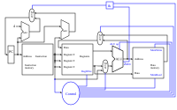



== Der Datenpfad

Im link:/de/pages/15_risc_v/[letzten Kapitel] haben wir den RISC-V-Befehlssatz kennengelernt und ein erstes
Programm geschrieben. Jetzt geht es um die Hardware: Wie muss eine CPU aufgebaut sein, damit sie diese Befehle
ausführen kann? Dafür setzen wir die Bausteine aus den vorherigen Kapiteln - ALU, Register und Speicher -
zu einem *Datenpfad* zusammen.

=== Eine minimale Implementierung

Die minimale funktionsfähige Teilmenge einer RISC-V-Implementierung enthält die folgenden Befehle:

* die arithmetisch-logischen Befehle `add`, `sub`, `and` und `or` [R-Typ]
* die Speicherbefehle load word (`lw`) und store word (`sw`) [I- bzw. S-Typ]
* den bedingten Sprungbefehl branch if equal (`beq`) [B-Typ]

Wir werden sehen, wie sich die gewählte Befehlssatzarchitektur auf wichtige Leistungsmerkmale wie
Taktrate und Zyklen pro Befehl (CPI) auswirkt.
Wir werden außerdem sehen, dass sich die verschiedenen Befehlstypen erst in den späteren Phasen
der Ausführung unterscheiden.

Die ersten beiden Schritte sind für jeden Befehl gleich:

  1. Der Programmzähler (PC) enthält die Adresse des aktuellen Befehls. Diese Adresse wird an den
     Befehlsspeicher gesendet, der den Befehl liefert.

  2. Aus der Registerdatei werden ein oder zwei Register gelesen; die Registernummern stehen in den Feldern
     des Befehls. `lw` und `addi` lesen nur ein Register (`rs1`), alle anderen Befehle unserer Teilmenge
     lesen zwei (`rs1` und `rs2`).

Die nächsten Schritte hängen vom Befehlstyp ab, nutzen aber weiterhin dieselben Ressourcen.
So verwenden R-Typ-Befehle die ALU zur Berechnung des Ergebnisses, Speicherbefehle zur Berechnung
der Adresse und Verzweigungsbefehle für den Gleichheitstest.
Erst nach der ALU unterscheiden sich die verschiedenen Befehlstypen wirklich.

Dieses abstrakte Schema erklärt jedoch noch nicht alle Fälle: Es zeigt zum Beispiel nicht, woher die ALU weiß,
welche Operation sie ausführen soll, oder wann in die Registerdatei geschrieben wird.
Dafür benötigen wir ein erweitertes Schema, das zusätzlich die Steuerung zeigt.

=== Die Ausführungsphasen für die verschiedenen Befehlstypen

Wir beginnen mit den fünf klassischen Phasen eines RISC-Prozessors
und zeigen, was in jeder Phase für die typischen Befehle passiert:

Befehl holen (IF) -> Dekodieren und Register lesen (ID) -> Ausführen (EX) -> Speicherzugriff (MEM) -> Zurückschreiben (WB)

[options="header"]
|==================
| Typ | Befehl | Befehl holen (IF) | Dekodieren (ID) | Ausführen (EX) | Speicherzugriff (MEM) | Zurückschreiben (WB)
| Register | `add`, `sub`, `and`, `or` | Befehl holen, PC + 4 berechnen | Befehl dekodieren, rs1 und rs2 lesen | ALU berechnet rs1 op rs2 | – | Ergebnis in rd schreiben
| Laden | `lw` | Befehl holen, PC + 4 berechnen | Befehl dekodieren, rs1 lesen | ALU berechnet Adresse rs1 + Offset | Wort aus dem Datenspeicher lesen | gelesenes Wort in rd schreiben
| Speichern | `sw` | Befehl holen, PC + 4 berechnen | Befehl dekodieren, rs1 und rs2 lesen | ALU berechnet Adresse rs1 + Offset | rs2 in den Datenspeicher schreiben | –
| Verzweigung | `beq` | Befehl holen, PC + 4 berechnen | Befehl dekodieren, rs1 und rs2 lesen | ALU vergleicht rs1 und rs2; zweiter Addierer berechnet Sprungziel PC + Offset | – | PC = Sprungziel, falls gleich, sonst PC + 4
|==================

In der Phase „Befehl holen“ wird also bei *jedem* Befehl zunächst nur PC + 4 berechnet.
Ob stattdessen gesprungen wird, steht bei `beq` erst fest, nachdem die ALU die beiden Register verglichen hat.
Ein Multiplexer wählt dann zwischen PC + 4 und dem Sprungziel als neuem Wert für den Programmzähler.

In unserer ersten, einfachen Implementierung werden alle fünf Phasen innerhalb eines einzigen Taktzyklus
durchlaufen (Single-Cycle-Prozessor). Die Aufteilung in Phasen hilft trotzdem beim Verständnis –
und sie ist die Grundlage für Pipelining, bei dem mehrere Befehle gleichzeitig in verschiedenen Phasen bearbeitet werden.

==== Der Befehlsteil

Um eine CPU auf dieser abstrakten Ebene zu erklären, benötigen wir noch einige Begriffe.
Ein **Befehl** ist im Speicher abgelegt und unter einer bestimmten Adresse erreichbar.
Eine **Adresse** ist bei RISC-V (in der 32-Bit-Variante RV32) ein 32 Bit langer Wert, der auf ein bestimmtes Byte
im Speicher zeigt.
Der **Programmzähler (PC)** ist ein Register, das die Adresse des aktuellen Befehls im Befehlsspeicher enthält.
Der Programmzähler ist mit dem ersten Addierer verbunden, der zu ihm die Konstante 4 addiert:
Ein Befehl ist 32 Bit = 4 Byte lang, der nächste Befehl liegt also 4 Adressen weiter.

Ist der Befehl ein Verzweigungsbefehl, addiert ein zweiter Addierer den im Befehl enthaltenen Offset zum
Programmzähler. Auf diese Weise entstehen **Sprünge**: Ist die Sprungbedingung erfüllt, wird dieses Ergebnis
statt PC + 4 in den Programmzähler übernommen.

==== Der Datenteil

Der Datenpfad zeigt Elemente, die wir bereits kennen: die ALU und die beiden Speicherblöcke –
links die Registerdatei, rechts der Datenspeicher.
Der erste Eingang der ALU ist mit dem ersten Leseport der Registerdatei (`rs1`) verbunden.
Der zweite Eingang erhält entweder den Wert des zweiten Leseports (`rs2`) oder eine Konstante aus dem Befehl,
etwa den Offset bei `lw` und `sw`.
Das Ergebnis der ALU dient je nach Befehl als Wert für die Registerdatei oder als Adresse für den Datenspeicher;
bei `lw` wird der aus dem Datenspeicher gelesene Wert in die Registerdatei zurückgeschrieben.

==== Der Steuerteil

Der Steuerteil ist das Element, das in unseren Schemata bisher am meisten Blackbox ist.
Wie Multiplexer funktionieren, wissen wir bereits, und wir sehen auch schon die Rückkopplung,
mit der eine Verzweigung den Programmzähler beeinflusst.
Offen ist aber noch die zentrale Frage: Woher wissen Multiplexer, ALU, Registerdatei und Datenspeicher,
was sie bei einem bestimmten Befehl tun sollen?
Die Antwort liefert das Steuerwerk, das aus dem Opcode des Befehls die passenden Steuersignale erzeugt.

Wie das Steuerwerk aufgebaut ist, sehen wir im nächsten Kapitel:
link:/de/pages/17_cpu_control/[Das Steuerwerk]. Dort verfolgen wir auch unser Beispielprogramm Takt für Takt durch die CPU.

(Gegengelesen mit Claude AI)