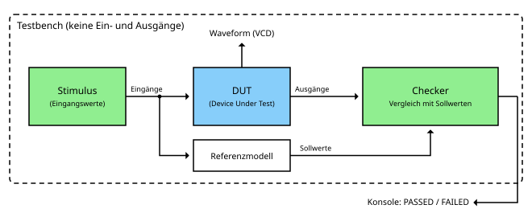
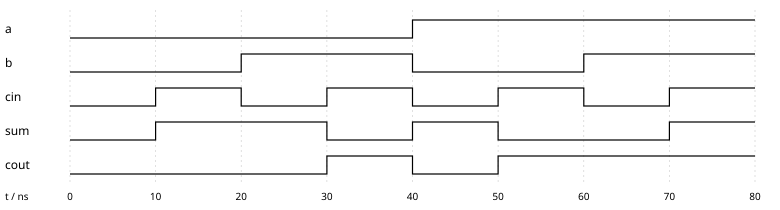
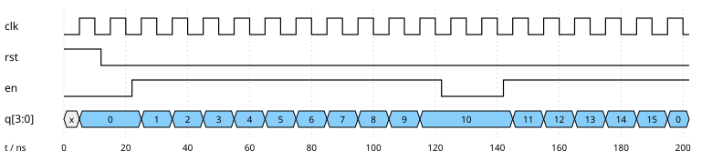



== Simulation und Testbenches

Im link:/de/pages/21_hdl/[letzten Kapitel] haben wir gesehen, dass eine HDL-Beschreibung zur Dokumentation,
zur Simulation und zur Synthese verwendet werden kann. In diesem Kapitel geht es um die Simulation - und um die Frage,
wie wir sicher sein können, dass eine Schaltung tut, was sie soll, bevor es sie überhaupt gibt.

Warum ist das so wichtig? Bei Software lässt sich ein Fehler mit einem neuen Release beheben. Bei Hardware ist das anders:
Einen fehlerhaften Chip, der bereits gefertigt ist, kann man nicht patchen. Ein neuer Fertigungsdurchlauf (ein sogenannter Respin)
kostet viel Geld und Monate an Zeit. Selbst bei FPGAs, die sich neu programmieren lassen, ist die Fehlersuche auf der echten
Hardware mühsam, denn wir können nur die wenigen Signale beobachten, die auf einen Pin geführt sind.
In einer Simulation dagegen sehen wir *jedes* Signal zu *jedem* Zeitpunkt.

Deshalb fließt in der Chipentwicklung oft mehr Aufwand in die Verifikation als in den Entwurf selbst.

=== Wie ein Simulator arbeitet

Ein Simulator führt die Schaltung nicht wie ein Programm Zeile für Zeile aus. Stattdessen bildet er das Verhalten der
Hardware über die Zeit nach. Die meisten HDL-Simulatoren arbeiten *ereignisgesteuert*:

. Der Simulator verwaltet eine Simulationszeit, die nichts mit der echten Zeit auf dem Rechner zu tun hat.
. Jedes Mal, wenn sich ein Signal ändert, ist das ein *Ereignis*.
. Der Simulator wertet dann alle Teile der Schaltung neu aus, die von diesem Signal abhängen.
  Dabei können neue Ereignisse entstehen, die ihrerseits verarbeitet werden.
. Gibt es zum aktuellen Zeitpunkt keine Ereignisse mehr, springt der Simulator zum nächsten Zeitpunkt,
  an dem etwas passiert.

So bildet der Simulator nach, dass in echter Hardware alle Teile gleichzeitig arbeiten:
Jedes Gatter reagiert auf seine Eingänge, egal an welcher Stelle es im Quelltext steht.

==== Vier Werte statt zwei

In Teil 1 war ein Signal entweder 0 oder 1. Ein Verilog-Simulator kennt vier Werte:

[width="70%"]
|===
| Wert | Bedeutung
| 0 | logische Null
| 1 | logische Eins
| x | unbekannt - z. B. ein Flipflop, das noch nicht zurückgesetzt wurde, oder zwei Treiber, die gegeneinander arbeiten
| z | hochohmig - das Signal wird gar nicht getrieben (z. B. ein abgeschalteter Tri-State-Ausgang)
|===

Der Wert x ist bei der Fehlersuche sehr nützlich: Zeigt ein Signal in der Simulation x, ist etwas nicht initialisiert
oder nicht angeschlossen - ein Fehler, der in echter Hardware zu zufälligem Verhalten führen würde.

=== Die Testbench

Um eine Schaltung zu simulieren, brauchen wir jemanden, der Werte an ihre Eingänge anlegt und ihre Ausgänge betrachtet.
Im Labor wären das ein Signalgenerator und ein Oszilloskop. In der Simulation übernimmt diese Aufgabe eine *Testbench* -
ein weiteres Verilog-Modul, das die zu testende Schaltung umgibt, das sogenannte *Device Under Test* (DUT):

Eine Testbench besteht typischerweise aus:

* *Stimulus:* erzeugt die Eingangswerte für das DUT - und bei sequentiellen Schaltungen auch Takt und Reset.
* *DUT:* die Schaltung, die wir testen wollen. Sie wird in der Testbench genauso eingesetzt, wie sie auch in einem größeren Entwurf verwendet würde.
* *Referenzmodell und Checker:* berechnen die Sollwerte und vergleichen sie mit den tatsächlichen Ausgängen des DUT.

Im Gegensatz zum DUT hat die Testbench selbst keine Ein- und Ausgänge - sie ist die komplette „Welt“, in der das DUT lebt.
Sie muss auch nicht synthetisierbar sein: Sie darf Verzögerungen, Schleifen und Textausgaben verwenden, die es in echter Hardware nicht gibt.

=== Eine erste Testbench

Testen wir den Volladdierer aus dem letzten Kapitel. Die einfachste Testbench legt nacheinander alle möglichen
Eingangskombinationen an und gibt die Ergebnisse aus:

[source,verilog]
----
`timescale 1ns / 1ps

module full_adder_tb;
    // Signale, die die Eingänge des DUT treiben
    reg  a, b, cin;
    // Signale, die die Ausgänge des DUT beobachten
    wire sum, cout;

    // das zu testende Bauteil (Device Under Test, DUT)
    full_adder dut (
        .a(a), .b(b), .cin(cin),
        .sum(sum), .cout(cout)
    );

    integer i;
    initial begin
        $dumpfile("full_adder.vcd");
        $dumpvars(0, full_adder_tb);

        // alle 8 Eingangskombinationen anlegen
        for (i = 0; i < 8; i = i + 1) begin
            {a, b, cin} = i;
            #10;
            $display("a=%b b=%b cin=%b -> cout=%b sum=%b", a, b, cin, cout, sum);
        end
        $finish;
    end
endmodule
----

Gehen wir die wichtigsten Teile durch:

* *`timescale 1ns / 1ps*: Eine Zeiteinheit in dieser Datei ist 1 ns, der Simulator rechnet mit einer Genauigkeit von 1 ps.
* *reg und wire:* Die Eingänge des DUT treibt die Testbench selbst, deshalb sind sie als `reg` deklariert.
  Die Ausgänge werden nur beobachtet, also sind sie `wire`-Signale.
* *Instanziierung:* `full_adder dut (...)` setzt den Volladdierer in die Testbench ein. `.a(a)` verbindet den Port `a`
  des Volladdierers mit dem Signal `a` der Testbench.
* *initial:* ein Block, der genau einmal zu Beginn der Simulation abläuft - er existiert nur in der Simulation.
* *{a, b, cin} = i:* Die drei Eingänge werden zu einer 3-Bit-Zahl zusammengefasst, sodass die Schleife alle Kombinationen von 000 bis 111 durchzählt.
* *#10:* 10 Zeiteinheiten warten, also 10 ns. Erst jetzt berechnet der Simulator die Ausgänge des DUT.
* *$display, $dumpfile, $dumpvars, $finish:* Systemfunktionen des Simulators für Textausgaben, für das Aufzeichnen der Waveform
  und für das Beenden der Simulation.

Die Ausgabe der Simulation ist genau die Wahrheitstabelle des Volladdierers aus Teil 1:

----
a=0 b=0 cin=0 -> cout=0 sum=0
a=0 b=0 cin=1 -> cout=0 sum=1
a=0 b=1 cin=0 -> cout=0 sum=1
a=0 b=1 cin=1 -> cout=1 sum=0
a=1 b=0 cin=0 -> cout=0 sum=1
a=1 b=0 cin=1 -> cout=1 sum=0
a=1 b=1 cin=0 -> cout=1 sum=0
a=1 b=1 cin=1 -> cout=1 sum=1
----

=== Waveforms lesen

Noch nützlicher als die Textausgabe ist die *Waveform* (Signalverlauf). Dank `$dumpvars` zeichnet der Simulator jede Änderung
jedes Signals in einer VCD-Datei (Value Change Dump) auf. Ein Waveform-Viewer wie GTKWave oder Surfer stellt diese Änderungen
über die Zeit dar - genau wie ein Oszilloskop oder ein Logikanalysator:

Die Zeit läuft von links nach rechts. Alle 10 ns legt die Testbench eine neue Eingangskombination an,
und wir sehen direkt, wie sum und cout darauf reagieren. Zum Beispiel bei 30 ns: b und cin sind 1, a ist 0 -
also ist sum gleich 0 und cout gleich 1.

=== Selbstprüfende Testbenches

Bei acht Kombinationen können wir die Ausgabe noch mit bloßem Auge prüfen. Das skaliert aber nicht: Ein 8-Bit-Addierer hat
\(2^{17} = 131072\) Eingangskombinationen. Eine gute Testbench prüft die Ergebnisse deshalb selbst.
Dafür brauchen wir ein *Referenzmodell* - eine zweite, unabhängige Beschreibung des erwarteten Verhaltens.
Beim Volladdierer ist das einfach: Die Summe dreier Bits ist eine 2-Bit-Zahl.

[source,verilog]
----
`timescale 1ns / 1ps

module full_adder_tb;
    reg  a, b, cin;
    wire sum, cout;
    integer i;
    integer errors = 0;

    full_adder dut (.a(a), .b(b), .cin(cin), .sum(sum), .cout(cout));

    initial begin
        for (i = 0; i < 8; i = i + 1) begin
            {a, b, cin} = i;
            #10;
            // Referenzmodell: Die Summe dreier Bits ist eine 2-Bit-Zahl
            if ({cout, sum} !== a + b + cin) begin
                $display("ERROR: a=%b b=%b cin=%b -> got %b%b", a, b, cin, cout, sum);
                errors = errors + 1;
            end
        end
        if (errors == 0) $display("PASSED: all 8 combinations correct");
        else             $display("FAILED: %0d errors", errors);
        $finish;
    end
endmodule
----

Der Operator `!==` vergleicht einschließlich der Werte x und z - ein Ausgang, der x ist, wird als Fehler gemeldet.
Bauen wir absichtlich einen Fehler ein, z. B. `cout = (a & b) | (cin & a)`, findet die Testbench ihn sofort:

----
ERROR: a=0 b=1 cin=1 -> got 00
FAILED: 1 errors
----

Alle Kombinationen zu testen (*erschöpfendes Testen*) ist nur bei kleinen Schaltungen möglich. Für eine 32-Bit-ALU mit zwei
Operanden gibt es \(2^{64}\) Kombinationen - selbst bei einer Milliarde Tests pro Sekunde würde das mehr als 500 Jahre dauern.
In der Praxis kombiniert man deshalb:

* *Grenzfälle:* 0, 1, der größte und der kleinste Wert, Überlauf, alle Bits gesetzt, ...
* *Zufallstests:* viele zufällig erzeugte Eingaben, die gegen das Referenzmodell geprüft werden.
* *gezielte Tests:* eigens konstruierte Abfolgen, die eine bestimmte Funktion prüfen.

=== Sequentielle Schaltungen testen

Bei einer sequentiellen Schaltung muss die Testbench zusätzlich Takt und Reset erzeugen. Unser Testobjekt ist ein
4-Bit-Zähler mit synchronem Reset und einem Freigabe-Eingang (enable):

[source,verilog]
----
module counter (
    input  wire       clk,
    input  wire       rst,
    input  wire       en,
    output reg  [3:0] q
);
    always @(posedge clk) begin
        if (rst)
            q <= 4'd0;
        else if (en)
            q <= q + 4'd1;
    end
endmodule
----

Die Details von `always @(posedge clk)` sehen wir uns im Kapitel über sequentielle Logik in Verilog an.
Für den Moment reicht: Mit jeder steigenden Taktflanke wird der Zähler zurückgesetzt oder, falls en = 1 ist,
um eins erhöht - genau wie der Zähler aus dem link:/de/pages/12_clocks_and_registers/[Kapitel über Taktgeber und Register].

Die Testbench erzeugt einen Takt mit einer Periode von 10 ns, hebt den Reset auf, schaltet den Zähler ein, pausiert ihn
für zwei Takte und lässt ihn dann weiterzählen:

[source,verilog]
----
`timescale 1ns / 1ps

module counter_tb;
    reg        clk = 0;
    reg        rst = 1;
    reg        en  = 0;
    wire [3:0] q;

    counter dut (.clk(clk), .rst(rst), .en(en), .q(q));

    // Takt: Periode 10 ns (100 MHz)
    always #5 clk = ~clk;

    initial begin
        $dumpfile("counter.vcd");
        $dumpvars(0, counter_tb);

        #12 rst = 0;      // Reset nach der ersten steigenden Flanke aufheben
        #10 en  = 1;      // Zählen starten
        #100 en = 0;      // zwei Takte pausieren
        #20 en  = 1;      // weiterzählen
        #60;
        $finish;
    end

    // Zählerstand nach jeder steigenden Taktflanke ausgeben
    always @(posedge clk)
        $strobe("t=%0d ns  rst=%b en=%b q=%0d", $time, rst, en, q);
endmodule
----

Die Zeile `always #5 clk = ~clk;` ist der Taktgenerator: Alle 5 ns wird der Takt invertiert, das ergibt eine Periode von 10 ns.
Beachte, dass die Eingänge (bei 12, 22, 122 und 142 ns) sich *nicht* genau an einer Taktflanke ändern. Das ist gute Praxis:
Auch in echter Hardware müssen Eingänge kurz vor und nach der Flanke stabil sein (Setup- und Hold-Zeit).

Die Waveform zeigt das Verhalten des Zählers:

Daraus lässt sich einiges ablesen:

* Ganz am Anfang ist q gleich *x*: Die Flipflops sind noch nicht zurückgesetzt. Erst mit der ersten steigenden Flanke bei 5 ns
  wirkt der Reset.
* Nachdem en bei 22 ns eingeschaltet wurde, zählt der Zähler mit jeder steigenden Flanke hoch.
* Zwischen 122 und 142 ns ist en = 0, und der Zähler hält seinen Wert 10.
* Bei 195 ns läuft der Zähler von 15 auf 0 über - eine 4-Bit-Zahl kann nicht mehr fassen.

NOTE: *Selbst ausprobieren:* Für das Beispiel braucht man nur den freien Simulator Icarus Verilog und einen Waveform-Viewer.
`iverilog -o sim counter_tb.v counter.v` übersetzt den Entwurf, `vvp sim` führt die Simulation aus und schreibt `counter.vcd`,
und `gtkwave counter.vcd` zeigt die Waveform an.

=== Simulatoren

Neben Icarus Verilog, das wir in dieser Reihe verwenden, gibt es weitere Simulatoren:

[width="100%"]
|===
| Simulator | Art | Eigenschaften
| Icarus Verilog | Open Source, ereignisgesteuert | einfach zu installieren, gut zum Lernen und für kleine Entwürfe
| Verilator | Open Source, taktbasiert | übersetzt Verilog in C++, extrem schnell, ideal für große Entwürfe wie ganze CPUs
| GHDL | Open Source | Simulator für VHDL
| Questa, Xcelium, VCS | kommerziell | die Simulatoren der Chipindustrie, mit voller Unterstützung für SystemVerilog und UVM
|===

=== Verifikation und Test - zwei verschiedene Dinge

Zum Schluss eine wichtige Unterscheidung. Alles, was wir in diesem Kapitel gemacht haben, ist *Verifikation*: Wir prüfen,
ob unser *Entwurf* korrekt ist. Aber auch ein korrekter Entwurf kann in der realen Welt versagen: Bei der Fertigung eines Chips
kann ein winziges Staubteilchen eine Verbindung unterbrechen oder zwei Leitungen kurzschließen. Solche Fertigungsfehler zu finden,
ist die Aufgabe des *Testens*.

Damit sich ein fertiger Chip überhaupt testen lässt, muss die Testbarkeit von Anfang an im Entwurf eingeplant werden
(Design for Testability). Zwei verbreitete Techniken:

* *Scan-Ketten:* In einem speziellen Testmodus werden alle Flipflops eines Chips zu einem langen Schieberegister verbunden.
  So lassen sich beliebige Zustände hineinschieben und die Ergebnisse herausschieben - jedes Flipflop wird von außen zugänglich.
* *Boundary Scan (JTAG):* eine standardisierte Schnittstelle (IEEE 1149.1), über die sich die Pins eines Chips von außen
  steuern und auslesen lassen, zum Beispiel um die Lötstellen auf einer Platine zu prüfen. Heute ist JTAG auch die übliche
  Schnittstelle zum Programmieren und Debuggen von Mikrocontrollern und FPGAs.

=== Zusammenfassung

* Ein Simulator bildet das Verhalten von Hardware über die Zeit nach, Ereignis für Ereignis.
* Eine Testbench umgibt das zu testende Bauteil, erzeugt die Eingangswerte und prüft die Ausgänge.
* Selbstprüfende Testbenches mit einem Referenzmodell finden Fehler automatisch.
* Waveforms zeigen jedes Signal zu jedem Zeitpunkt - das wichtigste Werkzeug bei der Fehlersuche.

Im nächsten Kapitel nutzen wir diese Werkzeuge, um die kombinatorischen Schaltungen aus Teil 1 in Verilog zu beschreiben -
und sie natürlich gleich zu testen.
