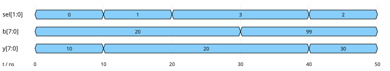



== Kombinatorische Logik in Verilog

Im link:/de/pages/22_simulation/[letzten Kapitel] haben wir bereits eine kombinatorische Schaltung in Verilog beschrieben:
den Volladdierer, mit zwei `assign`-Anweisungen. Für einen einzelnen Volladdierer reicht das.
Für größere Schaltungen brauchen wir ein paar weitere Werkzeuge: Signale mit mehreren Bits, eine lesbare Möglichkeit,
eine Wahrheitstabelle zu beschreiben, und eine Möglichkeit, große Schaltungen aus kleinen zusammenzusetzen.

In diesem Kapitel lernen wir diese Werkzeuge an zwei neuen Schaltungen kennen: einem *7-Segment-Decoder*, der eine Zahl
in das Muster für eine Ziffernanzeige umwandelt, und einem *Ripple-Carry-Addierer*, den wir aus unseren Volladdierern bauen.
Zum Schluss sehen wir uns den häufigsten Fehler bei der Beschreibung kombinatorischer Logik an.

=== Vektoren und Zahlen

Bisher waren alle unsere Signale ein einzelnes Bit. In Verilog kann ein Signal auch ein *Vektor* aus mehreren Bits sein:

[source,verilog]
----
wire [3:0] value;   // 4 Bit: value[3] (MSB) ... value[0] (LSB)
wire [6:0] seg;     // 7 Bit
----

Die wichtigsten Operationen auf Vektoren:

[width="100%"]
|===
| Schreibweise | Bedeutung | Beispiel
| `value[2]` | ein einzelnes Bit (Bit-Select) | das dritte Bit von rechts
| `value[3:2]` | mehrere Bits (Part-Select) | die beiden oberen Bits
| `{a, b}` | Verkettung - setzt Signale nebeneinander | `{cout, sum}` ist eine 2-Bit-Zahl
| `{4{x}}` | Wiederholung | das Bit x viermal
|===

Zahlen werden mit ihrer Breite und Basis geschrieben: `4'hA` ist die 4-Bit-Zahl A (hexadezimal, also 10),
`7'b0111111` ist eine 7-Bit-Binärzahl und `8'd200` die Dezimalzahl 200 mit 8 Bit.
Die Breite ausdrücklich anzugeben vermeidet Überraschungen - Verilog schneidet Zahlen mit falscher Breite stillschweigend
ab oder erweitert sie.

=== Zwei Wege, kombinatorische Logik zu beschreiben

Den ersten Weg kennen wir schon: eine kontinuierliche Zuweisung mit `assign`. Sie beschreibt eine Leitung, die ständig mit
dem Ergebnis eines Ausdrucks verbunden ist - genau wie ein Gatter, dessen Ausgang immer seinen Eingängen folgt.

Der zweite Weg ist ein `always`-Block:

[source,verilog]
----
always @(*) begin
    // Anweisungen
end
----

Das `@(*)` bedeutet: Führe den Block erneut aus, sobald sich *irgendeines* der darin gelesenen Signale ändert.
Der Block verhält sich also ebenfalls wie kombinatorische Logik. Darin dürfen wir `if`, `case` und andere Anweisungen verwenden,
was komplexe Logik viel lesbarer macht als ein langer boolescher Ausdruck.

Eine Sache verwirrt fast jeden Anfänger: Ein Signal, das in einem `always`-Block zugewiesen wird, muss als `reg` deklariert sein.
Trotz des Namens ist ein `reg` *nicht* automatisch ein Register. In einem `always @(*)`-Block wird daraus ganz gewöhnliche
kombinatorische Logik - der Name bedeutet nur, dass das Signal in einem prozeduralen Block zugewiesen wird.

=== Beispiel 1: Ein 7-Segment-Decoder

Eine 7-Segment-Anzeige besteht aus sieben Balken, genannt a bis g:

Um eine Ziffer anzuzeigen, muss eine bestimmte Kombination von Segmenten leuchten. Bei einer 8 leuchten alle sieben, bei einer 1
nur b und c. Unser Decoder erhält eine 4-Bit-Zahl von 0 bis F und gibt die sieben Segmentsignale aus. Das ist eine kombinatorische
Schaltung mit 4 Eingängen und 7 Ausgängen - also sieben Wahrheitstabellen mit je 16 Zeilen.

Mit `assign` müssten wir sieben boolesche Gleichungen aufstellen und vereinfachen. Mit einer `case`-Anweisung können wir die
Wahrheitstabelle direkt hinschreiben:

[source,verilog]
----
// 7-Segment-Decoder für die Hexadezimalziffern 0..F
// Reihenfolge der Segmente: seg = {g, f, e, d, c, b, a}, 1 = Segment leuchtet
module seven_seg (
    input  wire [3:0] value,
    output reg  [6:0] seg
);
    always @(*) begin
        case (value)
            4'h0: seg = 7'b0111111;
            4'h1: seg = 7'b0000110;
            4'h2: seg = 7'b1011011;
            4'h3: seg = 7'b1001111;
            4'h4: seg = 7'b1100110;
            4'h5: seg = 7'b1101101;
            4'h6: seg = 7'b1111101;
            4'h7: seg = 7'b0000111;
            4'h8: seg = 7'b1111111;
            4'h9: seg = 7'b1101111;
            4'hA: seg = 7'b1110111;
            4'hB: seg = 7'b1111100;
            4'hC: seg = 7'b0111001;
            4'hD: seg = 7'b1011110;
            4'hE: seg = 7'b1111001;
            4'hF: seg = 7'b1110001;
            default: seg = 7'b0000000;
        endcase
    end
endmodule
----

Jede Zeile der `case`-Anweisung ist eine Zeile der Wahrheitstabelle: Beim Eingang `4'h2` leuchten die Segmente g, e, d, b und a -
das ist eine 2. Die Bits von `seg` sind von g (Bit 6) bis a (Bit 0) geordnet.

Wer macht aus dieser Tabelle Gatter? Das Synthesewerkzeug. Es leitet die booleschen Gleichungen ab und vereinfacht sie -
genau die Arbeit, die wir in Teil 1 mit der link:/de/pages/01_boolean_algebra/[booleschen Algebra] von Hand erledigt haben.
Für unseren Decoder erzeugt das Open-Source-Synthesewerkzeug Yosys etwa 30 Gatter.

NOTE: Viele echte Anzeigen haben eine *gemeinsame Anode*: Ein Segment leuchtet, wenn sein Signal 0 ist, nicht 1.
Für solche Anzeigen wird der Ausgang einfach invertiert: `assign seg_n = ~seg;`.

==== Den Decoder testen

Die Testbench legt nacheinander alle 16 Werte an:

[source,verilog]
----
`timescale 1ns / 1ps

module seven_seg_tb;
    reg  [3:0] value;
    wire [6:0] seg;
    integer i;

    seven_seg dut (.value(value), .seg(seg));

    initial begin
        $dumpfile("seven_seg.vcd");
        $dumpvars(0, seven_seg_tb);
        for (i = 0; i < 16; i = i + 1) begin
            value = i;
            #10;
            $display("value=%h  seg(gfedcba)=%b", value, seg);
        end
        $finish;
    end
endmodule
----

Statt 16 Zeilen aus Nullen und Einsen zu lesen, lassen wir ein kleines Skript die Segmentmuster aus der Simulationsausgabe
zeichnen. Das ist das Ergebnis der Simulation:

image:./seven_seg_digits.svg[width="100%"]

Alle 16 Ziffern sehen richtig aus - einschließlich der Kleinbuchstaben b und d, die nötig sind, damit man sie nicht mit 8 und 0
verwechselt.

=== Beispiel 2: Hierarchie - ein Ripple-Carry-Addierer

Echte Entwürfe bestehen nicht aus einem großen Modul, sondern aus vielen kleinen Modulen, die zusammengesetzt werden - genau wie
in Teil 1, wo wir einen Addierer aus Volladdierern gebaut haben. In Verilog können wir ein Modul innerhalb eines anderen Moduls
verwenden. Das nennt man *Instanziierung*, und wir haben es bereits in der Testbench des letzten Kapitels getan.

Ein 4-Bit-Addierer besteht aus vier Volladdierern, wobei der Übertragsausgang jeder Stufe mit dem Übertragseingang der nächsten
Stufe verbunden ist:

[source,verilog]
----
// 4-Bit-Ripple-Carry-Addierer aus vier Volladdierern
module ripple_adder4 (
    input  wire [3:0] a,
    input  wire [3:0] b,
    input  wire       cin,
    output wire [3:0] sum,
    output wire       cout
);
    wire [3:1] c;   // interne Überträge zwischen den Stufen

    full_adder fa0 (.a(a[0]), .b(b[0]), .cin(cin),  .sum(sum[0]), .cout(c[1]));
    full_adder fa1 (.a(a[1]), .b(b[1]), .cin(c[1]), .sum(sum[1]), .cout(c[2]));
    full_adder fa2 (.a(a[2]), .b(b[2]), .cin(c[2]), .sum(sum[2]), .cout(c[3]));
    full_adder fa3 (.a(a[3]), .b(b[3]), .cin(c[3]), .sum(sum[3]), .cout(cout));
endmodule
----

Jede Zeile erzeugt einen Volladdierer mit einem eigenen Namen (`fa0` bis `fa3`). Die internen Leitungen `c[1]` bis `c[3]`
verbinden die Überträge. Da der Übertrag von Stufe zu Stufe „durchrieselt“ (englisch: to ripple), heißt diese Schaltung
*Ripple-Carry-Addierer*.

==== Parameter und generate

Für 4 Bit sind vier Zeilen noch in Ordnung. Für 32 Bit wäre es mühsam und fehleranfällig.
Verilog hat dafür zwei Werkzeuge: Ein *Parameter* macht die Breite einstellbar, und eine *generate-Schleife* erzeugt
die Instanzen automatisch:

[source,verilog]
----
// N-Bit-Ripple-Carry-Addierer, die Volladdierer werden in einer Schleife erzeugt
module ripple_adder #(
    parameter N = 8
) (
    input  wire [N-1:0] a,
    input  wire [N-1:0] b,
    input  wire         cin,
    output wire [N-1:0] sum,
    output wire         cout
);
    wire [N:0] c;   // c[0] = Übertrag hinein, c[N] = Übertrag heraus
    assign c[0] = cin;
    assign cout = c[N];

    genvar i;
    generate
        for (i = 0; i < N; i = i + 1) begin : stage
            full_adder fa (
                .a(a[i]), .b(b[i]), .cin(c[i]),
                .sum(sum[i]), .cout(c[i+1])
            );
        end
    endgenerate
endmodule
----

Die `for`-Schleife im `generate`-Block wird nicht zur Laufzeit ausgeführt wie eine Schleife in Software. Sie wird *vor*
der Simulation oder Synthese aufgelöst: Sie erzeugt einfach N Volladdierer, genau so, als hätten wir sie von Hand hingeschrieben.
Ein 32-Bit-Addierer ist jetzt nur noch `ripple_adder #(.N(32)) add32 (...)`.

==== Den Addierer testen

Bei einem 8-Bit-Addierer können wir noch alle Kombinationen testen - das sind die \(2^{17} = 131072\) Kombinationen
aus dem letzten Kapitel. Das Referenzmodell ist wieder einfach der `+`-Operator:

[source,verilog]
----
`timescale 1ns / 1ps

module ripple_adder_tb;
    localparam N = 8;

    reg  [N-1:0] a, b;
    reg          cin;
    wire [N-1:0] sum;
    wire         cout;
    integer i, j, k;
    integer errors = 0;

    ripple_adder #(.N(N)) dut (.a(a), .b(b), .cin(cin), .sum(sum), .cout(cout));

    initial begin
        // erschöpfender Test: 256 * 256 * 2 = 131072 Kombinationen
        for (i = 0; i < (1 << N); i = i + 1)
            for (j = 0; j < (1 << N); j = j + 1)
                for (k = 0; k < 2; k = k + 1) begin
                    a = i; b = j; cin = k;
                    #1;
                    if ({cout, sum} !== a + b + cin) begin
                        if (errors < 10)
                            $display("ERROR: %0d + %0d + %0d = %0d", a, b, cin, {cout, sum});
                        errors = errors + 1;
                    end
                end
        if (errors == 0) $display("PASSED: all %0d combinations correct", (1 << (2*N)) * 2);
        else             $display("FAILED: %0d errors", errors);
        $finish;
    end
endmodule
----

Die Simulation dauert weniger als eine Sekunde:

----
PASSED: all 131072 combinations correct
----

Übrigens: In einem echten Entwurf würde man einfach `assign {cout, sum} = a + b + cin;` schreiben. Das Synthesewerkzeug
kennt viele Addiererstrukturen und wählt eine passende aus. Wir bauen den Addierer hier selbst, um Hierarchie zu üben -
und weil es zeigt, was hinter dem `+` steckt. Seine Schwäche ist ebenfalls sichtbar: Im schlimmsten Fall muss der Übertrag
durch alle N Stufen laufen, die Verzögerung wächst also mit der Breite. Schnellere Addierer, wie der Carry-Lookahead-Addierer,
berechnen die Überträge parallel.

=== Die klassische Falle: ungewollte Latches

Es gibt einen Fehler, den fast jeder beim Einstieg in Verilog macht. Sehen wir uns einen Multiplexer an, der einen von drei
8-Bit-Eingängen auswählt:

[source,verilog]
----
// FALSCH: 3-zu-1-Multiplexer - der Fall sel = 2'b11 fehlt
module mux3 (
    input  wire [1:0] sel,
    input  wire [7:0] a, b, c,
    output reg  [7:0] y
);
    always @(*) begin
        case (sel)
            2'b00: y = a;
            2'b01: y = b;
            2'b10: y = c;
        endcase
    end
endmodule
----

Der Code lässt sich ohne Fehler übersetzen. Aber `sel` hat 2 Bit und damit vier mögliche Werte - und für `2'b11` wird `y`
kein Wert zugewiesen. Was soll die Hardware in diesem Fall tun? Verilog legt es fest: `y` behält seinen *alten Wert*.
Einen Wert behalten heißt, ihn zu speichern - die kombinatorische Schaltung hat plötzlich ein Gedächtnis bekommen.
Die Simulation zeigt das deutlich:

Zwischen 20 und 40 ns ist sel = 3. Der Ausgang behält den Wert 20 - selbst als sich der Eingang b bei 30 ns auf 99 ändert.

Das Synthesewerkzeug reagiert genauso: Es baut für jedes Bit von `y` ein *Latch*. Yosys meldet das in seinem Log:

----
Latch inferred for signal `\mux3.\y' ...
----

und die synthetisierte Schaltung enthält 8 Latches (`$_DLATCH_N_`), eines pro Ausgangsbit.
Das ist ein Problem: Latches sind pegelgesteuert, können Timing-Probleme verursachen und werden auf FPGAs schlecht unterstützt -
und vor allem wollte sie hier niemand haben.

Die Abhilfe ist einfach: Jeder Ausgang muss auf *jedem* Pfad durch den `always`-Block einen Wert bekommen.
Entweder mit einem `default`-Zweig:

[source,verilog]
----
// RICHTIG: Jeder Pfad weist y einen Wert zu
module mux3 (
    input  wire [1:0] sel,
    input  wire [7:0] a, b, c,
    output reg  [7:0] y
);
    always @(*) begin
        case (sel)
            2'b00:   y = a;
            2'b01:   y = b;
            2'b10:   y = c;
            default: y = 8'h00;
        endcase
    end
endmodule
----

oder indem man am Anfang des Blocks einen Standardwert zuweist, der dann bei Bedarf überschrieben wird:

[source,verilog]
----
always @(*) begin
    y = 8'h00;           // Standardwert
    case (sel)
        2'b00: y = a;
        2'b01: y = b;
        2'b10: y = c;
    endcase
end
----

Damit erzeugt Yosys keine Latches mehr. Deshalb hat auch unser 7-Segment-Decoder einen `default`-Zweig,
obwohl alle 16 Werte abgedeckt sind: Es ist eine gute Gewohnheit, die vor diesem Fehler schützt.

Die Regeln für kombinatorische `always`-Blöcke in Kürze:

. Verwende `always @(*)`, damit kein Eingang vergessen wird.
. Weise jedem Ausgang auf jedem Pfad einen Wert zu - mit `default` oder einem Standardwert am Anfang.
. Verwende die blockierende Zuweisung `=`. (Die nicht-blockierende Zuweisung `\<=` lernen wir im nächsten Kapitel kennen, bei den Flipflops.)

NOTE: *Selbst ausprobieren:* Mit Yosys lässt sich jedes Modul auf Latches prüfen:
`yosys -p "read_verilog mux3_latch.v; synth -top mux3; stat"` gibt die Zellen der synthetisierten Schaltung aus.
Taucht `$_DLATCH_` auf, fehlt ein Pfad.

=== Zusammenfassung

* Vektoren, Verkettung und Zahlen mit Breitenangabe sind die Grundbausteine für Signale mit mehreren Bits.
* Kombinatorische Logik lässt sich mit `assign` oder mit einem `always @(*)`-Block beschreiben; `case`-Anweisungen beschreiben
  Wahrheitstabellen direkt.
* Module lassen sich in anderen Modulen instanziieren; `parameter` und `generate` machen sie konfigurierbar.
* Ein `always @(*)`-Block, in dem ein Ausgang nicht auf jedem Pfad zugewiesen wird, erzeugt ein ungewolltes Latch.

Im nächsten Kapitel wenden wir uns der sequentiellen Logik zu: Flipflops, Register, Zähler - und die Ampel aus dem Kapitel über
endliche Automaten.

(Erstellt mit Claude AI)