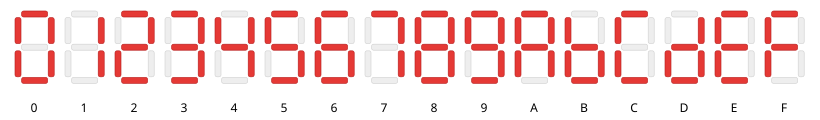



== Kombinatorische Logik in Verilog

Im link:/de/pages/22_simulation/[letzten Kapitel] haben wir bereits eine kombinatorische Schaltung in Verilog beschrieben:
den Volladdierer, mit zwei `assign`-Anweisungen. Für einen einzelnen Volladdierer reicht das.
Für größere Schaltungen brauchen wir ein paar weitere Werkzeuge: Signale mit mehreren Bits, eine lesbare Möglichkeit,
eine Wahrheitstabelle zu beschreiben, und eine Möglichkeit, große Schaltungen aus kleinen zusammenzusetzen.

In diesem Kapitel lernen wir diese Werkzeuge an zwei neuen Schaltungen kennen: einem *7-Segment-Decoder*, der eine Zahl
in das Muster für eine Ziffernanzeige umwandelt, und einem *Ripple-Carry-Addierer*, den wir aus unseren Volladdierern bauen.
Zum Schluss sehen wir uns den häufigsten Fehler bei der Beschreibung kombinatorischer Logik an.

=== Vektoren und Zahlen

Bisher waren alle unsere Signale ein einzelnes Bit. In Verilog kann ein Signal auch ein *Vektor* aus mehreren Bits sein:

[source,verilog]
----
wire [3:0] value;   // 4 Bit: value[3] (MSB) ... value[0] (LSB)
wire [6:0] seg;     // 7 Bit
----

Die wichtigsten Operationen auf Vektoren:

[width="100%"]
|===
| Schreibweise | Bedeutung | Beispiel
| `value[2]` | ein einzelnes Bit (Bit-Select) | das dritte Bit von rechts
| `value[3:2]` | mehrere Bits (Part-Select) | die beiden oberen Bits
| `{a, b}` | Verkettung - setzt Signale nebeneinander | `{cout, sum}` ist eine 2-Bit-Zahl
| `{4{x}}` | Wiederholung | das Bit x viermal
|===

Zahlen werden mit ihrer Breite und Basis geschrieben: `4'hA` ist die 4-Bit-Zahl A (hexadezimal, also 10),
`7'b0111111` ist eine 7-Bit-Binärzahl und `8'd200` die Dezimalzahl 200 mit 8 Bit.
Die Breite ausdrücklich anzugeben vermeidet Überraschungen - Verilog schneidet Zahlen mit falscher Breite stillschweigend
ab oder erweitert sie.

=== Zwei Wege, kombinatorische Logik zu beschreiben

Den ersten Weg kennen wir schon: eine kontinuierliche Zuweisung mit `assign`. Sie beschreibt eine Leitung, die ständig mit
dem Ergebnis eines Ausdrucks verbunden ist - genau wie ein Gatter, dessen Ausgang immer seinen Eingängen folgt.

Der zweite Weg ist ein `always`-Block:

[source,verilog]
----
always @(*) begin
    // Anweisungen
end
----

Das `@(*)` bedeutet: Führe den Block erneut aus, sobald sich *irgendeines* der darin gelesenen Signale ändert.
Der Block verhält sich also ebenfalls wie kombinatorische Logik. Darin dürfen wir `if`, `case` und andere Anweisungen verwenden,
was komplexe Logik viel lesbarer macht als ein langer boolescher Ausdruck.

Eine Sache verwirrt fast jeden Anfänger: Ein Signal, das in einem `always`-Block zugewiesen wird, muss als `reg` deklariert sein.
Trotz des Namens ist ein `reg` *nicht* automatisch ein Register. In einem `always @(*)`-Block wird daraus ganz gewöhnliche
kombinatorische Logik - der Name bedeutet nur, dass das Signal in einem prozeduralen Block zugewiesen wird.

=== Beispiel 1: Ein 7-Segment-Decoder

Eine 7-Segment-Anzeige besteht aus sieben Balken, genannt a bis g:

image:./seven_seg_names.svg[width="20%"]

Um eine Ziffer anzuzeigen, muss eine bestimmte Kombination von Segmenten leuchten. Bei einer 8 leuchten alle sieben, bei einer 1
nur b und c. Unser Decoder erhält eine 4-Bit-Zahl von 0 bis F und gibt die sieben Segmentsignale aus. Das ist eine kombinatorische
Schaltung mit 4 Eingängen und 7 Ausgängen - also sieben Wahrheitstabellen mit je 16 Zeilen.

Mit `assign` müssten wir sieben boolesche Gleichungen aufstellen und vereinfachen. Mit einer `case`-Anweisung können wir die
Wahrheitstabelle direkt hinschreiben:

[source,verilog]
----
// 7-Segment-Decoder für die Hexadezimalziffern 0..F
// Reihenfolge der Segmente: seg = {g, f, e, d, c, b, a}, 1 = Segment leuchtet
module seven_seg (
    input  wire [3:0] value,
    output reg  [6:0] seg
);
    always @(*) begin
        case (value)
            4'h0: seg = 7'b0111111;
            4'h1: seg = 7'b0000110;
            4'h2: seg = 7'b1011011;
            4'h3: seg = 7'b1001111;
            4'h4: seg = 7'b1100110;
            4'h5: seg = 7'b1101101;
            4'h6: seg = 7'b1111101;
            4'h7: seg = 7'b0000111;
            4'h8: seg = 7'b1111111;
            4'h9: seg = 7'b1101111;
            4'hA: seg = 7'b1110111;
            4'hB: seg = 7'b1111100;
            4'hC: seg = 7'b0111001;
            4'hD: seg = 7'b1011110;
            4'hE: seg = 7'b1111001;
            4'hF: seg = 7'b1110001;
            default: seg = 7'b0000000;
        endcase
    end
endmodule
----

Jede Zeile der `case`-Anweisung ist eine Zeile der Wahrheitstabelle: Beim Eingang `4'h2` leuchten die Segmente g, e, d, b und a -
das ist eine 2. Die Bits von `seg` sind von g (Bit 6) bis a (Bit 0) geordnet.

==== Von der Tabelle zur Hardware

Wer macht aus dieser Tabelle Hardware? Das Synthesewerkzeug - und was es baut, hängt vom *Ziel* ab:

* Für einen *Chip* (ASIC) leitet das Werkzeug aus der Tabelle boolesche Gleichungen ab, vereinfacht sie - genau die Arbeit,
  die wir in Teil 1 mit der link:/de/pages/01_boolean_algebra/[booleschen Algebra] von Hand erledigt haben - und baut sie
  aus den Gattern der Zellbibliothek des Herstellers.
* Ein *FPGA* hat überhaupt keine einzelnen Gatter. Es besteht aus Tausenden kleiner *Lookup-Tabellen* (LUTs): winzigen
  Speichern, die die Wahrheitstabelle einer Funktion mit wenigen Eingängen enthalten - bei vielen FPGAs 4 Eingänge,
  also 16 Bit. Für eine LUT spielt es keine Rolle, wie kompliziert die Funktion ist: Sie schlägt das Ergebnis einfach nach.

Unser Decoder zeigt das schön: Jedes Segment ist eine Funktion von genau 4 Eingängen. Auf einem Lattice-iCE40-FPGA
braucht Yosys deshalb genau *7 LUTs* - eine pro Segment, jede enthält eine Spalte unserer Wahrheitstabelle.
Boolesche Vereinfachung ist dafür nicht einmal nötig.

Wie LUTs funktionieren und wie ein FPGA aufgebaut ist, sehen wir uns im Kapitel _Vom Code zum Chip_ an.

NOTE: Viele echte Anzeigen haben eine *gemeinsame Anode*: Ein Segment leuchtet, wenn sein Signal 0 ist, nicht 1.
Für solche Anzeigen wird der Ausgang einfach invertiert: `assign seg_n = ~seg;`.

==== Den Decoder testen

Die Testbench legt nacheinander alle 16 Werte an:

[source,verilog]
----
`timescale 1ns / 1ps

module seven_seg_tb;
    reg  [3:0] value;
    wire [6:0] seg;
    integer i;

    seven_seg dut (.value(value), .seg(seg));

    initial begin
        $dumpfile("seven_seg.vcd");
        $dumpvars(0, seven_seg_tb);
        for (i = 0; i < 16; i = i + 1) begin
            value = i;
            #10;
            $display("value=%h  seg(gfedcba)=%b", value, seg);
        end
        $finish;
    end
endmodule
----

Statt 16 Zeilen aus Nullen und Einsen zu lesen, lassen wir ein kleines Skript die Segmentmuster aus der Simulationsausgabe
zeichnen. Das ist das Ergebnis der Simulation:

Alle 16 Ziffern sehen richtig aus - einschließlich der Kleinbuchstaben b und d, die nötig sind, damit man sie nicht mit 8 und 0
verwechselt.

=== Beispiel 2: Hierarchie - ein Ripple-Carry-Addierer

Echte Entwürfe bestehen nicht aus einem großen Modul, sondern aus vielen kleinen Modulen, die zusammengesetzt werden - genau wie
in Teil 1, wo wir einen Addierer aus Volladdierern gebaut haben. In Verilog können wir ein Modul innerhalb eines anderen Moduls
verwenden. Das nennt man *Instanziierung*, und wir haben es bereits in der Testbench des letzten Kapitels getan.

Ein 4-Bit-Addierer besteht aus vier Volladdierern, wobei der Übertragsausgang jeder Stufe mit dem Übertragseingang der nächsten
Stufe verbunden ist:

[source,verilog]
----
// 4-Bit-Ripple-Carry-Addierer aus vier Volladdierern
module ripple_adder4 (
    input  wire [3:0] a,
    input  wire [3:0] b,
    input  wire       cin,
    output wire [3:0] sum,
    output wire       cout
);
    wire [3:1] c;   // interne Überträge zwischen den Stufen

    full_adder fa0 (.a(a[0]), .b(b[0]), .cin(cin),  .sum(sum[0]), .cout(c[1]));
    full_adder fa1 (.a(a[1]), .b(b[1]), .cin(c[1]), .sum(sum[1]), .cout(c[2]));
    full_adder fa2 (.a(a[2]), .b(b[2]), .cin(c[2]), .sum(sum[2]), .cout(c[3]));
    full_adder fa3 (.a(a[3]), .b(b[3]), .cin(c[3]), .sum(sum[3]), .cout(cout));
endmodule
----

Jede Zeile erzeugt einen Volladdierer mit einem eigenen Namen (`fa0` bis `fa3`). Die internen Leitungen `c[1]` bis `c[3]`
verbinden die Überträge. Da der Übertrag von Stufe zu Stufe „durchrieselt“ (englisch: to ripple), heißt diese Schaltung
*Ripple-Carry-Addierer*.

==== Parameter und generate

Für 4 Bit sind vier Zeilen noch in Ordnung. Für 32 Bit wäre es mühsam und fehleranfällig.
Verilog hat dafür zwei Werkzeuge: Ein *Parameter* macht die Breite einstellbar, und eine *generate-Schleife* erzeugt
die Instanzen automatisch:

[source,verilog]
----
// N-Bit-Ripple-Carry-Addierer, die Volladdierer werden in einer Schleife erzeugt
module ripple_adder #(
    parameter N = 8
) (
    input  wire [N-1:0] a,
    input  wire [N-1:0] b,
    input  wire         cin,
    output wire [N-1:0] sum,
    output wire         cout
);
    wire [N:0] c;   // c[0] = Übertrag hinein, c[N] = Übertrag heraus
    assign c[0] = cin;
    assign cout = c[N];

    genvar i;
    generate
        for (i = 0; i < N; i = i + 1) begin : stage
            full_adder fa (
                .a(a[i]), .b(b[i]), .cin(c[i]),
                .sum(sum[i]), .cout(c[i+1])
            );
        end
    endgenerate
endmodule
----

Ein 32-Bit-Addierer ist jetzt nur noch `ripple_adder #(.N(32)) add32 (...)`.

==== Schleifen beschreiben Kopien, keine Schritte

Diese Schleife sieht aus wie eine Schleife in jeder Programmiersprache - sie tut aber etwas völlig anderes.
Sie wird *nicht* ausgeführt, während die Schaltung läuft. Sie wird *vor* der Simulation oder Synthese aufgelöst
und erzeugt einfach N Volladdierer, genau so, als hätten wir sie von Hand hingeschrieben. Für N = 4 erzeugt Yosys
diese vier Instanzen:

----
ripple_adder/stage[0].fa
ripple_adder/stage[1].fa
ripple_adder/stage[2].fa
ripple_adder/stage[3].fa
----

Das ist dieselbe Schaltung wie der von Hand geschriebene 4-Bit-Addierer oben. Der Name `stage` hinter dem `begin` wird Teil
der Instanznamen - und unter genau diesen Namen finden wir die Volladdierer später im Waveform-Viewer wieder.

Dasselbe gilt für eine `for`-Schleife *innerhalb* eines `always @(*)`-Blocks. Dieses Modul berechnet die Parität von 8 Bit,
also ob eine ungerade Anzahl von Bits gesetzt ist:

[source,verilog]
----
// Parität über 8 Bit: p = 1, wenn eine ungerade Anzahl Bits gesetzt ist
module parity8 (
    input  wire [7:0] d,
    output reg        p
);
    integer i;

    always @(*) begin
        p = 1'b0;
        for (i = 0; i < 8; i = i + 1)
            p = p ^ d[i];
    end
endmodule
----

Das liest sich wie acht Schritte nacheinander. Das Synthesewerkzeug löst die Schleife aber in *7 XOR-Gatter* auf,
die alle gleichzeitig arbeiten. Es gibt keinen Zähler `i` in der Hardware, und nichts wird achtmal ausgeführt.

Zum Vergleich die Testbenches aus dem letzten Kapitel: Dort läuft eine `for`-Schleife mit `#10` tatsächlich Schritt für Schritt
durch die simulierte Zeit - weil Testbenches nie zu Hardware werden. Dieselbe Schreibweise hat also zwei Bedeutungen:
In einer Testbench kostet eine Schleife *Zeit*, in einer Schaltung kostet sie *Fläche*.

[NOTE]
.Für Softwareentwickler
====
In synthetisierbarem Verilog bedeutet eine Schleife *Vervielfältigung im Raum*, nicht *Wiederholung in der Zeit*.
Die nächsten Analogien aus der Software sind der C-Präprozessor, C++-Templates oder das Abrollen von Schleifen
(Loop Unrolling) durch einen Compiler: Alles passiert, bevor das Programm - hier: die Schaltung - läuft. Was keine dieser
Analogien erfasst: Alle Kopien arbeiten *gleichzeitig*. Daraus folgt:

* Die Anzahl der Durchläufe muss vor der Synthese feststehen. Eine Schleife, die bei einem Eingangswert dreimal und bei
  einem anderen siebenmal läuft, gibt es in Hardware nicht.
* Aus demselben Grund gibt es kein `break`, das von Daten abhängt.
* Mehr Durchläufe dauern nicht länger - sie brauchen mehr Hardware.
====

==== Den Addierer testen

Bei einem 8-Bit-Addierer können wir noch alle Kombinationen testen - das sind die \(2^{17} = 131072\) Kombinationen
aus dem letzten Kapitel. Das Referenzmodell ist wieder einfach der `+`-Operator:

[source,verilog]
----
`timescale 1ns / 1ps

module ripple_adder_tb;
    localparam N = 8;

    reg  [N-1:0] a, b;
    reg          cin;
    wire [N-1:0] sum;
    wire         cout;
    integer i, j, k;
    integer errors = 0;

    ripple_adder #(.N(N)) dut (.a(a), .b(b), .cin(cin), .sum(sum), .cout(cout));

    initial begin
        // erschöpfender Test: 256 * 256 * 2 = 131072 Kombinationen
        for (i = 0; i < (1 << N); i = i + 1)
            for (j = 0; j < (1 << N); j = j + 1)
                for (k = 0; k < 2; k = k + 1) begin
                    a = i; b = j; cin = k;
                    #1;
                    if ({cout, sum} !== a + b + cin) begin
                        if (errors < 10)
                            $display("ERROR: %0d + %0d + %0d = %0d", a, b, cin, {cout, sum});
                        errors = errors + 1;
                    end
                end
        if (errors == 0) $display("PASSED: all %0d combinations correct", (1 << (2*N)) * 2);
        else             $display("FAILED: %0d errors", errors);
        $finish;
    end
endmodule
----

Die Simulation dauert weniger als eine Sekunde:

----
PASSED: all 131072 combinations correct
----

Übrigens: In einem echten Entwurf würde man einfach `assign {cout, sum} = a + b + cin;` schreiben. Was das Synthesewerkzeug
daraus macht, hängt wieder vom Ziel ab. Für einen Chip kennt es viele Addiererstrukturen und wählt eine, die schnell genug ist.
Viele FPGAs enthalten dagegen eine eigene *Carry-Kette* - zusätzliche Hardware nur für Überträge. Für ein 8-Bit-`+` verwendet
Yosys auf dem iCE40 8 LUTs und 8 Carry-Zellen (`SB_CARRY`).

Wir bauen den Addierer hier selbst, um Hierarchie zu üben - und weil es zeigt, was hinter dem `+` steckt.
Seine Schwäche ist ebenfalls sichtbar: Im schlimmsten Fall muss der Übertrag durch alle N Stufen laufen, die Verzögerung wächst
also mit der Breite. Schnellere Addierer, wie der Carry-Lookahead-Addierer aus dem link:/de/pages/03_binary_system/[Kapitel über
das Binärsystem], berechnen die Überträge parallel.

=== Die klassische Falle: ungewollte Latches

Es gibt einen Fehler, den fast jeder beim Einstieg in Verilog macht. Sehen wir uns einen Multiplexer an, der einen von drei
8-Bit-Eingängen auswählt:

[source,verilog]
----
// FALSCH: 3-zu-1-Multiplexer - der Fall sel = 2'b11 fehlt
module mux3 (
    input  wire [1:0] sel,
    input  wire [7:0] a, b, c,
    output reg  [7:0] y
);
    always @(*) begin
        case (sel)
            2'b00: y = a;
            2'b01: y = b;
            2'b10: y = c;
        endcase
    end
endmodule
----

Der Code lässt sich ohne Fehler übersetzen. Aber `sel` hat 2 Bit und damit vier mögliche Werte - und für `2'b11` wird `y`
kein Wert zugewiesen. Die Simulation zeigt, was passiert:

image:./mux3_latch_waveform.svg[width="100%"]

Zwischen 20 und 40 ns ist sel = 3. Der Ausgang behält den Wert 20 - selbst als sich der Eingang b bei 30 ns auf 99 ändert.
Die kombinatorische Schaltung hat plötzlich ein Gedächtnis bekommen.

==== Warum passiert das?

Der Grund ist eine Regel, die Verilog mit Software gemeinsam hat: *Ein `reg` behält seinen Wert, bis ihm etwas Neues
zugewiesen wird.* Der `always @(*)`-Block läuft erneut, sobald sich ein Eingang ändert. Ist sel = 3, trifft keiner der drei
Zweige zu, mit `y` passiert nichts - und `y` hat noch den Wert vom letzten Durchlauf.

Das Synthesewerkzeug muss Hardware bauen, die sich genau so verhält. Es baut, was wir *beschrieben* haben, nicht was wir
*gemeint* haben. Und beschrieben haben wir: Bei sel = 3 hängt `y` davon ab, was *vorher* war. Reine kombinatorische Logik kann
das nicht - ihr Ausgang hängt nur von den aktuellen Eingängen ab. Sobald etwas von der Vergangenheit abhängt, brauchen wir Speicher.

Welche Art von Speicher? Sehen wir uns das Verhalten an:

* bei sel = 0, 1 oder 2 folgt `y` *sofort* dem gewählten Eingang, ohne auf einen Takt zu warten,
* bei sel = 3 *hält* `y` seinen Wert.

Ein *Latch* ist ein einfaches Speicherelement, das über den Pegel eines Signals gesteuert wird, nicht über eine
Taktflanke: Solange es freigegeben ist, folgt sein Ausgang dem Eingang, sonst hält es seinen letzten Wert.
Die RS-Schaltung aus dem link:/de/pages/12_clocks_and_registers/[Kapitel über Taktgeber und Flipflops]
ist ein solches Latch. Den Unterschied zwischen Latches und Flipflops sehen wir uns im nächsten Kapitel genauer an.

Unser Multiplexer wird also genau dazu: zu einem Latch, dessen Dateneingang der Multiplexer ist und dessen Freigabe
„einer der drei Fälle trifft zu“ lautet, also sel ≠ 3. Wir können dieses Verhalten auch so schreiben:

[source,verilog]
----
y = (sel != 2'b11) ? mux(a, b, c) : y;   // Pseudocode, kein synthetisierbares Verilog
----

`y` hängt von sich selbst ab. Genau diese Rückkopplung macht in Kapitel 12 aus zwei NAND-Gattern ein RS-Latch und gibt in
link:/de/pages/14_automata/[Kapitel 14] einem Automaten sein Gedächtnis - nur wollte sie hier niemand haben.

==== Was das Synthesewerkzeug daraus macht

Yosys meldet das in seinem Log:

----
Latch inferred for signal `\mux3.\y' ...
----

und die synthetisierte Schaltung enthält 8 Latches (`$_DLATCH_N_`), eines pro Ausgangsbit.
Auf einem FPGA wird es noch schlimmer: Der iCE40 hat überhaupt keine Latch-Zellen. Yosys baut jedes Latch deshalb aus LUTs
mit einer Rückkopplungsschleife - 16 LUTs statt eines sauberen Multiplexers. Solche Schleifen verursachen Timing-Probleme und
lassen sich schlecht analysieren. Und vor allem: Diesen Speicher wollte niemand.

==== Die Abhilfe

Jeder Ausgang muss auf *jedem* Pfad durch den `always`-Block einen Wert bekommen.
Entweder mit einem `default`-Zweig:

[source,verilog]
----
// RICHTIG: Jeder Pfad weist y einen Wert zu
module mux3 (
    input  wire [1:0] sel,
    input  wire [7:0] a, b, c,
    output reg  [7:0] y
);
    always @(*) begin
        case (sel)
            2'b00:   y = a;
            2'b01:   y = b;
            2'b10:   y = c;
            default: y = 8'h00;
        endcase
    end
endmodule
----

oder indem man am Anfang des Blocks einen Standardwert zuweist, der dann bei Bedarf überschrieben wird:

[source,verilog]
----
always @(*) begin
    y = 8'h00;           // Standardwert
    case (sel)
        2'b00: y = a;
        2'b01: y = b;
        2'b10: y = c;
    endcase
end
----

Jetzt ist `y` für jeden Wert von `sel` festgelegt und hängt nur noch von den aktuellen Eingängen ab - keine Rückkopplung,
kein Speicher, und Yosys erzeugt keine Latches mehr. Deshalb hat auch unser 7-Segment-Decoder einen `default`-Zweig,
obwohl alle 16 Werte abgedeckt sind: Es ist eine gute Gewohnheit, die vor diesem Fehler schützt.

Als Merksatz: *Weist ein kombinatorischer Block auf irgendeinem Pfad keinen Wert zu, haben wir „behalte den alten Wert“
beschrieben - und Behalten heißt Speichern.*

Die Regeln für kombinatorische `always`-Blöcke in Kürze:

. Verwende `always @(*)`, damit kein Eingang vergessen wird.
. Weise jedem Ausgang auf jedem Pfad einen Wert zu - mit `default` oder einem Standardwert am Anfang.
. Verwende die blockierende Zuweisung `=`. (Die nicht-blockierende Zuweisung `\<=` lernen wir im nächsten Kapitel kennen, bei den Flipflops.)

NOTE: *Selbst ausprobieren:* Mit Yosys lässt sich jedes Modul auf Latches prüfen:
`yosys -p "read_verilog mux3_latch.v; synth -top mux3; stat"` gibt die Zellen der synthetisierten Schaltung aus.
Taucht `$_DLATCH_` auf, fehlt ein Pfad.

=== Zusammenfassung

* Vektoren, Verkettung und Zahlen mit Breitenangabe sind die Grundbausteine für Signale mit mehreren Bits.
* Kombinatorische Logik lässt sich mit `assign` oder mit einem `always @(*)`-Block beschreiben; `case`-Anweisungen beschreiben
  Wahrheitstabellen direkt.
* Was das Synthesewerkzeug baut, hängt vom Ziel ab: Gatter auf einem Chip, Lookup-Tabellen auf einem FPGA.
* Module lassen sich in anderen Modulen instanziieren; `parameter` und `generate` machen sie konfigurierbar.
* Schleifen in synthetisierbarem Code werden vor der Synthese aufgelöst: Sie erzeugen Kopien von Hardware, keine Schritte in der Zeit.
* Ein `always @(*)`-Block, in dem ein Ausgang nicht auf jedem Pfad zugewiesen wird, erzeugt ein ungewolltes Latch.

Im nächsten Kapitel wenden wir uns der sequentiellen Logik zu: Flipflops, Register, Zähler - und die Ampel aus dem Kapitel über
endliche Automaten.

(Erstellt mit Claude AI)
