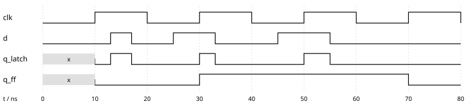
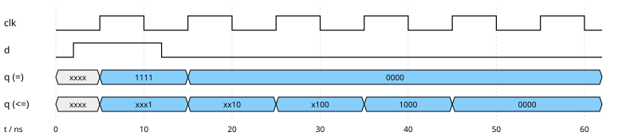
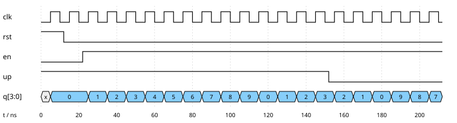
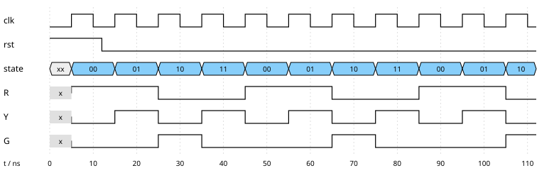



== Sequentielles Verilog

Im link:/de/pages/23_combinational_verilog/[letzten Kapitel] haben wir die Sprachmittel von Verilog besprochen, mit denen sich rein kombinatorische Logik beschreiben lässt...
Begonnen haben wir mit einem einfachen 7-Segment-Decoder (Code und Testbench), weiter ging es mit dem Ripple-Carry-Addierer als zweitem Beispiel,
und zum Schluss kam die Latch-Falle, die wir besprochen haben.
In diesem Kapitel machen wir den Sprung von rein kombinatorischer Verilog-Logik zu sequentieller Logik... Dazu kommen weitere Sprachmittel,
auf die wir schon einen kurzen Blick geworfen haben...

=== Beispiel 1: D-Flipflop vs. Latch

Mit den Unterschieden zwischen D-Flipflops und Latches haben wir uns schon in link:/de/pages/12_clocks_and_registers/[Kapitel 12] beschäftigt.

[source,verilog]
----
include::d_ff.v[]
----

Der Unterschied zwischen einem D-Flipflop und einem Latch: Ein D-Flipflop ist flankengesteuert
(es ändert seinen Ausgangswert also nur bei steigenden Taktflanken),
während ein Latch pegelgesteuert ist,
sein Ausgangswert ändert sich also jedes Mal, solange der en(able)-Eingang aktiv ist.

[source,verilog]
----
include::d_latch.v[]
----

Wie in Zeile 9 der Testbench unten zu sehen ist, ist der en(able)-Eingang mit dem Takt der Testbench verbunden, während beim D-Flipflop
der Takt ebenfalls auf den Takteingang geht.
Flipflop und Latch bekommen also dieselben Signale, reagieren aber auf unterschiedliche Zeitspannen: Das Latch reagiert
während des ganzen Zeitfensters, das Flipflop ändert sich nur an Flanken...

*Eingänge ändern sich nie auf Flanken.*

Dafür gibt es zwei Gründe. In *echter Hardware* muss der Eingang eines Flipflops kurz vor und nach der Flanke stabil sein
(Setup- und Hold-Zeiten; siehe Kapitel 22). Ändert er sich genau auf der Flanke, ist das Ergebnis nicht vorhersagbar.
In einer *Simulation* wäre das Ergebnis ebenfalls mehrdeutig: Passieren zwei Ereignisse zur selben Zeit, hängt das Ergebnis von der Reihenfolge ab,
in der der Simulator sie abarbeitet. Das nennt man eine Race Condition.

[source,verilog]
----
include::latch_vs_ff_tb.v[]
----

*$monitor*: Diese Systemfunktion wird einmal aufgerufen und bleibt danach aktiv. Sobald sich eines der aufgeführten Signale ändert, gibt sie eine Zeile aus, höchstens
eine pro Zeitschritt. Deshalb erscheinen die oben gezeigten Zeilen. Anders als $display, das genau einmal beim Aufruf ausgibt, überwacht $monitor
fortlaufend.

==== Die Waveform

Als Nächstes schauen wir uns die Waveforms an. Der Takt ist von 10-20 ns, 30-40 ns, 50-60 ns und schließlich 70-80 ns high. In diesen Zeiten ist das Latch offen.

Zu Beginn sind beide Ausgänge (der des Latches und der des Flipflops) im Zustand x, also unbekannt...

Das Latch bekommt erst einen Wert, wenn es bei 10 ns öffnet; das Flipflop übernimmt den Wert an der steigenden Flanke, ebenfalls bei 10 ns. Danach sind beide null.

// Bei 13 und 17 ns folgt das Latch d, das Flipflop nicht: Der Takt ist 1, das Latch also offen. d springt bei 13 ns auf 1, und das Latch folgt sofort. Bei 17 ns fällt d wieder auf 0, und das Latch folgt erneut. Das Flipflop hat seinen Wert bei 10 ns übernommen und ignoriert alles bis zur nächsten steigenden Flanke; es bleibt 0. Ein kurzer Puls am Eingang kommt also durch das Latch, aber nicht durch das Flipflop.

// 25 und 45 ns, beide halten: d wird 1, aber der Takt ist 0. Das Latch ist geschlossen, und für das Flipflop gibt es keine Flanke. Keines von beiden reagiert.

// 30, 50 und 70 ns: Das Flipflop tastet an der Flanke ab. Bei 30 ns steigt der Takt; d ist seit 25 ns 1, also übernimmt das Flipflop die 1. Das Latch öffnet im selben Moment und zeigt ebenfalls 1. Dasselbe passiert bei 50 ns. Bei 70 ns ist d = 0; das Flipflop übernimmt jetzt die 0, nachdem es 40 ns lang 1 gehalten hat.

// Bei 33 und 55 ns fällt das Latch auf 0, während das Flipflop 1 hält: Der Takt ist noch high, das Latch noch offen. d fällt auf 0, und das Latch folgt sofort. Das Flipflop hat an der Flanke die 1 übernommen und behält sie bis zur nächsten steigenden Flanke bei 50 bzw. 70 ns. Das ist der auffälligste Unterschied im Diagramm: Zwischen 33 und 40 ns sowie zwischen 55 und 70 ns zeigen die beiden Ausgänge unterschiedliche Werte, obwohl sie dasselbe d und denselben Takt sehen.

Zusammengefasst: Das Flipflop schaut nur viermal hin, bei 10, 30, 50 und 70 ns, und hält den Wert dazwischen. Das Latch überwacht das Signal die ganze Zeit, in der der Takt 1 ist.

=== Beispiel 2: Schieberegister

Die beiden folgenden Verilog-Quellen sollen dieselbe Hardware beschreiben, ein 4-Bit-Schieberegister, aber es gibt eine Falle:

Der Grund ist, dass die Zuweisung "=" nicht funktioniert, sondern durch "<=" ersetzt werden muss; die genauen Gründe kannst du ein LLM deiner Wahl fragen.

Die erste zeigt ein nicht-blockierendes Schieberegister - das, das wir meistens haben wollen, während die zweite Version
blockierend ist...

[source,verilog]
----
include::shift_reg.v[]
----

[source,verilog]
----
include::shift_reg_blocking.v[]
----

Wie die Waveform der Testbench zeigt, sind die Ergebnisse der ersten und der zweiten Version ziemlich unterschiedlich...

[source,verilog]
----
include::shift_reg_tb.v[]
----

=== Beispiel 3: Ein Zähler

[source,verilog]
----
include::counter_updown.v[]
----

==== Parameter

Wie oben zu sehen ist, führen wir diesmal Parameter in den Code ein:

Zuerst die Bitbreite *WIDTH*, dann den Modulo-Zähler *MOD*.

Diese Parametrisierung erleichtert die Umsetzung fein einstellbarer Schaltungen.
Die Bitbreite kennen wir schon aus dem Beispiel mit dem Ripple-Carry-Addierer.

Der Modulo-10-Zähler wird zum Beispiel in der 7-Segment-Anzeige verwendet.

==== Priorität der Bedingungen

Der Reset "if (rst)" wird zuerst geprüft, er greift also immer, egal ob en 0 oder 1 ist.
Erst danach kommt "else if (en)": Ohne Enable hält der Zähler einfach seinen Wert.
Da das in einem getakteten Block passiert, entsteht kein Latch, sondern ein Flipflop, das seinen Wert behält.

==== Synchroner Reset

Weil der Reset im Block "always @(posedge clk)" steht, greift er nur an einer Taktflanke.
Das nennt man einen synchronen Reset. Die Alternative ist ein asynchroner Reset, der sofort greift,
unabhängig vom Takt: "always @(posedge clk or posedge rst)".

==== Der Bedingungsoperator

Der Ausdruck "(q == MOD - 1) ? 0 : q + 1" liest sich wie in der Programmiersprache C: Steht der Zähler auf 9, wird er 0,
sonst wird er um eins erhöht. Abwärts funktioniert es genauso: Steht der Zähler auf 0, wird er 9, sonst wird er um eins verringert.
In Hardware wird aus "? :" ein Multiplexer; für diesen Zähler erzeugt Yosys 6 $_MUX_-Zellen.

==== Überlauf in beide Richtungen

Der Zähler aus link:/de/pages/22_simulation/[Kapitel 22] läuft von 15 auf 0 über, da er nicht mehr als 4 Bit fassen kann.
Hier ist der Überlauf von 9 auf 0 und von 0 auf 9 ausdrücklich beschrieben.

==== Was passiert bei den Werten 10 bis 15?

Nach einem Reset kommen sie nie vor. Sollte sich der Zähler doch einmal auf einen solchen Wert verzählen, fängt er sich von selbst wieder:
Aufwärts geht es von 12 über 13, 14, 15 zurück auf null, abwärts von 11 und 10 auf 9. Das ist genau die "Falle der unbenutzten Zustände" aus
link:/de/pages/14_automata/[Kapitel 14], hier gelöst (allerdings nur in echter Hardware, nach 1 bis 6 Taktzyklen).

==== Die Testbench

[source,verilog]
----
include::counter_updown_tb.v[]
----

Wird der Zähler mit #(.WIDTH(4), .MOD(10)) instanziiert, werden die Parameter überschrieben: So wird ein parametrisiertes Modul
beim Einbinden konfiguriert. Der Takt hat eine Periode von 10 ns, die steigenden Flanken liegen also bei 5, 15, 25 … ns.
Die Stimuli folgen mit relativen #-Verzögerungen aufeinander: Der Reset endet bei 12 ns, en geht bei 22 ns auf 1, up bei 152 ns auf 0,
und die Simulation endet bei 212 ns. Weil $strobe in einem "always @(posedge clk)"-Block steht, gibt es pro steigender Flanke eine Zeile aus,
mit dem Wert, der sich am Ende dieses Zeitschritts eingestellt hat.

In der Waveform ist q in den ersten 5 ns unbekannt (x), bis die erste Flanke bei aktivem Reset es auf 0 setzt.
Ohne Reset würde die Simulation für immer auf x bleiben: x + 1 ist wieder x, und der Vergleich mit 9 ebenso.
Ab 25 ns zählt der Zähler von 1 bis 9 aufwärts, springt bei 115 ns von 9 auf 0 und zählt weiter bis 3.
Ab 155 ns zählt er abwärts, springt bei 185 ns von 0 auf 9 und endet bei 7. Es kommen nur die Werte 0 bis 9 vor.

==== Synchron statt asynchron

Der Binärzähler aus link:/de/pages/12_clocks_and_registers/[Kapitel 12] war asynchron: Jedes Flipflop wurde vom Ausgang der vorherigen Stufe getaktet.
Hier hängen alle Flipflops am selben Takt und schalten deshalb gleichzeitig. So werden Zähler in modernen Schaltungen aufgebaut.

==== Was Yosys synthetisiert

33 Zellen, darunter 4 × $_SDFFE_PP0P_: Das sind Flipflops mit eingebautem synchronem Reset und Enable. Yosys erkennt also die Struktur "if (rst) … else if (en)"
und erzeugt die passenden Flipflops. Die übrigen Zellen gehen an die Inkrement- und Dekrementlogik, den Vergleich und die Auswahl.

=== Beispiel 4: Eine Ampel

Bauen wir das Ampel-Beispiel aus link:/de/pages/14_automata/[Kapitel 14] als konkrete Beschreibung der Schaltung in Verilog nach.

Die Ampel ist der Moore-Automat aus Kapitel 14: vier Zustände (Rot, Rot-Gelb, Grün, Gelb), binär kodiert als 00, 01, 10, 11,
und alle drei Ausgänge hängen nur vom Zustand ab. In Kapitel 14 haben wir die booleschen Gleichungen von Hand hergeleitet:
Q0' = ¬Q0, Q1' = Q1 ⊕ Q0, R = ¬Q1, Y = Q0, G = Q1 · ¬Q0. Das Ergebnis waren "zwei D-Flipflops, zwei Inverter, ein XOR-Gatter und ein AND-Gatter".
Yosys bestätigt das: traffic_light_eq.v wird zu 2 Flipflops, 2 Invertern, 1 XOR und 1 ANDNOT (ein AND mit einem invertierten Eingang) synthetisiert.

[source,verilog]
----
include::traffic_light_eq.v[]
----

==== Zwei verschiedene Modelle

Das traffic_light_eq.v oben schreibt die Gleichungen direkt in Verilog. Die beiden Flipflops q1 und q0 stehen in einem getakteten Block mit <=,
und die Ausgänge sind drei assign-Anweisungen, genau die booleschen Gleichungen aus Kapitel 14.
Das ist kompakt, aber die booleschen Gleichungen muss man selbst herleiten, und bei großen Automaten wird das schnell unübersichtlich.

[source,verilog]
----
include::traffic_light.v[]
----

==== traffic_light.v: Der übliche Stil mit benannten Zuständen

Hier gibt localparam den Zuständen Namen: RED, RED_YELLOW, GREEN und YELLOW. Anders als ein normaler Parameter
gilt ein localparam nur innerhalb seines Moduls und lässt sich von außen nicht überschreiben.

Das Modul besteht aus drei Blöcken, und die entsprechen genau den Blöcken des Blockdiagramms aus Kapitel 14.
Das Zustandsregister ist ein "always @(posedge clk)"-Block mit <=, der blaue Block im Diagramm.
Die Übergangslogik δ ist ein "always @(*)"-Block mit einer case-Anweisung, die next aus state berechnet.
Die Ausgangslogik λ ist ein weiterer "always @(*)"-Block mit case, der R, Y und G allein aus state berechnet, und das macht sie zu einem Moore-Automaten.
Das ist die Faustregel vom Schieberegister in ihrer reinsten Form: <= in getakteten Blöcken, = in kombinatorischen Blöcken.

Der große Vorteil: Es gibt keine booleschen Gleichungen herzuleiten. Der Automat wird genau so beschrieben wie im Zustandsdiagramm,
und das Synthesewerkzeug leitet die Gleichungen selbst her.

==== Testbench und Waveform

[source,verilog]
----
include::traffic_light_tb.v[]
----

===== Die Testbench

Diese Testbench funktioniert anders als die bisherigen: Sie regt nicht nur eine Schaltung an, sondern vergleicht zwei
Implementierungen miteinander. Dazu werden beide Module nebeneinander instanziiert. `by_hand` ist `traffic_light_eq.v` mit den
Gleichungen aus Kapitel 14, `named` ist `traffic_light.v` mit den benannten Zuständen. Beide bekommen dieselben Signale `clk` und `rst`,
ihre Ausgänge liegen auf getrennten Leitungen. Außer clk und rst hat die Ampel keine Eingänge, es gibt also nichts weiter
anzuregen: Der Reset endet bei 12 ns, danach läuft der Automat allein durch den Takt weiter.

Verglichen wird nach jeder steigenden Flanke, allerdings erst nach #1. Bis dahin sind die nicht-blockierenden Zuweisungen
in beiden Modulen übernommen. Ein Vergleich genau auf der Flanke wäre wieder eine Race Condition, wie wir sie in Beispiel 1 gesehen haben.
Mit {r_eq, y_eq, g_eq} werden die drei Ausgänge zu einem 3-Bit-Wert zusammengefasst, so lassen sie sich
in einem Schritt vergleichen.

Für den Vergleich verwenden wir !== statt !=. Der Unterschied liegt im Umgang mit x: !== vergleicht exakt, einschließlich x.
Liefert eine Implementierung x und die andere einen gültigen Wert, zählt das als Fehler. Mit != wäre das Ergebnis selbst x,
und das if würde gar nicht erst greifen.

Für die Ausgabe greift die Testbench mit named.state auf den internen Zustand der Instanz named zu, obwohl state gar kein Port ist.
Ein solcher hierarchischer Name funktioniert nur in der Simulation. Am Ende steht kein Blick auf die Ausgabe mehr, sondern ein
Urteil: PASSED oder FAILED, zusammen mit der Anzahl der Abweichungen.

*Hinweis:* Die Testbench prüft nur, ob beide Implementierungen dasselbe ausgeben, nicht, ob die Ausgabe gültig ist.
Ohne Reset bleiben beide die ganze Zeit auf x, und für !== ist x gleich x. Die Testbench meldet dann trotzdem PASSED.

===== Die Waveform

Die Waveform zeigt clk, rst und state sowie die Ausgänge R (Rot), Y (Gelb) und G (Grün) der Instanz named.

In den ersten 5 ns ist `state` noch `xx`, und auch R, Y und G sind unbekannt. Vor der ersten Flanke haben die Flipflops noch
keinen Wert, genau wie beim Zähler. Die erste steigende Flanke bei 5 ns kommt bei aktivem Reset und setzt `state` auf 00,
also Rot. Bei 12 ns fällt rst, und ab der nächsten Flanke bei 15 ns wechselt der Zustand mit jedem Takt, also alle 10 ns:
von Rot (00) über Rot-Gelb (01) und Grün (10) zu Gelb (11) und wieder zurück zu Rot. Bis zum Ende der Simulation
bei 112 ns läuft dieser Zyklus knapp dreimal durch.

Auffällig ist, dass sich R, Y und G nur zusammen mit `state` ändern, also nur an den Flanken. Daran erkennt man den
Moore-Automaten: Die Ausgänge hängen ausschließlich vom Zustand ab und nicht direkt von einem Eingang. Die Werte passen auch
zu den Gleichungen aus Kapitel 14. R = ¬Q1 ist in den Zuständen 00 und 01 gesetzt, Y = Q0 in 01 und 11, und G = Q1 · ¬Q0 nur in 10.

Eine echte Ampel ist das allerdings noch nicht, denn jede Phase dauert hier genau einen Takt. Für unterschiedlich lange
Phasen bräuchte man zusätzlich einen Zähler, der in jedem Zustand eine bestimmte Zeit abwartet.

==== One-hot: Was Yosys aus traffic_light.v macht

Synthetisiert man traffic_light.v mit Yosys, kommt nicht die Schaltung aus Kapitel 14 heraus. Yosys erkennt den
Zustandsautomaten und kodiert ihn um, in die sogenannte One-hot-Kodierung. Dabei bekommt jeder Zustand sein eigenes Flipflop,
und es ist immer genau eines davon gesetzt: Aus 00 wird 0001, aus 10 wird 0010, aus 01 wird 0100 und aus 11 wird 1000.

Das Ergebnis sind 13 Zellen, darunter 4 Flipflops statt 2. Zum Vergleich: `traffic_light_eq.v` kommt mit 6 Zellen aus.
Mit `synth -nofsm` lässt sich die Umkodierung abschalten, dann behält Yosys die binäre Kodierung bei und kommt auf 11 Zellen
mit 2 Flipflops.

Warum macht Yosys das? One-hot braucht zwar mehr Flipflops, dafür ist die Logik für jeden einzelnen Zustand einfacher und damit
schneller. Auf FPGAs, die ohnehin viele Flipflops haben, ist das oft die bessere Wahl; mehr dazu in Kapitel 27.
Wichtig ist dabei: Die Kodierung steht nicht im Verilog-Code. Der Code beschreibt das Verhalten, die Kodierung wählt
das Synthesewerkzeug.

(Erstellt mit Claude AI)
