

Im letzten Kapitel, link:/de/pages/24_sequential_verilog/[Kapitel 24], haben wir erklärt, wie sequentielle Logik
in der HDL (Hardware Description Language) Verilog beschrieben und umgesetzt wird.

In diesem Kapitel steigen wir tiefer in den Kaninchenbau hinab und sehen uns an, wie Multiplikation und Division ganzer Zahlen
in Hardware umgesetzt werden:

Für Multiplikatoren und Divisoren, die Zweierpotenzen sind, ist das einfach, denn es bedeutet nur, die Bits nach links zu schieben - das ist die Multiplikation -
oder nach rechts, das ist die Division. Die komplizierteren Fälle behandeln wir später - sehen wir uns zuerst das Schieben an.

[TIP]
====
Alle Beispiele dieses Kapitels liegen im Ordner `25_arithmetic_units` unseres Repositorys link:https://github.com/wehrend/hdl-training[hdl-training],
das wir in link:/de/pages/21_hdl/[Kapitel 21] geklont haben: `00-barrel-shifter`, `01-array-multiplier`, `02-shift-add-multiplier`, `03-divider`.
Wer es schon früher geklont hat, holt mit `git pull` den aktuellen Stand. In der README des Repositorys steht für jedes Beispiel der Befehl zum Simulieren.
====

== Schieben und Barrel-Shifter

[NOTE]
.Warum `>>>` und nicht `>>`?
====
Verilog hat zwei Operatoren für das Rechtsschieben:

* `>>` ist der *logische* Shift: Er schiebt immer Nullen nach. `8'b11011001 >> 1` ergibt `8'b01101100`.
* `>>>` ist der *arithmetische* Shift: Er schiebt Kopien des Vorzeichenbits nach, aber nur, wenn der Wert vorzeichenbehaftet ist.
  `$signed(8'b11011001) >>> 1` ergibt `8'b11101100`, also -20.

Bei einem vorzeichenlosen Wert verhält sich `>>>` genau wie `>>`. Deshalb muss der Wert als vorzeichenbehaftet gekennzeichnet werden,
entweder mit `$signed()` oder durch die Deklaration als `reg signed` bzw. `wire signed`.

In C und Java ist `>>` bei einer vorzeichenbehafteten Zahl meist ebenfalls ein arithmetischer Shift. Verilog macht den
Unterschied ausdrücklich. Für das Linksschieben gibt es auch `<<<`, es tut aber genau dasselbe wie `<<`.
====

== Die Schiebebefehle (sll, srl, sra)

[width="100%" cols="1,2,1,2,1,1",options="header"]
|================
| Befehl  | Name                   | Richtung | nachgeschoben                    | Eingabe    | Ergebnis
| `sll`   | shift left logical     | links    | Nullen von rechts                | `00101101` | `01011010`
| `srl`   | shift right logical    | rechts   | Nullen von links                 | `11011001` | `01101100`
| `sra`   | shift right arithmetic | rechts   | Kopien des Vorzeichenbits von links | `11011001` | `11101100`
|================

[IMPORTANT]
.Warum gibt es kein arithmetisches Linksschieben (sla)?
====
Der Unterschied zwischen „logisch“ und „arithmetisch“ liegt allein darin, was in die frei werdende Stelle nachgeschoben wird.

Beim Rechtsschieben wird links eine Stelle frei, also dort, wo das Vorzeichenbit sitzt. Es gibt zwei sinnvolle Möglichkeiten: Nullen für vorzeichenlose Zahlen (srl) oder Kopien des Vorzeichenbits für vorzeichenbehaftete Zahlen (sra).

Beim Linksschieben wird rechts eine Stelle frei, beim niederwertigsten Bit. Dort ist eine 0 immer richtig, egal ob die Zahl ein Vorzeichen hat oder nicht. Auch im Zweierkomplement bedeutet „mal 2“ einfach „alles eine Stelle nach links, rechts eine 0“:

....
 -3 = 11111101   << 1  =  11111010 = -6
  5 = 00000101   << 1  =  00001010 = 10
....

Ein sla würde also genau dieselben Bits liefern wie sll. Es wäre nur ein zweiter Name für dieselbe Operation.

Passt das Ergebnis nicht mehr in den Zahlenbereich, kippt das Vorzeichen:

....
100 = 01100100   << 1  =  11001000 = -56   (statt 200)
....

Das ist ein Überlauf, genau wie bei add. Das Vorzeichenbit festzuhalten würde auch nicht helfen: 200 passt schlicht nicht in 8 Bit mit Vorzeichen.

====

=== Der Barrel-Shifter
Was wäre, wenn wir Hardware hätten, die Bits um eine beliebige Anzahl von Stellen nach links oder rechts schiebt?

Genau das tut ein Barrel-Shifter; seine Funktionsweise erklären wir unten Befehl für Befehl...

Ein Barrel-Shifter kann die Bits um den Betrag von shamt schieben, also um 1, 2, 4 oder eine Kombination dieser Beträge.

=== Shift right logical

- srl: shift right logical (logisches Rechtsschieben)

- jedes Bit wandert nach rechts, von links kommen Nullen nach

[source,verilog]
----
include::./barrel_shifter_files/srl.v[Shift-right-logical]
----

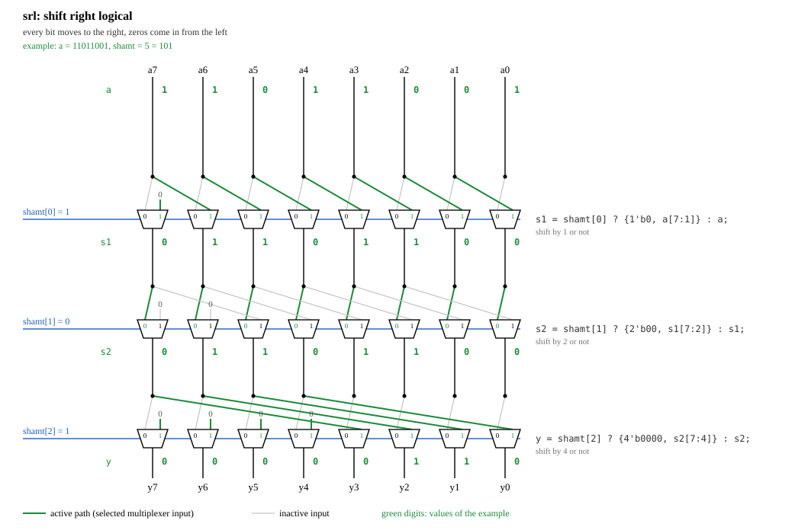

=== Shift right arithmetic

- sra: shift right arithmetic (arithmetisches Rechtsschieben)

- jedes Bit wandert nach rechts, von links kommen Kopien des Vorzeichenbits a7 nach

[source,verilog]
----
include::./barrel_shifter_files/sra.v[Shift-right-arithmetic]
----

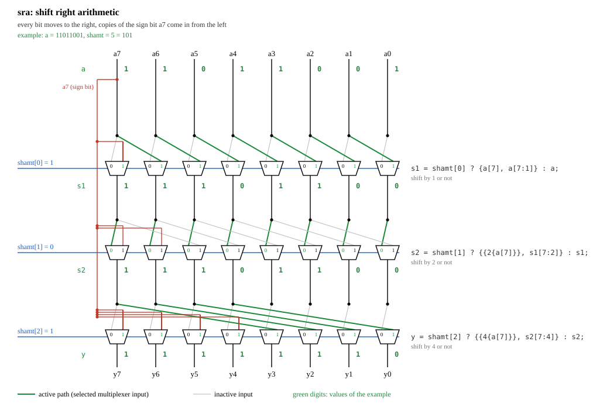

=== Shift left logical

- sll: shift left logical (logisches Linksschieben)

- jedes Bit wandert nach links, von rechts kommen Nullen nach

[source,verilog]
----
include::./barrel_shifter_files/sll.v[Shift-left-logical]
----

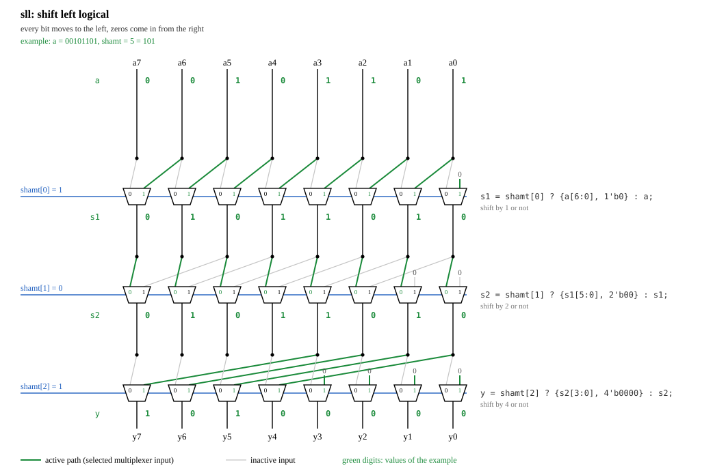

=== Alle drei Befehle zusammen

Als Nächstes wollen wir Hardware, die alle drei Befehle vereint.

[source,verilog]
----
include::./barrel_shifter_files/shifter_all.v[Shift-all]
----

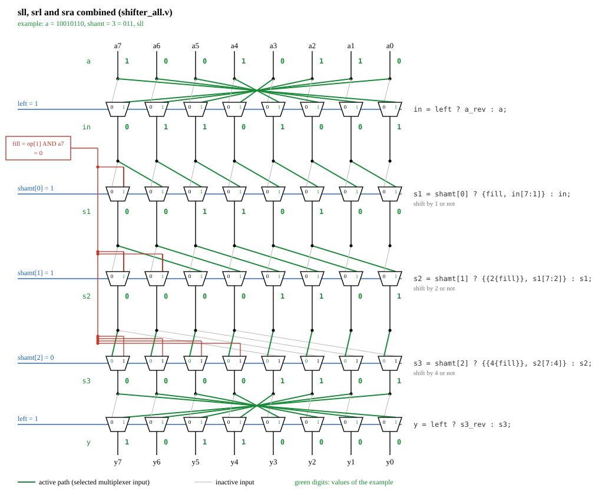

=== Die Testbench für den Shifter

Die Testbench prüft alle vier Schaltungen auf einmal: die drei einzelnen Shifter für sll, srl und sra
und den kombinierten Shifter, der dreimal instanziiert wird, einmal für jeden Wert von op.

[source,verilog]
----
include::./barrel_shifter_files/shifters_tb.v[Shifter-Testbench]
----

Zuerst gibt sie ein Beispiel zum Nachlesen aus: a = 10010110 um 3 geschoben ergibt 10110000 bei sll,
00010010 bei srl und 11110010 bei sra.

Dann geht sie alle möglichen Eingaben durch: alle 256 Werte von a und alle 8 Schiebeweiten, insgesamt 2048 Kombinationen.
Für jede davon vergleicht sie die Ausgänge mit dem Ergebnis der Verilog-Operatoren `<<`, `>>` und `>>>`.
Stimmen alle Ausgänge überein, meldet die Testbench PASSED. Weil jede Kombination getestet wird, bedeutet PASSED,
dass die Schaltungen für jede Eingabe korrekt sind, nicht nur für ein paar Beispiele.

[WARNING]
.Eine Falle in der Testbench
====
Die erwarteten Werte werden zuerst in eigenen Registern gespeichert (exp_sll, exp_srl, exp_sra) und erst dann verglichen.
Das sieht überflüssig aus, ist es aber nicht. Bei einem Vergleich wie

  y_sra !== $signed(a) >>> shamt

wertet Verilog den ganzen Ausdruck vorzeichenlos aus, weil y_sra vorzeichenlos ist. Dann schiebt `>>>` Nullen
statt des Vorzeichenbits nach, und die Testbench meldet bei jeder negativen Zahl Fehler, obwohl die Schaltung richtig ist.
Schreibt man `$signed(a) >>> shamt` zuerst in ein eigenes Register, lässt sich das vermeiden.
====

== Multiplizierer

Die Multiplikation mit einer Zweierpotenz ist ein einziger Shift. Aber jede Zahl ist eine Summe von Zweierpotenzen,
also ist jede Multiplikation eine Summe von Shifts:

\[ x \cdot 10 = x \cdot (8 + 2) = (x \ll 3) + (x \ll 1) \]

Das ist die Grundidee aller Multiplizierer: Für jedes Bit des Multiplikators, das 1 ist, wird der Multiplikand
an die Stelle dieses Bits geschoben und addiert.

=== Schriftliche Multiplikation

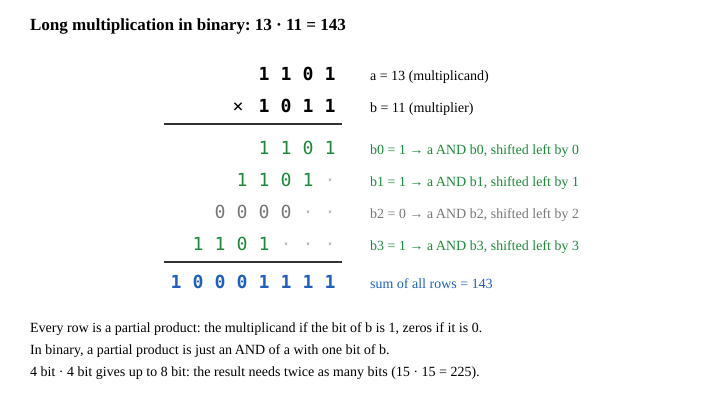

Die binäre Multiplikation funktioniert genau wie die schriftliche Multiplikation aus der Schule, nur einfacher.
Jedes Bit des Multiplikators b ergibt eine Zeile, ein Teilprodukt: Ist das Bit 1, ist die Zeile der Multiplikand a,
ist es 0, besteht die Zeile nur aus Nullen. Jede Zeile ist eine Stelle weiter nach links verschoben. Am Ende werden alle Zeilen addiert.

Im Binärsystem ist ein Teilprodukt nichts anderes als ein AND: Jedes Bit von a wird mit einem Bit von b verundet.
Und das Ergebnis braucht doppelt so viele Bits wie die Eingaben: 4 Bit mal 4 Bit ergibt bis zu 8 Bit, denn 15 · 15 = 225.

=== Array-Multiplizierer

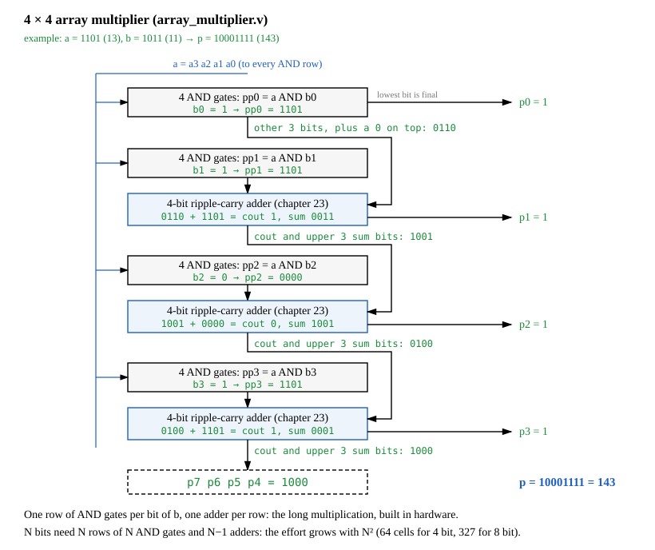

Der Array-Multiplizierer baut die schriftliche Multiplikation direkt in Hardware nach: eine Reihe von AND-Gattern für jedes Bit von b
und ein Addierer für jede Zeile nach der ersten. Als Addierer verwenden wir den Ripple-Carry-Addierer aus
link:/de/pages/23_combinational_verilog/[Kapitel 23] (ripple_adder.v und full_adder.v), mit dem Parameter N auf die Breite des Multiplizierers gesetzt.

Das Bild folgt unserem Beispiel 13 · 11. In jeder Zeile ist das unterste Bit der Summe bereits endgültig:
Es ändert sich nicht mehr, weil alle folgenden Zeilen weiter nach links verschoben sind.
Es verlässt das Array also als ein Bit des Produkts (p0 bis p3), und nur die übrigen Bits wandern zusammen mit dem Übertrag
in die nächste Zeile. Nach der letzten Zeile bilden diese übrigen Bits die obere Hälfte des Produkts.

[source,verilog]
----
include::./multiplier_files/array_multiplier.v[]
----

Der Verilog-Code beschreibt diese Struktur mit zwei generate-Schleifen: Die erste erzeugt die Teilprodukte pp[i] = a & {N{b[i]}},
die zweite einen Addierer pro Zeile. Da der Code nur beschreibt, wie die Zeilen verbunden sind, funktioniert dasselbe Modul für jedes N.

[source,verilog]
----
include::./multiplier_files/array_multiplier_tb.v[]
----

Die Testbench gibt unser Beispiel aus (13 · 11 = 143) und vergleicht dann alle 256 Kombinationen zweier 4-Bit-Zahlen mit dem Verilog-Operator
`*`. Stimmen alle überein, meldet sie PASSED.

Der Array-Multiplizierer liefert das Ergebnis innerhalb eines Taktes, hat aber zwei Nachteile.
Erstens wächst seine Größe mit dem Quadrat von N: N Zeilen mit je N AND-Gattern und N−1 Addierer. Yosys synthetisiert die 4-Bit-Version
zu 64 Zellen, die 8-Bit-Version schon zu 327. Eine 32-Bit-Version wäre riesig.
Zweitens müssen die Signale nacheinander durch alle Addierer laufen. Dieser lange Pfad begrenzt die Taktfrequenz.

=== Sequentieller Multiplizierer

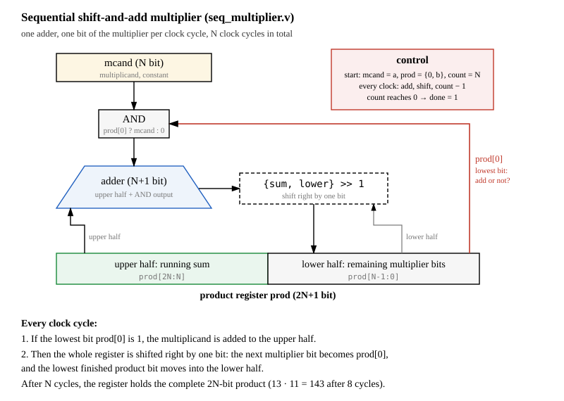

Der sequentielle Multiplizierer löst das Größenproblem andersherum: Statt N Addierer nebeneinander
verwendet er einen einzigen Addierer N-mal, ein Bit des Multiplikators pro Takt.

Der Trick ist das Produktregister. Seine obere Hälfte enthält die laufende Summe, seine untere Hälfte die Bits des Multiplikators, die noch nicht
verarbeitet sind. In jedem Takt passieren zwei Dinge:

. Ist das unterste Bit prod[0] gleich 1, wird der Multiplikand zur oberen Hälfte addiert.
. Dann wird das ganze Register um ein Bit nach rechts geschoben.

Das Schieben bringt das nächste Multiplikator-Bit an Position 0 und schiebt gleichzeitig das unterste fertige Bit des Produkts
in die untere Hälfte. Nach N Takten sind alle Bits des Multiplikators verbraucht, und das Register enthält das vollständige Produkt.
Die obere Hälfte hat ein zusätzliches Bit, weil die Addition einen Übertrag erzeugen kann.

[source,verilog]
----
include::./multiplier_files/seq_multiplier.v[]
----

Hier kommt die sequentielle Logik aus link:/de/pages/24_sequential_verilog/[Kapitel 24] ins Spiel. Ein Impuls auf start lädt
den Multiplikanden, legt den Multiplikator in die untere Hälfte und setzt einen Zähler auf N. Solange busy 1 ist, addiert und schiebt die Schaltung
in jedem Takt und zählt herunter. Ist der Zähler abgelaufen, geht done auf 1, und das Produkt p ist gültig.

[source,verilog]
----
include::./multiplier_files/seq_multiplier_tb.v[]
----

Die Testbench verwendet einen task, um eine Multiplikation zu starten und auf done zu warten. Sie rechnet zuerst unser Beispiel und dann alle 65.536 Kombinationen
zweier 8-Bit-Zahlen, was ein paar Sekunden dauert. Für die Waveform zeigt sie die beiden Hälften des Produktregisters als
die Signale upper und lower.

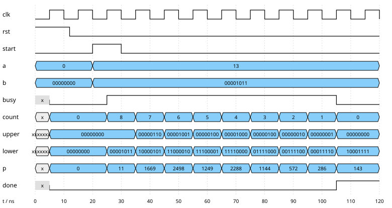

Die Waveform zeigt die Multiplikation 13 · 11 mit b = 00001011. Bei 25 ns lädt start das Register, und der Zähler beginnt bei 8.
Ab 35 ns folgt mit jeder Taktflanke ein Schritt. In den ersten beiden Schritten ist das unterste Bit 1: Der Multiplikand 13 wird addiert,
und das Register wird geschoben. Im dritten Schritt ist das unterste Bit 0, also wird nur geschoben. Man kann beobachten, wie die Bits von b
nach rechts aus lower hinauswandern, während die fertigen Produktbits von links hineinwandern.
Nach 8 Schritten, bei 105 ns, geht done auf 1: upper ist 00000000, lower ist 10001111, und p ist 143.

=== Platz gegen Zeit

[width="100%",cols="2,1,1,1",options="header"]
|===
| | Array-Multiplizierer | sequentieller Multiplizierer |
| Zellen (8 Bit) | 327 | 113 (davon 30 Flipflops) |
| Takte pro Multiplikation | 1 | 8 |
| Größe wächst mit | N² | N |
|===

Das ist ein Grundprinzip des Hardware-Entwurfs: Fläche lässt sich gegen Zeit tauschen.
Der Barrel-Shifter war eine Schaltung nach dem Prinzip „alles auf einmal“, der sequentielle Multiplizierer ist die erste nach dem Prinzip „Schritt für Schritt“.
Echte CPUs verwenden schnellere Verfahren wie Booth-Kodierung, Wallace-Bäume oder Pipelining, aber sie alle bauen auf diesen beiden Ideen auf.

[NOTE]
.Und vorzeichenbehaftete Zahlen?
====
Beide Multiplizierer arbeiten mit vorzeichenlosen Zahlen. Interessanterweise sind die unteren N Bits des Produkts bei vorzeichenbehafteten und vorzeichenlosen Zahlen gleich.
Deshalb hat RISC-V für die untere Hälfte nur einen Befehl mul. Nur die obere Hälfte unterscheidet sich,
daher gibt es für sie drei Befehle: mulh (mit Vorzeichen · mit Vorzeichen), mulhu (ohne Vorzeichen · ohne Vorzeichen) und mulhsu (mit Vorzeichen · ohne Vorzeichen).
====

== Dividierer

Die Division ist die Umkehrung der Multiplikation: Statt zu schieben und zu addieren, schieben und subtrahieren wir.

=== Schriftliche Division

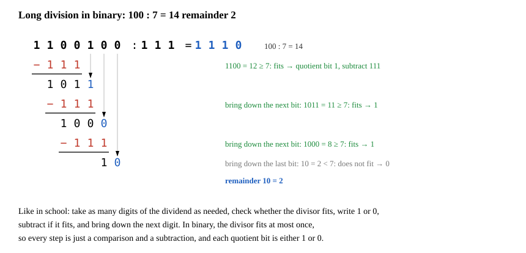

Wieder beginnen wir mit dem Verfahren aus der Schule. Man nimmt so viele Stellen des Dividenden, bis der Divisor hineinpasst,
schreibt eine 1 in den Quotienten, zieht den Divisor ab und holt die nächste Stelle herunter. Passt der Divisor nicht, schreibt man eine 0
und holt einfach die nächste Stelle herunter.

Im Binärsystem ist das noch einfacher als im Dezimalsystem: Der Divisor passt entweder einmal oder gar nicht.
Man muss also nicht raten, wie oft er passt. Jeder Schritt ist nur ein Vergleich und eine Subtraktion,
und jedes Quotientenbit ist entweder 1 oder 0. In unserem Beispiel ergibt 1100100 (100) geteilt durch 111 (7) den Quotienten 1110 (14) mit dem Rest 10 (2).

=== Sequentieller Dividierer

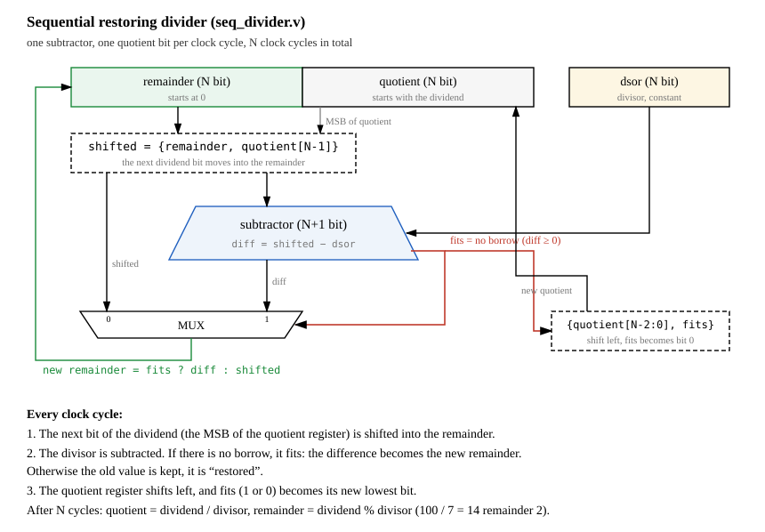

Der sequentielle Dividierer führt genau diese Schritte aus, ein Quotientenbit pro Takt. Er braucht drei Register:
den Divisor, der konstant bleibt, den Rest, der bei 0 beginnt, und das Quotientenregister,
das mit dem Dividenden beginnt. In jedem Takt:

. Das nächste Bit des Dividenden, das MSB des Quotientenregisters, wird von rechts in den Rest geschoben.
  Das ist das „Herunterholen der nächsten Stelle“.
. Der Divisor wird von diesem geschobenen Wert abgezogen. Gibt es kein Borgen, ist die Differenz nicht negativ: Der Divisor passt.
  Dann wird die Differenz zum neuen Rest. Passt er nicht, behält der Rest seinen alten Wert, er wird „wiederhergestellt“.
  Daher heißt dieses Verfahren Restoring Division.
. Das Quotientenregister wird nach links geschoben, und das Ergebnis des Vergleichs, fits, wird sein neues unterstes Bit.

Das Quotientenregister erfüllt also zwei Aufgaben gleichzeitig: Links werden die Bits des Dividenden hinausgeschoben,
rechts die Bits des Quotienten hineingeschoben. Nach N Takten sind alle Bits des Dividenden verbraucht, und das Register
enthält den vollständigen Quotienten. Das Restregister enthält den Rest.

[source,verilog]
----
include::./divider_files/seq_divider.v[]
----

Die Steuerung ist dieselbe wie beim sequentiellen Multiplizierer: start lädt die Register und setzt den Zähler auf N,
busy ist 1, solange die Schaltung arbeitet, und done zeigt an, dass Quotient und Rest gültig sind.
Die Subtraktion verwendet N+1 Bits, damit das Borgen im obersten Bit diff[N] erscheint: Ist es 0, passt der Divisor.

[source,verilog]
----
include::./divider_files/seq_divider_tb.v[]
----

Die Testbench teilt zuerst 100 durch 7 und 42 durch 0 und prüft dann alle 65.536 Kombinationen zweier 8-Bit-Zahlen
gegen die Verilog-Operatoren `/` und `%`.

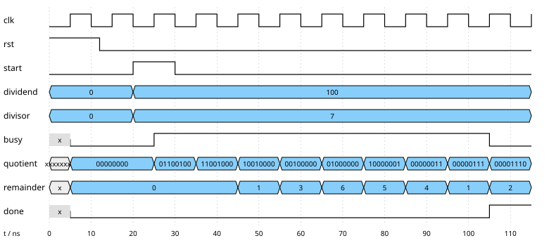

Die Waveform zeigt die Division 100 : 7. Bei 25 ns lädt start das Quotientenregister mit dem Dividenden 01100100.
Ab 35 ns folgt mit jeder Taktflanke ein Schritt. In den ersten vier Schritten wächst der Rest auf 0, 1, 3 und 6, während die
Bits des Dividenden hineinwandern, aber 7 passt nie, also sind die Quotientenbits 0. Im fünften Schritt, bei 75 ns, wäre der Rest 12:
Der Divisor passt, der Rest wird 12 − 7 = 5, und eine 1 wandert in das Quotientenregister.
Nach 8 Schritten, bei 105 ns, geht done auf 1: Das Quotientenregister enthält 00001110 (14), der Rest ist 2.

[NOTE]
.Division durch null
====
Was passiert, wenn der Divisor 0 ist? Die Schaltung braucht dafür keinen Sonderfall: 0 „passt“ immer, also wird jedes Quotientenbit
1, und vom Rest wird nie etwas abgezogen. Das Ergebnis ist ein Quotient aus lauter Einsen (255)
und der Dividend als Rest, 42 : 0 ergibt also 255 Rest 42.

Genau das schreibt RISC-V für die Befehle divu und remu vor: Eine Division durch null löst keine Ausnahme aus,
der Quotient besteht aus lauter Einsen, und der Rest ist der Dividend. Das Programm muss selbst prüfen, ob der Divisor null ist.
====

=== Division mit Vorzeichen

Unser Dividierer arbeitet nur mit vorzeichenlosen Zahlen. Bei vorzeichenbehafteten Zahlen teilt eine CPU meist die Beträge
und korrigiert danach das Vorzeichen. Zwei Details sind wissenswert:

* *Rundung:* Das div von RISC-V rundet zur Null hin, wie C: −7 / 2 = −3, mit dem Rest −1.
  Der arithmetische Shift vom Anfang dieses Kapitels rundet dagegen ab: −7 >>> 1 = −4.
  Bei negativen Zahlen ist eine Division durch 2 also nicht dasselbe wie ein arithmetischer Rechtsshift.
* *Überlauf:* Die kleinste Zahl geteilt durch −1 passt nicht: In 8 Bit wäre −128 / −1 gleich +128.
  RISC-V legt das Ergebnis als −128 fest, mit dem Rest 0.

== Takte im Vergleich

Wie lange brauchen unsere Schaltungen? Mit N = 8 Bit zeigen die Testbenches:

[width="100%",cols="3,2,2,2",options="header"]
|===
| Schaltung | Takte (8 Bit) | Takte (32 Bit) | Größe wächst mit
| Barrel-Shifter | 1 | 1 | N · log~2~ N
| Array-Multiplizierer | 1 | 1 | N²
| sequentieller Multiplizierer | 8 (+1 zum Laden) | 32 (+1) | N
| sequentieller Dividierer | 8 (+1 zum Laden) | 32 (+1) | N
|===

Die kombinatorischen Schaltungen liefern ihr Ergebnis innerhalb eines Taktes, aber je länger der Pfad durch die Addierer ist,
desto langsamer muss dieser Takt sein. Die sequentiellen Schaltungen brauchen einen Takt pro Bit und dazu einen Takt, in dem start die Register lädt.
In den Waveforms lädt start bei 25 ns, und done geht bei 105 ns auf 1: acht Schritte zu je 10 ns.

Echte Prozessoren treffen dieselbe Abwägung:

* Der Arm Cortex-M0+, ein kleiner Mikrocontroller-Kern, kann mit jeder unserer beiden Arten von Multiplizierer gebaut werden:
  mit einem Multiplizierer, der einen Takt braucht, oder mit einem, der 32 Takte braucht und dafür weniger Fläche benötigt. Der Chip-Designer entscheidet.
* Der Cortex-M0+ hat überhaupt keinen Divisionsbefehl. Der RP2040 hat deshalb neben jedem seiner beiden Kerne einen Dividierer,
  der für eine 32-Bit-Division 8 Takte braucht.
* Ein Desktop-Prozessor wie Intels Skylake multipliziert zwei 64-Bit-Zahlen mit einer Latenz von 3 Takten.
  Eine 64-Bit-Division dauert je nach Werten zwischen etwa 35 und 89 Takten.

[NOTE]
Die Multiplikation ist überall schnell geworden, die Division nicht. Den Grund sieht man an unseren Schaltungen: Die Teilprodukte
einer Multiplikation sind alle voneinander unabhängig, sie lassen sich also gleichzeitig berechnen und in einem Baum addieren.
Bei einer Division braucht jeder Schritt den Rest des vorherigen Schritts: Ob der Divisor passt, lässt sich erst entscheiden,
wenn die vorherige Subtraktion fertig ist. Schnelle Dividierer berechnen mehrere Bits pro Takt, aber nicht alle Bits auf einmal.
Deshalb ersetzen Compiler eine Division durch eine Konstante, wo immer es geht, durch eine Multiplikation,
und deshalb ist der Shift vom Anfang dieses Kapitels noch immer der schnellste Weg, durch eine Zweierpotenz zu teilen.

(Erstellt mit Claude AI)
