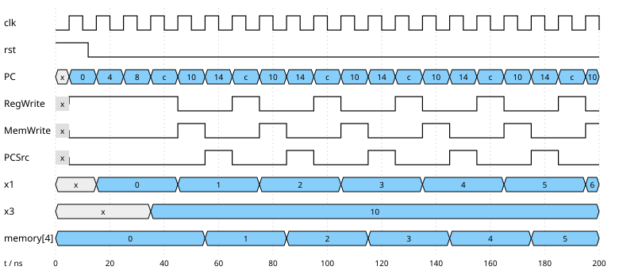



== Die CPU in Verilog

In Teil 2 haben wir eine vollständige Single-Cycle-RISC-V-CPU auf dem Papier entworfen: den link:/de/pages/16_datapath/[Datenpfad] in Kapitel 16
und das link:/de/pages/17_cpu_control/[Steuerwerk] in Kapitel 17. Am Ende von Kapitel 17 haben wir unser Zählprogramm
Takt für Takt durch eine Tabelle verfolgt - von Hand.

In den Kapiteln seitdem haben wir die Werkzeuge gesammelt, um das mit dem Computer zu erledigen: Module und Signale
(link:/de/pages/21_hdl/[Kapitel 21]), Testbenches und Waveforms (link:/de/pages/22_simulation/[Kapitel 22]),
Vektoren, Hierarchie und `generate` (link:/de/pages/23_combinational_verilog/[Kapitel 23]), Flipflops und Register
(link:/de/pages/24_sequential_verilog/[Kapitel 24]) sowie Arithmetik in Hardware (link:/de/pages/25_arithmetic_units/[Kapitel 25]).

Jetzt setzen wir alles zusammen. Wir beschreiben die CPU in Verilog und lassen den Simulator das Zählprogramm ausführen.
Am Ende gibt der Simulator dieselbe Tabelle aus, die wir in Kapitel 17 von Hand ausgefüllt haben.

[TIP]
====
Alle Beispiele dieses Kapitels liegen im Ordner `26_cpu_verilog` unseres Repositorys link:https://github.com/wehrend/hdl-training[hdl-training],
das wir in link:/de/pages/21_hdl/[Kapitel 21] geklont haben: `00-register-file`, `01-alu`, `02-control`, `03-cpu`.
Wer es schon früher geklont hat, holt mit `git pull` den aktuellen Stand. In der README des Repositorys steht für jedes Beispiel der Befehl zum Simulieren.
====

=== Der Plan: Block für Block

Wir könnten die ganze CPU in eine Datei schreiben und simulieren. Wenn sie dann nicht bis 10 zählt, hätten wir ein Problem:
Der Fehler könnte überall stecken. Deshalb bauen wir die CPU in vier Schritten auf, und jeder Block bekommt seine eigene Testbench,
bevor er verwendet wird:

[width="100%",options="header"]
|===
| Schritt | Block | Entworfen in | Dateien
| 1 | Registerdatei | link:/de/pages/16_datapath/[Kapitel 16] | `regfile.v`
| 2 | ALU | link:/de/pages/05_alu/[Kapitel 05] | `alu_cell.v`, `alu.v`
| 3 | Steuerwerk, ALU-Steuerung, Immediate-Generator | link:/de/pages/17_cpu_control/[Kapitel 17] | `control.v`, `alu_control.v`, `imm_gen.v`
| 4 | Speicher und die komplette CPU | Kapitel 16 und 17 | `instr_mem.v`, `data_mem.v`, `cpu.v`
|===

So werden auch in der Praxis Chips entwickelt: Zuerst wird jeder Block für sich getestet (Unit-Test),
dann das zusammengesetzte System (Integrationstest). Schlägt der Integrationstest fehl, wissen wir wenigstens, dass die Blöcke
selbst korrekt sind und der Fehler in der Verdrahtung zwischen ihnen liegen muss.

=== Schritt 1: Die Registerdatei

Die Registerdatei enthält die 32 Register x0 bis x31, jedes 32 Bit breit. In Kapitel 16 haben wir sie mit drei Anschlüssen gezeichnet:

* zwei *Leseports*: Die Registernummern rs1 und rs2 gehen hinein, die Inhalte rd1 und rd2 kommen heraus,
* ein *Schreibport*: Ist RegWrite gleich 1, wird der Wert wd in das Register rd geschrieben.

Das Lesen ist kombinatorisch: Sobald sich rs1 ändert, zeigt rd1 nach einer kurzen Verzögerung das neue Register.
Geschrieben wird mit der steigenden Taktflanke, wie bei jedem Register aus Kapitel 24.
Und das Register x0 ist etwas Besonderes: Es liefert beim Lesen immer 0, Schreiben hat keine Wirkung.

[source,verilog]
----
include::./register_files/regfile.v[]
----

==== Ein neues Sprachmittel: Arrays

Bisher war ein Signal entweder ein einzelnes Bit oder ein Vektor wie `wire [31:0] a`. Die Zeile

[source,verilog]
----
reg [31:0] regs [0:31];
----

deklariert ein *Array*: 32 Elemente (der Bereich nach dem Namen), jedes davon ein Vektor aus 32 Bit (der Bereich vor dem Namen).
`regs[5]` ist das komplette Register x5, und `regs[5][31]` wäre sein Vorzeichenbit. Der Index muss keine Konstante sein:
`regs[rs1]` wählt das Register aus, dessen Nummer gerade an rs1 anliegt. In Hardware ist das ein großer Multiplexer
mit 32 Eingängen zu je 32 Bit - und da wir zwei Leseports haben, bekommen wir zwei davon.

==== Warum wird x0 beim Lesen abgefragt?

Der Schreibblock weigert sich, Register 0 zu beschreiben (`rd != 0`). regs[0] wird also nie beschrieben - das bedeutet aber auch,
dass es nie initialisiert wird und in der Simulation `x` enthält. Deshalb prüfen die Leseports selbst auf Register 0
und liefern eine konstante 0. In Hardware muss regs[0] gar nicht existieren: Das Synthesewerkzeug bemerkt, dass
es nie beschrieben wird, und entfernt es.

==== Die Testbench

[source,verilog]
----
include::./register_files/regfile_tb.v[]
----

Die Testbench schreibt zuerst den Wert i · 3 in jedes Register i. Bei x0 versucht sie stattdessen, 0xDEAD zu schreiben.
Neue Werte werden an der fallenden Flanke angelegt (`@(negedge clk)`), damit sie an der steigenden Flanke stabil sind.
Wie in Kapitel 22 ändern sich die Eingänge also nicht genau an der Taktflanke. Dann werden alle Register gleichzeitig über beide Ports gelesen:
Port 1 zählt von x0 aufwärts, Port 2 von x31 abwärts. Zum Schluss prüft die Testbench, dass bei we = 0 nichts geschrieben wird.

----
x0 = 0 (0xDEAD was written, x0 stays 0), x7 = 21
PASSED
----

=== Schritt 2: Die ALU

Die ALU aus link:/de/pages/05_alu/[Kapitel 05] ist eine Kette aus identischen 1-Bit-Zellen. Genau dafür sind
Hierarchie und `generate` in Verilog gemacht (link:/de/pages/23_combinational_verilog/[Kapitel 23]).
Wir beginnen mit einer einzelnen Zelle:

[source,verilog]
----
include::./alu_files/alu_cell.v[]
----

Alles in dieser Zelle kennen wir aus Teil 1:

* Die beiden XOR-Gatter sind *steuerbare Inverter*: Ist ainvert = 1, arbeitet die Zelle mit dem invertierten a. Dasselbe gilt für b.
* `sum` und `cout` bilden einen Volladdierer.
* Die `case`-Anweisung ist der Multiplexer am Ausgang, gesteuert von den beiden Operation-Bits.
* Der Eingang `less` wird nur für slt gebraucht; woher sein Wert kommt, sehen wir gleich.

==== Von der Zelle zur 32-Bit-ALU

[source,verilog]
----
include::./alu_files/alu.v[]
----

Die `generate`-Schleife erzeugt 32 Kopien der Zelle und verbindet über den Vektor c den Übertragsausgang jeder Zelle
mit dem Übertragseingang der nächsten. Die vier Steuerbits werden in Ainvert, Binvert und Operation aufgeteilt.
Damit ergeben sich folgende Operationen:

[width="70%",options="header"]
|===
| ctrl | Ainvert | Binvert | Operation | Funktion
| 0000 | 0 | 0 | 00 | and
| 0001 | 0 | 0 | 01 | or
| 0010 | 0 | 0 | 10 | add
| 0110 | 0 | 1 | 10 | sub
| 0111 | 0 | 1 | 11 | slt
| 1100 | 1 | 1 | 00 | nor
| 1101 | 1 | 1 | 01 | nand
|===

Vier Zeilen verdienen einen genaueren Blick:

* `assign c[0] = binvert;` - im link:/de/pages/04_signs/[Zweierkomplement] ist eine Subtraktion a - b = a + ~b + 1.
  Binvert invertiert b in jeder Zelle, und da Binvert zugleich der Übertrag in die erste Zelle ist, liefert es auch gleich die + 1.
* `assign overflow = c[N-1] ^ c[N];` - ein Überlauf liegt vor, wenn sich der Übertrag in das Vorzeichenbit vom Übertrag aus ihm heraus unterscheidet.
* `assign is_less = sum[N-1] ^ overflow;` - für slt berechnet die ALU a - b. Ist das Ergebnis negativ, gilt a < b.
  Das verrät uns das Vorzeichenbit der Summe - außer die Subtraktion ist übergelaufen, dann ist das Vorzeichenbit falsch und das XOR korrigiert es.
  Dieser Wert geht an den Eingang `less` von Zelle 0. Alle anderen Zellen bekommen eine 0, das Ergebnis ist also entweder 1 oder 0.
* `assign zero = ~|result;` - das `|` vor einem Vektor ist ein *Reduktionsoperator*: Er verknüpft alle Bits des Vektors mit ODER.
  Das `~` invertiert das Ergebnis. zero ist also genau dann 1, wenn alle 32 Ergebnisbits 0 sind - ein NOR-Gatter mit 32 Eingängen.

Die Zeile mit `is_less` sieht vielleicht wie eine Schleife aus: Das Ergebnis der letzten Zelle geht zurück in die erste Zelle.
Sie ist aber keine: is_less hängt von `sum` der letzten Zelle ab, und `sum` hängt überhaupt nicht von `less` ab.
Das Signal läuft einfach einmal durch die Übertragskette und dann in den Ausgangsmultiplexer von Zelle 0.
Eine echte kombinatorische Schleife, in der ein Signal von sich selbst abhängt, wäre ein Fehler.

[NOTE]
.Warum nicht einfach `a + b` schreiben?
====
In der Praxis würden wir das tun: `assign result = a + b;` ist kürzer, und das Synthesewerkzeug weiß sehr gut, wie man einen Addierer baut,
zum Beispiel mit der eigens dafür vorhandenen Übertragslogik eines FPGAs. Hier bauen wir die ALU absichtlich aus Zellen, weil wir sehen wollen,
dass die Schaltung aus Teil 1 tatsächlich funktioniert. In link:/de/pages/27_code_to_chip/[Kapitel 27] sehen wir uns an, was das Synthesewerkzeug daraus macht.
====

==== Die Testbench

[source,verilog]
----
include::./alu_files/alu_tb.v[]
----

Alle Kombinationen zu testen, wie beim 8-Bit-Shifter in Kapitel 25, ist hier nicht möglich:
Bei zwei 32-Bit-Eingängen gibt es 2^64^ Kombinationen. Stattdessen verwendet die Testbench zwei Arten von Werten:

* *Randwerte*: 0, 1, -1, die größte und die kleinste Zahl und ein paar weitere. Die meisten Fehler passieren an den Rändern:
  beim Übertrag von Bit 30 in Bit 31, beim Überlauf, beim Übergang von -1 auf 0.
  Jede Operation wird mit allen 64 Paaren aus diesen 8 Werten getestet.
* *Zufallswerte*: 1000 zufällige Paare pro Operation, erzeugt mit `$random`. Sie finden Fehler, an die niemand gedacht hat.

Zusammen mit den vier Beispielen am Anfang sind das 4 + 7 · (64 + 1000) = 7452 Tests.
Jedes Ergebnis wird mit den Verilog-Operatoren `&`, `|`, `+`, `-` und `<` verglichen:

----
add: 1 + 1   = 2
sub: 1 - 10  = -9, zero = 0
sub: 10 - 10 = 0, zero = 1
slt: -2147483648 < 1 = 1 (overflow = 1)
PASSED: 7452 tests
----

Interessant ist die letzte Beispielzeile: -2^31^ - 1 passt nicht in 32 Bit, die Subtraktion läuft über,
und das Vorzeichenbit des Ergebnisses ist 0. Ohne die Überlaufkorrektur würde slt behaupten, -2^31^ sei nicht kleiner als 1.

=== Schritt 3: Das Steuerwerk

In Kapitel 17 bestand die Steuerung aus drei Blöcken: dem Hauptsteuerwerk, der ALU-Steuerung und dem Immediate-Generator.
In Verilog wird jeder davon zu einem kleinen Modul aus rein kombinatorischer Logik.

==== Das Hauptsteuerwerk

[source,verilog]
----
include::./control_files/control.v[]
----

Das ist die Schaltung aus Kapitel 17, eins zu eins: ein Decoder mit einer Leitung pro Befehlstyp,
und jedes Steuersignal ist ein ODER der Leitungen, in denen es 1 ist. Die Leitung `imm` und ihre beiden ODER sind die Erweiterung für `addi`
aus Kapitel 17. ALUOp entsteht durch eine Verkettung: `{r, br}` legt r in Bit 1 und br in Bit 0.

Wir hätten die Haupttabelle auch als `case`-Anweisung über den Opcode schreiben können, mit einer Zeile pro Befehl.
Nach der Synthese käme dasselbe heraus. Die hier gewählte Form hat den Vorteil, dass der Code aussieht wie
die Gleichungen in Kapitel 17.

==== Die ALU-Steuerung

[source,verilog]
----
include::./alu_files/alu_control.v[]
----

Die zweistufige Decodierung aus Kapitel 17: ALUOp trifft die grobe Entscheidung, und nur bei R-Typ-Befehlen (ALUOp = 10)
werden funct3 und Bit 30 angesehen. Beachte, dass beide `case`-Anweisungen ein `default` haben: Wie wir in
link:/de/pages/23_combinational_verilog/[Kapitel 23] gelernt haben, erzeugt ein `always @(*)`-Block, in dem ein Ausgang nicht in jedem Fall
zugewiesen wird, ein Latch.

Die `addi`-Falle aus Kapitel 17 löst das Hauptsteuerwerk, nicht die ALU-Steuerung: Da `addi` ALUOp = 00 bekommt,
schaut die ALU-Steuerung bei einem `addi` nie auf Bit 30, das dort zur Konstanten gehört.

==== Der Immediate-Generator

[source,verilog]
----
include::./other/imm_gen.v[]
----

Hier zeigt die Verkettung ihre Stärke. Die Tabelle aus Kapitel 17 lässt sich fast wörtlich hinschreiben:
`{inst[31:25], inst[11:7]}` setzt die beiden Teile der S-Typ-Konstanten zusammen.
`{20{inst[31]}}` ist eine *Replikation*: 20 Kopien des Vorzeichenbits. Das ist die Vorzeichenerweiterung in einem einzigen Ausdruck.

Am seltsamsten ist die B-Typ-Zeile: Die Bits der Konstanten kommen von vier Stellen im Befehl,
und am Ende wird eine 0 angehängt, weil Sprungziele immer gerade sind. Nachzählen zeigt, dass es aufgeht:
19 + 1 + 1 + 6 + 4 + 1 = 32.

==== Die Testbench

[source,verilog]
----
include::./control_files/control_tb.v[]
----

Die Testbench füttert alle drei Blöcke mit echten Maschinenbefehlen: den Befehlen unseres Zählprogramms
und ein paar weiteren für `sub`, `and`, `or` und `lw`. Die erwarteten Werte stammen aus den Tabellen in Kapitel 17.
Die letzte Zeile testet die `addi`-Falle: In `addi x5, x5, -1` ist Bit 30 gleich 1, und die ALU-Steuerung muss trotzdem die Addition wählen.

----
addi x3,x0,10    RegWrite=1 ALUSrc=1 MemToReg=0 MemRead=0 MemWrite=0 Branch=0 ALUOp=00 ALUctrl=0010 imm=10
add x1,x1,x2     RegWrite=1 ALUSrc=0 MemToReg=0 MemRead=0 MemWrite=0 Branch=0 ALUOp=10 ALUctrl=0010 imm=2
sub x2,x1,x2     RegWrite=1 ALUSrc=0 MemToReg=0 MemRead=0 MemWrite=0 Branch=0 ALUOp=10 ALUctrl=0110 imm=1026
and x1,x1,x2     RegWrite=1 ALUSrc=0 MemToReg=0 MemRead=0 MemWrite=0 Branch=0 ALUOp=10 ALUctrl=0000 imm=2
or x1,x1,x2      RegWrite=1 ALUSrc=0 MemToReg=0 MemRead=0 MemWrite=0 Branch=0 ALUOp=10 ALUctrl=0001 imm=2
lw x5,8(x6)      RegWrite=1 ALUSrc=1 MemToReg=1 MemRead=1 MemWrite=0 Branch=0 ALUOp=00 ALUctrl=0010 imm=8
sw x1,4(x0)      RegWrite=0 ALUSrc=1 MemToReg=0 MemRead=0 MemWrite=1 Branch=0 ALUOp=00 ALUctrl=0010 imm=4
bne x1,x3,-8     RegWrite=0 ALUSrc=0 MemToReg=0 MemRead=0 MemWrite=0 Branch=1 ALUOp=01 ALUctrl=0110 imm=-8
beq x0,x0,0      RegWrite=0 ALUSrc=0 MemToReg=0 MemRead=0 MemWrite=0 Branch=1 ALUOp=01 ALUctrl=0110 imm=0
addi x5,x5,-1    RegWrite=1 ALUSrc=1 MemToReg=0 MemRead=0 MemWrite=0 Branch=0 ALUOp=00 ALUctrl=0010 imm=-1
PASSED
----

Der Immediate-Generator liefert auch bei R-Typ-Befehlen einen Wert (imm=2, imm=1026). Er interpretiert den Befehl
einfach als I-Typ. Das spielt keine Rolle: ALUSrc = 0, der Multiplexer vor der ALU ignoriert den Wert also.
Deshalb prüft die Testbench imm nur dort, wo ALUSrc oder Branch gleich 1 ist.

=== Schritt 4: Die komplette CPU

Zwei Blöcke fehlen noch: die Speicher. Dann können wir alles verbinden.

==== Befehlsspeicher und Datenspeicher

[source,verilog]
----
include::./other/instr_mem.v[]
----

Der Befehlsspeicher ist ein Array aus 64 Worten. `$readmemh` lädt ihn beim Start der Simulation aus einer Textdatei
mit Hexadezimalzahlen - ein Befehl pro Zeile:

----
include::./other/program.hex[]
----

Das ist unser Zählprogramm aus den Kapiteln 15 und 17, übersetzt in Maschinencode. Alles nach `//` ist ein Kommentar.

Der PC enthält Byteadressen: 0x00, 0x04, 0x08, ... Der Speicher ist aber in Worten zu 4 Byte organisiert.
Deshalb wird die Adresse durch 4 geteilt, indem einfach die beiden untersten Bits weggelassen werden: `addr[7:2]`.
Aus Adresse 0x0C wird Wort 3. Sechs Adressbits ergeben 64 Worte - genug für unser Programm.

[source,verilog]
----
include::./other/data_mem.v[]
----

Der Datenspeicher funktioniert wie die Registerdatei, nur mit einem einzigen Port: Gelesen wird kombinatorisch, geschrieben
an der steigenden Flanke, wenn MemWrite = 1 ist. Die `initial`-Schleife setzt zu Beginn der Simulation alle Worte auf 0,
damit wir in der Waveform kein `x` sehen.

==== Alles verbinden

[source,verilog]
----
include::./cpu_files/cpu.v[]
----

Wer das Bild aus link:/de/pages/17_cpu_control/[Kapitel 17] neben diesen Code legt, findet jeden Block und jede Leitung wieder.
Der Code ist nach den Phasen eines Befehls geordnet:

* *Befehl holen:* Der PC adressiert den Befehlsspeicher, der erste Addierer berechnet PC + 4.
* *Decodieren:* Der Befehl wird in seine Felder zerlegt. Das sind nur Leitungen, keine Logik: `inst[19:15]` *ist* rs1.
* *Steuerung:* Hauptsteuerwerk und ALU-Steuerung erzeugen die Steuersignale.
* *Registerdatei und Immediate:* Die Registerdatei liest rs1 und rs2, der Immediate-Generator holt die Konstante heraus.
* *Ausführen:* Der Multiplexer vor der ALU wählt den zweiten Operanden, die ALU rechnet.
* *Speicherzugriff:* Das ALU-Ergebnis ist die Adresse für den Datenspeicher, rs2 sind die zu schreibenden Daten.
* *Zurückschreiben:* Der Multiplexer hinter dem Speicher wählt aus, was in rd geschrieben wird.
* *Nächster PC:* Der zweite Addierer berechnet das Sprungziel, PCSrc wählt den nächsten PC.

Alle Multiplexer sind eine einzige Zeile mit dem Bedingungsoperator aus Kapitel 24, zum Beispiel
`alu_b = alu_src ? imm : rd2`. Und die Sprungentscheidung mit der Erweiterung für `bne` ist die Formel aus Kapitel 17:

\[PCSrc = Branch \cdot (Zero \oplus inst_{12})\]

Im ganzen Modul gibt es nur einen einzigen `always`-Block: den PC. Zusammen mit der Registerdatei und dem Datenspeicher
ist er der einzige Teil der CPU, der etwas speichert. Alles andere ist kombinatorische Logik zwischen zwei Taktflanken -
genau das bedeutet „Single-Cycle“.

Der PC hat einen *synchronen Reset*: Solange rst = 1 ist, wird der PC an jeder steigenden Flanke auf 0 gesetzt.
Ohne Reset würde der PC mit `x` starten, und die CPU würde einen Befehl von einer unbekannten Adresse holen.

==== Die Testbench

[source,verilog]
----
include::./cpu_files/cpu_tb.v[]
----

Die Testbench erledigt drei Dinge:

* Sie erzeugt den Takt und nimmt den Reset nach 12 ns weg.
* An jeder steigenden Flanke gibt sie eine Zeile aus: PC, Befehl und was der Befehl bewirkt.
  An der steigenden Flanke sind die neuen Werte noch nicht gespeichert (es sind nichtblockierende Zuweisungen, siehe Kapitel 24),
  wir sehen also noch den Befehl dieses Takts und den Wert, der gleich geschrieben wird.
* Nach 35 Takten prüft sie das Ergebnis: x1 und x3 müssen 10 sein, memory[4] muss 10 sein, der PC muss bei 0x18 stehen,
  und es muss genau 10 Schreibzugriffe auf den Speicher gegeben haben, mit den Werten 1 bis 10.

Die Testbench schaut mit *hierarchischen Namen* in die CPU hinein: `dut.rf.regs[1]` ist Element 1 des Arrays regs
in der Instanz rf innerhalb der Instanz dut. Das funktioniert nur in der Simulation, ein Synthesewerkzeug würde es ablehnen.
Für eine Testbench ist es aber sehr praktisch: Wir können jedes Signal beobachten, ohne es über Ports aus der CPU herausführen zu müssen.

[NOTE]
.Wozu die zusätzlichen Leitungen x1, x3 und mem4?
====
Die meisten Simulatoren, darunter Icarus Verilog, schreiben Arrays nicht automatisch in die VCD-Datei.
Die Leitungen `x1`, `x3` und `mem4` in der Testbench sind Kopien einzelner Array-Elemente, damit sie in der Waveform erscheinen.
====

==== Die CPU zählt bis 10

----
clock  1  PC=0x00  inst=00000093  x1 = 0  ->  next PC=0x04
clock  2  PC=0x04  inst=00100113  x2 = 1  ->  next PC=0x08
clock  3  PC=0x08  inst=00a00193  x3 = 10  ->  next PC=0x0c
clock  4  PC=0x0c  inst=002080b3  x1 = 1  ->  next PC=0x10
clock  5  PC=0x10  inst=00102223  memory[4] = 1  ->  next PC=0x14
clock  6  PC=0x14  inst=fe309ce3  Zero=0 PCSrc=1  ->  next PC=0x0c
clock  7  PC=0x0c  inst=002080b3  x1 = 2  ->  next PC=0x10
...
clock 31  PC=0x0c  inst=002080b3  x1 = 10  ->  next PC=0x10
clock 32  PC=0x10  inst=00102223  memory[4] = 10  ->  next PC=0x14
clock 33  PC=0x14  inst=fe309ce3  Zero=1 PCSrc=0  ->  next PC=0x18
clock 34  PC=0x18  inst=00000063  Zero=1 PCSrc=1  ->  next PC=0x18
clock 35  PC=0x18  inst=00000063  Zero=1 PCSrc=1  ->  next PC=0x18
PASSED: counted to 10 in 33 clock cycles, CPU loops at 0x18
----

Vergleiche das mit der Tabelle am Ende von Kapitel 17: Sie ist Zeile für Zeile dieselbe.
In Takt 6 sieht `bne` Zero = 0 (1 - 10 ist nicht 0) und springt zurück nach 0x0C. In Takt 33 ist x1 = x3 = 10,
Zero = 1, und der Sprung wird nicht ausgeführt. Ab Takt 34 dreht die CPU in der Endlosschleife bei 0x18 ihre Runden.

Icarus gibt beim Start eine Warnung aus: `program.hex` enthält nur 7 Befehle, der Speicher hat aber 64 Worte.
Das ist in Ordnung, der Rest des Befehlsspeichers wird nie verwendet.

Die Waveform zeigt die ersten 200 ns:

Wir können einiges daraus ablesen:

* Bis zur ersten steigenden Flanke bei 5 ns ist der PC `x`. Erst dann greift der Reset und setzt ihn auf 0.
* Nach dem Reset durchläuft der PC 0, 4, 8 und wiederholt dann die Schleife c, 10, 14 - alle drei Takte.
* RegWrite ist 1 bei `addi` und `add`, MemWrite bei `sw`, PCSrc beim ausgeführten `bne`.
* x1 zählt mit jedem Schleifendurchlauf hoch, und memory[4] folgt einen Takt später - das `sw` kommt nach dem `add`.

=== Simulation ist (noch) keine Hardware

Unsere CPU funktioniert - in der Simulation. Können wir sie jetzt auf ein FPGA laden? Wir haben es mit dem Lattice iCE40 HX1K versucht,
dem FPGA auf dem Nandland Go Board, das wir im nächsten Kapitel verwenden. Das Ergebnis: Der Entwurf braucht mehr als dreimal
so viele Logikzellen, wie der Chip hat.

Der Grund liegt in den Speichern. Registerdatei und Datenspeicher werden kombinatorisch gelesen. Das FPGA hat schnellen Block-RAM,
aber Block-RAM lässt sich nur an einer Taktflanke lesen. Also baut das Synthesewerkzeug unsere Speicher aus einzelnen Flipflops
und riesigen Multiplexern - mehr als 3000 Flipflops allein zum Speichern. In der Simulation macht das überhaupt keinen Unterschied.

Wie man das behebt und was zwischen dem Verilog-Code und dem Chip passiert - Synthese, Place and Route, Timing-Analyse -,
ist das Thema von link:/de/pages/27_code_to_chip/[Kapitel 27].

=== Selbst ausprobieren

. *`slt` hinzufügen.* Die ALU kann slt bereits berechnen (ctrl = 0111), aber die ALU-Steuerung kennt den Befehl noch nicht.
  `slt` ist ein R-Typ-Befehl mit funct3 = 010. Eine zusätzliche Zeile in `alu_control.v` genügt.
  Teste es mit einem kleinen Programm, zum Beispiel:
+
----
00300093  // addi x1, x0, 3
ffb00113  // addi x2, x0, -5
0020a1b3  // slt  x3, x1, x2     3 < -5 ?  -> x3 = 0
00112233  // slt  x4, x2, x1    -5 <  3 ?  -> x4 = 1
00000063  // beq  x0, x0, 0
----
+
Die negative Zahl zeigt, ob der Vergleich wirklich vorzeichenbehaftet ist.
. *Ein anderes Programm.* Ändere `program.hex` so, dass die CPU die Zahlen von 1 bis 10 aufsummiert und die Summe (55)
  in memory[8] ablegt. Du brauchst dafür ein Register und ein `add` mehr. Den Maschinencode kannst du von Hand mit den Formaten
  aus link:/de/pages/15_RISC_V/[Kapitel 15] erstellen oder mit einem Assembler, etwa dem im Simulator Ripes.
. *Absichtlich kaputt machen.* Ändere in `cpu.v` bei der Instanz von `alu_control` Bit 30 in Bit 29, oder vertausche zwei Eingänge eines Multiplexers.
  Welche Testbench findet den Fehler? Wie schnell findest du ihn in der Waveform?
  (Tipp zu Bit 29: Enthält unser Zählprogramm ein `sub`? Ein Test kann nur Fehler in dem finden, was er auch benutzt.)

=== Zusammenfassung

* Wir haben die Single-Cycle-CPU aus Teil 2 in Verilog gebaut, aus vier Arten von Blöcken: Registerdatei, ALU,
  Steuerung (Hauptsteuerwerk, ALU-Steuerung, Immediate-Generator) und Speicher.
* Jeder Block hat seine eigene Testbench bekommen, bevor er verwendet wurde. Die CPU-Testbench musste dann nur noch die Verdrahtung prüfen.
* Neue Sprachmittel: Arrays (`reg [31:0] regs [0:31]`), der Reduktionsoperator (`~|result`), die Replikation (`{20{inst[31]}}`),
  `$readmemh` zum Laden von Speicherinhalten und hierarchische Namen in Testbenches.
* Die CPU führt unser Zählprogramm in 33 Takten aus - genau wie wir es in Kapitel 17 von Hand vorhergesagt haben.
* Was in der Simulation funktioniert, passt nicht automatisch auf einen Chip. Darum geht es im nächsten Kapitel.

(Erstellt mit Claude AI)
