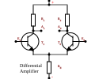
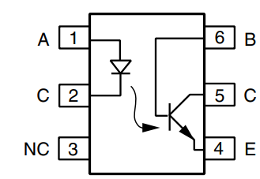




Nach diesem Kapitel kennen Sie alle Grundlagen rund um das Halbleiterbauelement Transistor (BJT sowie MOSFETs) und seine Wirkungen...




Der Transistor verdient ein eigenes Kapitel, denn er hat eine völlig neue Generation der Elektronik in den 1970er- bis 1980er-Jahren entscheidend geprägt...

Der Transistor ist ein *nichtlineares Bauelement*, also ein Bauteil, dessen Strom-Spannungs-Verhältnis **nicht proportional** ist.
Mit anderen Worten: Der Strom steigt nicht linear mit der angelegten Spannung an.

Beispiele für nichtlineare Bauelemente sind:

* Dioden (leiten Strom nur in eine Richtung),
* Transistoren (deren Verhalten von internen Halbleiterübergängen abhängt)
* und CMOS-Strukturen.

Aufgrund dieses nichtlinearen Verhaltens ermöglichen solche Bauelemente das Schalten, Verstärken,
Gleichrichten und fast alle Formen der digitalen Logik.


== Elektronik 103.5: Weitere Anwendungen für Transistoren

In link:https://wehrend.github.io/de/pages/electronics-103/[Elektronik 103] haben wir die Physik der Halbleiter untersucht und
gesehen, wie ein einzelner BJT oder MOSFET als einfacher Schalter oder Verstärker arbeitet. In modernen Systemen arbeiten Transistoren jedoch selten allein.

Um ein Smartphone oder ein Elektroauto zu bauen, müssen wir Transistoren in spezielle Konfigurationen bringen. Dieser Beitrag behandelt
die „fehlenden Kapitel“: Leistungsskalierung, differenzielle Signalübertragung und die Effizienz von PWM.

== 1. Die Leistungsvervielfacher: Darlington-Schaltungen
Ein einzelner Transistor hat eine physikalische Grenze für seine Stromverstärkung (stem:[ \beta ]). Wenn Sie einen 5-A-Motor mit einem 20-mA-Signal
eines Mikrocontrollers schalten wollen, wird ein einzelner BC547 schlicht nicht weit genug durchsteuern.

Die **Darlington-Schaltung** löst dieses Problem, indem sie zwei Transistoren hintereinanderschaltet: Der Emitter des ersten steuert die Basis des zweiten.

* **Gesamtverstärkung:** stem:[ \beta_{total} \approx \beta_1 \cdot \beta_2 ]
* **Der Kompromiss:** Die Einschaltspannung steigt von 0,7 V auf ca. 1,4 V, und die Schaltgeschwindigkeit sinkt etwas, weil
im ersten Transistor Ladung gespeichert wird.

== 2. Differenzverstärker: Störungen unterdrücken
Ein gewöhnlicher Verstärker in Emitterschaltung ist „unsymmetrisch“ (single-ended): Er verstärkt alles, auch elektromagnetische Störungen (EMI), die Ihre Leitungen einfangen.
Wir vertiefen das in Elektronik 104, aber hier schon einmal das Wesentliche...

Der **Differenzverstärker** (auch Long-Tailed Pair genannt) verwendet zwei Transistoren, deren Emitter an einer gemeinsamen Stromquelle hängen.

* **Gleichtaktunterdrückung:** Trifft eine Störspitze beide Eingänge gleichzeitig (z. B. 50-Hz-Brummen), reagieren beide Transistoren gleich, und die *Differenz* zwischen ihren Kollektoren bleibt null.
* **Präzision:** Diese Schaltung ist die „Eingangstür“ jedes jemals gebauten Operationsverstärkers (OPV).

== 3. Fototransistoren und Optokoppler

Nachdem wir uns im vorigen Artikel mit LEDs beschäftigt haben, lohnt sich ein Blick auf ihr funktionales Gegenstück: den Fototransistor.
Diese Bauteile werden am häufigsten in Optokopplern eingesetzt, wo ihre Hauptaufgabe die galvanische Trennung ist.

Galvanische Trennung ermöglicht die Signalübertragung zwischen zwei unabhängigen Stromkreisen ohne direkte elektrische Verbindung
und schützt so empfindliche Niederspannungsbauteile wirksam vor Hochspannungsspitzen. Ein klassisches Beispiel ist der CNY17,
der eine Infrarot-LED und einen Fototransistor in einem Gehäuse vereint.

Sein innerer Aufbau und seine Pinbelegung sind unten dargestellt:

== 4. Die CMOS-Revolution
Warum hat CMOS (Complementary Metal-Oxide-Semiconductor) den Prozessorkrieg gewonnen? Wegen der **statischen Leistungsaufnahme**.
(Das ist ein weiteres Thema für Elektronik 105)...

In der älteren NMOS-Logik wurden Widerstände verwendet, um die Spannung „hochzuziehen“ (Pull-up). Dadurch floss ständig Strom, auch wenn die Schaltung ihren Zustand nicht änderte. CMOS kombiniert einen **N-Kanal-** und einen **P-Kanal-MOSFET** so, dass immer einer sperrt, wenn der andere leitet.

> **Kernaussage:** In einer CMOS-Schaltung wird nur während des Umschaltens Leistung verbraucht. Deshalb wird Ihre CPU mit steigendem Takt heißer.

== 5. Linear- vs. PWM-Steuerung
Bei der Ansteuerung einer Last wie eines Motors oder einer LED gibt es zwei Möglichkeiten: Der Transistor arbeitet wie ein veränderlicher Widerstand (linear) oder wie ein schneller Verschluss (PWM).

=== Vergleich der Steuerungsarten

[cols="1,2,2", options="header"]
|===
| Merkmal | Linearbetrieb (analog) | Schaltbetrieb (PWM)
| **Transistorzustand** | Teilweise leitend (aktiver Bereich) | Voll leitend oder voll gesperrt
| **Wirkungsgrad** | Niedrig (ca. 40–60 %) | Hoch (über 90 %)
| **Wärmeentwicklung** | Erheblich (Kühlkörper nötig) | Gering
| **Am besten für** | Audioverstärker, Funk | Motoren, LED-Dimmung, Netzteile
|===

Im **Linearbetrieb** setzt der Transistor die „überschüssige“ Spannung in Wärme um:
[stem]
++++
P_{waste} = (V_{supply} - V_{load}) \cdot I_{load}
++++

Im **PWM-Betrieb** ist der Transistor entweder ein idealer Leiter (0 V Spannungsabfall) oder ein idealer Isolator (0 A Stromfluss). Die im Transistor selbst umgesetzte Leistung ist daher nahezu null.

== 6. Den Schalter schützen: Die Freilaufdiode
Wenn Sie mit einem MOSFET oder BJT eine **induktive Last** schalten (alles mit einer Spule, etwa einen Motor oder ein Relais), müssen Sie eine **Freilaufdiode** vorsehen.

Wenn der Transistor abschaltet, bricht das Magnetfeld der Spule zusammen und erzeugt eine gewaltige Spannungsspitze (Gegen-EMK), die über 100 V betragen und das Silizium Ihres Transistors durchschlagen kann. Die Diode bietet dieser Energie einen sicheren Rückweg.

_Dieser Blogbeitrag wurde mit Hilfe von KI erstellt, konkret mit Google Gemini._

//'''
//
// == Wie geht es weiter?
// Nachdem wir gesehen haben, wie Transistoren mit Leistung und Logik umgehen: Soll ich eine **Stückliste (BOM) und einen Schaltplan** für ein praktisches DIY-Projekt bereitstellen, etwa einen **transistorbasierten PWM-Motorregler**?
