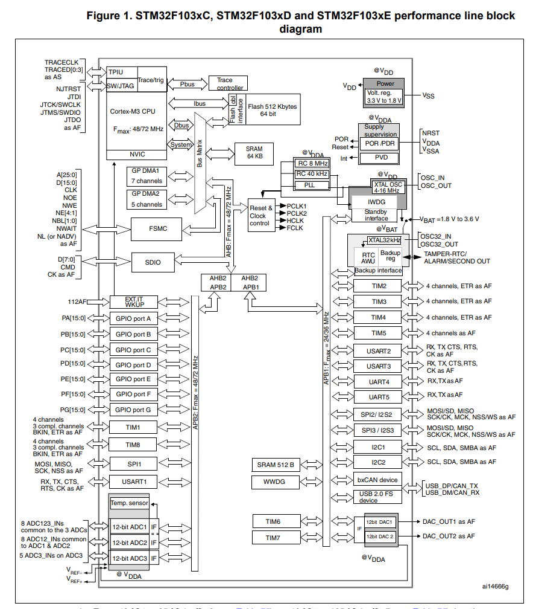
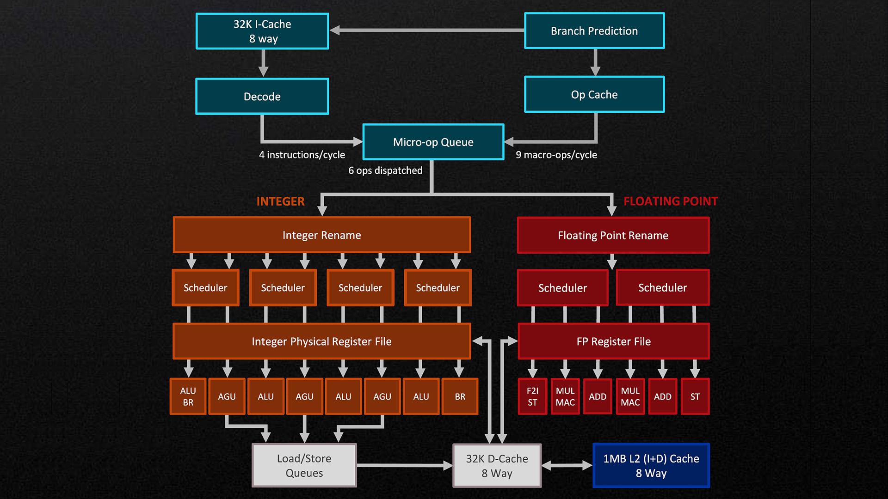

== Zwei völlig verschiedene Welten – Mikrocontroller vs. Mikroprozessoren (MCU vs. CPU)

In diesem Beitrag wollen wir die grundlegenden Unterschiede zwischen eingebetteten Systemen auf Basis von
Mikrocontrollern und Desktop- oder Serverrechnern mit leistungsstarken CPUs und einem vollständigen Betriebssystem
genauer betrachten.

Dazu stellen wir eine MCU-Plattform, zum Beispiel ein STM32-basiertes System, einer typischen Desktop-CPU-Plattform
wie einem AMD-Ryzen-System gegenüber. Obwohl beide Software ausführen und Daten verarbeiten, sind sie für völlig
unterschiedliche Ziele und Einsatzszenarien optimiert.

Während die wichtigste Eigenschaft eingebetteter Systeme Vorhersagbarkeit und deterministisches Zeitverhalten ist,
stehen bei Desktop- und Serversystemen mit CPUs hohe Rechenleistung und ein möglichst großer Gesamtdurchsatz im
Vordergrund.

== Die wichtigsten Eigenschaften und der Aufbau von MCUs / eingebetteten Systemen

Mikrocontroller sind dafür gebaut, direkt mit der physischen Welt zu interagieren. Eine MCU vereint in der Regel
den CPU-Kern, Speicher und eine Vielzahl von Peripheriekomponenten auf einem einzigen Chip. Dieser hohe
Integrationsgrad ermöglicht sehr kompakte, energieeffiziente und kostengünstige Systeme.

MCU-Boards bieten üblicherweise Peripherie wie GPIOs, Timer, Kommunikationsschnittstellen und analoge Komponenten
wie ADCs und DACs, wie sie in
link:../adc_dac/[diesem Beitrag]
beschrieben sind. Mit dieser Peripherie lassen sich Sensoren für Temperatur, Luftfeuchtigkeit, Druck, Licht oder
Schall direkt an den Mikrocontroller anschließen, ohne zusätzliche Hardware (abgesehen von den Sensoren selbst).

Software für eingebettete Systeme läuft häufig entweder direkt auf der Hardware (Bare Metal) oder auf einem kleinen
Echtzeitbetriebssystem. In beiden Fällen ist die Softwarearchitektur meist einfach und eng an die Hardware
gekoppelt. Programme sind oft um eine Hauptschleife oder eine kleine Anzahl von Echtzeit-Tasks herum aufgebaut.
Entscheidend ist, dass bestimmte Vorgänge innerhalb garantierter Zeitgrenzen ablaufen. Die Ausführungszeit im
ungünstigsten Fall (Worst Case) ist dabei weitaus wichtiger als die durchschnittliche Leistung, denn eine verpasste
Deadline kann zu fehlerhaftem Systemverhalten oder sogar zu physischen Schäden führen.

== Die wichtigsten Eigenschaften und der Aufbau von CPU-basierten Desktop- und Serversystemen

Desktop- und Serversysteme auf Basis von CPUs folgen einer grundlegend anderen Designphilosophie. Hier ist die CPU
nur ein Teil eines deutlich größeren und komplexeren Systems. Externer Arbeitsspeicher, Massenspeicher,
Grafikhardware, Netzwerkschnittstellen und viele weitere Komponenten sind über schnelle Busse angebunden und werden
von einem vollwertigen Betriebssystem wie Linux oder Windows gesteuert.

In dieser Umgebung wird Leistung vor allem am Durchsatz und an der durchschnittlichen Ausführungsgeschwindigkeit
gemessen. Moderne CPUs nutzen Techniken wie tiefe Pipelines, mehrstufige Caches, Out-of-Order-Ausführung und
spekulative Ausführung, um möglichst viele Befehle pro Zeiteinheit abzuarbeiten. Diese Optimierungen steigern die
Leistung erheblich, machen das genaue Zeitverhalten jedoch schwer oder gar nicht vorhersagbar.

Betriebssysteme auf Desktop- und Servermaschinen legen den Schwerpunkt auf Fairness, Ressourcenauslastung und
Benutzerfreundlichkeit. Prozesse werden dynamisch eingeplant, der Speicher ist virtualisiert, und Anwendungen sind
voneinander isoliert. Kleine Schwankungen in der Latenz sind akzeptabel, solange das System reaktionsfähig bleibt und
viele Aufgaben gleichzeitig bewältigen kann.

