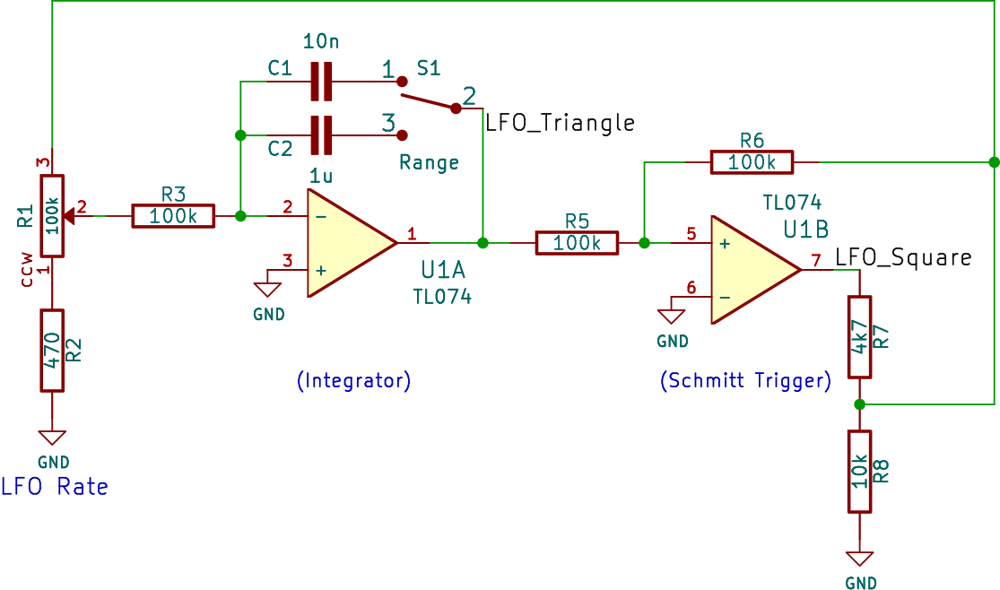
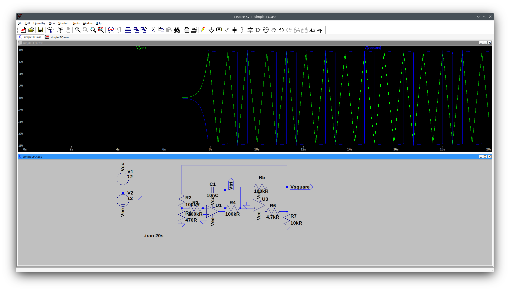
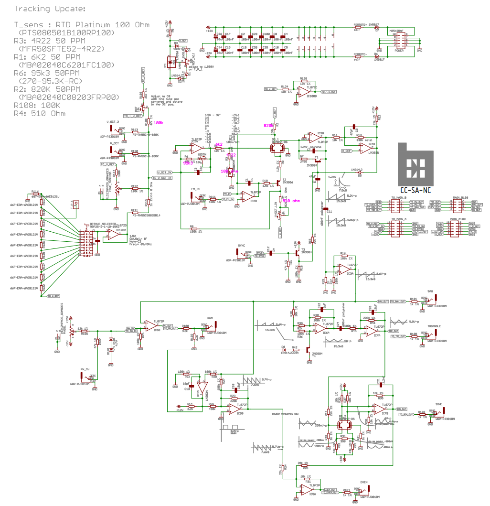
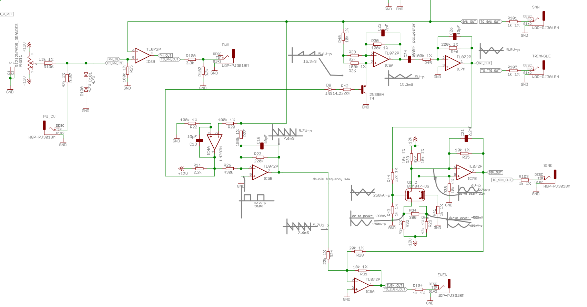

== Der Oszillator (bzw. die Oszillatoren) – was er ist und wie er hinter den Kulissen funktioniert...

Mit Ausnahme von Rauschen benötigt jeder Synthesizer eine Schwingungsschaltung – besser bekannt als Oszillator.
Es gibt zahlreiche Schaltungen, die diese Aufgabe erfüllen, aber wir wollen uns zunächst mit dem Niederfrequenz-Oszillator befassen, besser bekannt
als LFO...

== Ein einfacher (LF)O

Man kann sich diese Schaltung wie einen rasanten Wechselvorgang zwischen zwei Stufen des Operationsverstärkers vorstellen. Es ist eine selbsterhaltende Schleife, bei der die Abschnitte kontinuierlich aufeinander reagieren, um das Signal in Schwingung zu halten.

Der Prozess beginnt mit dem **Integrator**. Stellen Sie sich diesen als einen Erzeuger gleichmäßiger Rampen vor. Wenn er eine feste Spannung von der
nächsten Stufe erhält, beginnt er, einen Kondensator aufzuladen. Da die Aufladung mit konstanter Rate erfolgt, springt die Ausgangsspannung nicht einfach;
sie steigt oder fällt in einer perfekt geraden Linie und erzeugt so jene glatte **Dreieckwelle**, die wir zur Modulation verwenden.
Der „Rate“-Regler fungiert hier im Wesentlichen als Ventil – er steuert, wie viel Strom in diesen Kondensator fließt, was wiederum bestimmt, wie
steil die Rampe ist und somit, wie schnell der LFO zyklisch arbeitet.

Diese Rampe wird vom **Schmitt-Trigger** überwacht. Dieser Teil der Schaltung ist im Wesentlichen ein „Entscheidungsträger“ mit zwei spezifischen
Umschaltpunkten. Er wartet darauf, dass die Dreieckwelle eine bestimmte Höhe erreicht. In dem Moment, in dem die Rampe die obere Schwelle erreicht,
„springt“ der Ausgang des Schmitt-Triggers in den High-Zustand. Umgekehrt springt er zurück in den Low-Zustand, sobald die Rampe auf die untere Schwelle fällt.
Dieses plötzliche Umschalten liefert uns den **Rechteckwellen-**Ausgang.

Die „Oszillation“ entsteht, weil diese beiden Bauteile in einer Rückkopplungsschleife verbunden sind. Wenn der Schmitt-Trigger auf „High“ springt, sendet er
diese hohe Spannung zurück an den Eingang des Integrators. Der Integrator erkennt diesen „High“-Zustand und beginnt sofort, seinen Ausgang *abwärts* abfallen zu lassen.
Er gleitet so lange abwärts, bis er die untere Grenze des Schmitt-Triggers erreicht, wodurch der Trigger auf „Low“ umschaltet.
Nun erkennt der Integrator diesen „Low“-Zustand und beginnt wieder, *aufwärts* anzusteigen.

Im Grunde jagen sie sich gegenseitig endlos hinterher. Um sicherzustellen, dass die Schaltung stabil bleibt, hat David Haillant ganz am Ende eine **Puffer**-Stufe
eingefügt. Diese wirkt wie ein Einwegspiegel: Sie lässt die Dreieck- und Rechteckwellen zu deinen anderen Synth-Modulen durch, verhindert aber,
dass diese Module an der Kernschaltung „zerren“ und die Frequenz oder Wellenform verfälschen. Schließlich kümmert sich ein separater Teil des Chips
um die LED und stellt sicher, dass die Stromaufnahme des blinkenden Lichts keine winzigen Schwankungen in Ihrem eigentlichen Audiosignal verursacht.

link:./simpleLFO.asc[Hier ist also meine Interpretation der einfachen LFO-Schaltung].

Und hier ist die grafische Darstellung der Schaltung.

== Der BEFACO evenVCO

Nachdem wir uns den einfachen LFO angesehen haben, wollen wir nun einen Blick auf eine komplexere Schaltung werfen: den Befaco evenVCO – zur Veranschaulichung finden Sie unten den vollständigen Schaltplan:

Wir werfen einen genaueren Blick auf einen Ausschnitt dieser Schaltung:

Der Befaco EvenVCO ist ein ziemlich cleveres Gerät, denn im Gegensatz zu vielen Oszillatoren, die mit einer Dreieckwelle beginnen, ist dieser
von Haus aus ein **Rampen-/Sägezahn**-Oszillator. Das bedeutet, dass der „Waveshaper“-Bereich einige anspruchsvolle Kunststücke vollbringen muss, um
dir diese weichen Sinus- und Dreieckwellen zu liefern.

Der Kern der Formung besteht darin, diese rohe Rampenwelle zu nehmen und sie durch bestimmte Transistor- und Operationsverstärker-Stufen
zu falten oder zu filtern. Um die **Dreieckwelle** zu erhalten, „faltet“ die Schaltung die Rampenwelle im Wesentlichen. Stell dir vor, du nimmst die diagonale Linie einer Sägezahnwelle
und spiegelst deren zweite Hälfte; mithilfe eines Fensterkomparators und eines Inverters dreht die Schaltung die fallende Flanke der
Rampenwelle wieder nach oben. Es ist wie ein Falttrick mit Papier – sobald man diese diagonale Linie über sich selbst faltet, bleibt die symmetrische
„V“-Form einer Dreieckwelle übrig.

Sobald man diese Dreieckwelle hat, übernimmt der **Sinus-Shaper**. Dabei handelt es sich in der Regel um eine „Soft-Clipping“-Stufe. Wenn man eine Dreieckwelle
in ein Transistorpaar (oft ein Differentialpaar) oder ein spezielles Diodennetzwerk einspeist, beginnt die Schaltung, die
scharfen Spitzen „abzurunden“. Es ist ein bisschen so, als würde man eine Holzpyramide mit Schleifpapier bearbeiten; während man die scharfe Spitze und die kantigen
Ecken am unteren Ende abschleift, verwandeln sich die linearen Steigungen in den glatten, mathematischen Bogen einer Sinuswelle.

Der „Even“-Ausgang – Namensgeber des Moduls – ist ein einzigartiger Formungstrick. Er erzeugt ein Signal, das hauptsächlich aus
**geraden Obertönen** besteht, was ihm einen äußerst charakteristischen, fast stimmartigen oder „hohlen“ Klangcharakter verleiht

Übersetzt mit DeepL.com (kostenlose Version)