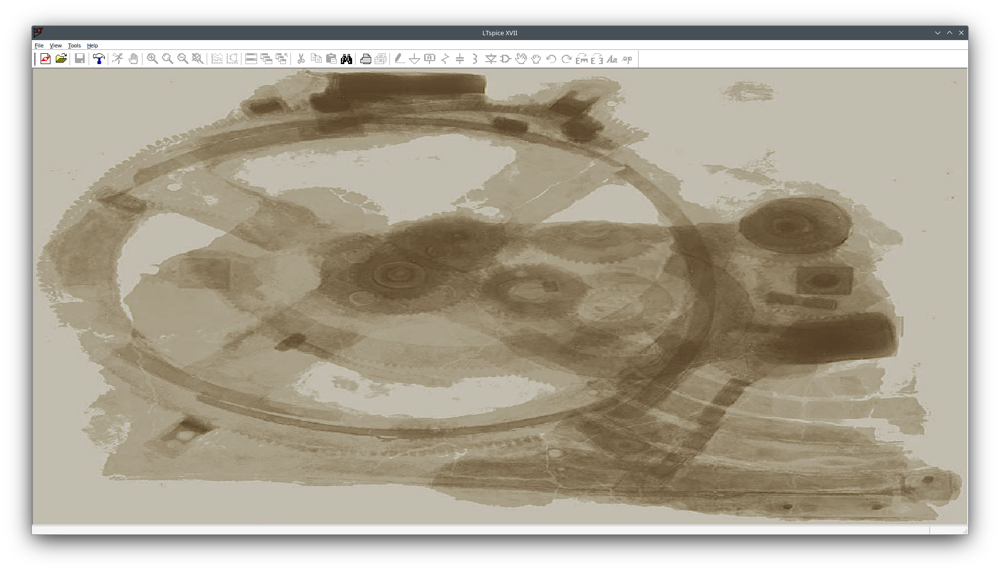
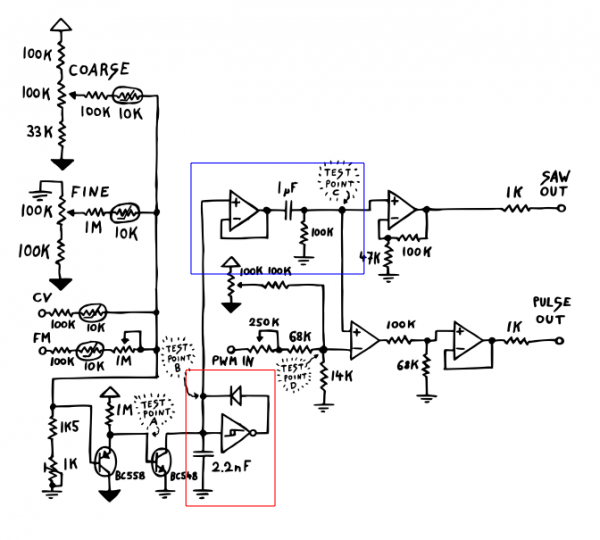
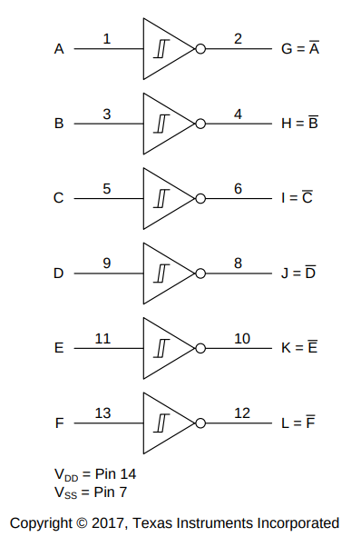
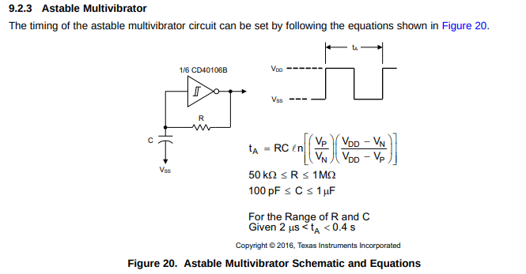
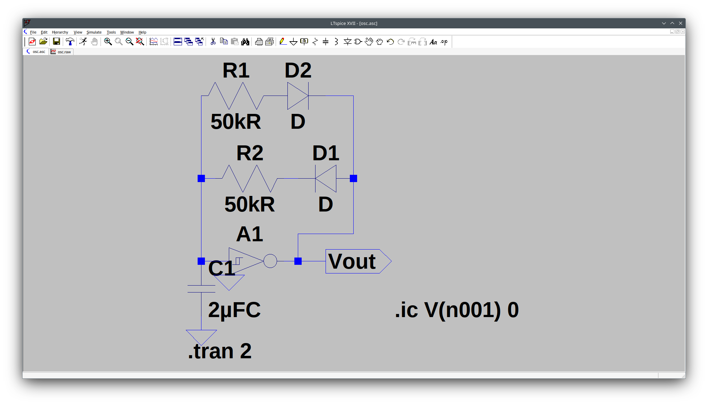
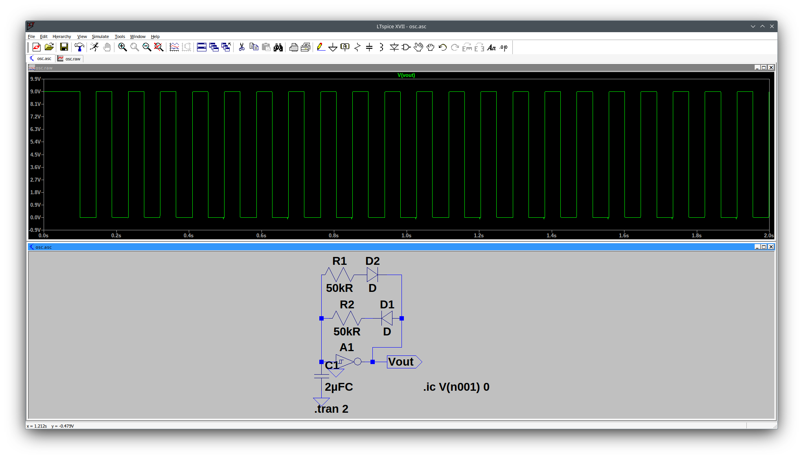

Hallo zusammen,

heute möchte ich ein Thema beginnen, das ich schon länger im Kopf hatte und nun endlich angegangen bin.

Wir wollen einen einfachen LFO simulieren (oder einen normalen Oszillator, je nach gewählter Dimensionierung). Dafür
verwenden wir das recht bekannte Werkzeug https://www.analog.com/en/resources/design-tools-and-calculators/ltspice-simulator.html[LTspice],
das dank https://www.winehq.org/[Wine] (das kein Emulator ist) erfreulicherweise auch unter Linux läuft.

Eine einfache Anleitung für den Einstieg finden Sie https://github.com/joaocarvalhoopen/LTSpice_on_Linux_Ubuntu__How_to_install_and_use[hier].

Nach der Installation geben wir in der Shell einfach Folgendes ein (oder kopieren es):

----
# LTspice über Wine starten
wine ~/.wine/drive_c/Program\ Files/LTC/LTspiceXVII/XVIIx64.exe
----

Wir beginnen mit einem Oszillator auf Basis eines Schmitt-Triggers und nutzen dazu einen 40106-IC mit sechs invertierenden Schmitt-Triggern.

Er basiert auf dem VCO-Schaltplan von Erica Synths, siehe unten.

Darunter der Schaltplan aus dem Datenblatt:

Weitere Details finden Sie im Datenblatt:

https://www.ti.com/lit/ds/symlink/cd40106b.pdf[Datenblatt]

Entscheidend ist hier der folgende Anwendungsfall als astabiler Multivibrator:

Wir ergänzen die Schaltung um zwei antiparallele Dioden. Damit lassen sich für Puls und Pause unterschiedliche Zeiten einstellen.

Vergessen Sie nicht, Werte für den Schmitt-Trigger festzulegen. Sonst verhält er sich nicht wie gewünscht, sondern wie ein ideales Bauteil.
Klicken Sie dazu mit der rechten Maustaste auf den Schmitt-Trigger und tragen Sie unter „Value“ Folgendes ein: Vhigh=9 Vt=4.45 Vh=.85 Trise=.1u Tfall=.1u

Nachdem wir die Schaltung Stück für Stück aufgebaut haben, kommen wir zur Simulation. Dafür müssen wir eine Anfangsbedingung (.ic) setzen. Der vollständige
SPICE-Befehl lautet:

----
.ic V(n001) 0
----

Außerdem müssen wir die Transientenanalyse einstellen, also wie lange die Simulation laufen soll:

----
.tran 2s
----

Eine fertige Version des Oszillators zum Herunterladen:

link:./osc.asc[osc.asc]

Damit können wir den Simulator starten:

Als Nächstes können wir die Widerstandswerte verändern und feststellen, dass sie das Puls-Pausen-Verhältnis bestimmen.

Denken Sie daran, dass Sie in einer realen Schaltung einen Operationsverstärker als Spannungsfolger bzw. Impedanzwandler benötigen,
wie im Schaltplan blau skizziert, damit der Ausgang mit der nächsten Stufe belastet werden kann.
Zu guter Letzt befindet sich am Ende ein RC-Glied, ein Hochpass erster Ordnung...

Das war es für heute, bis bald in weiteren Artikeln.
