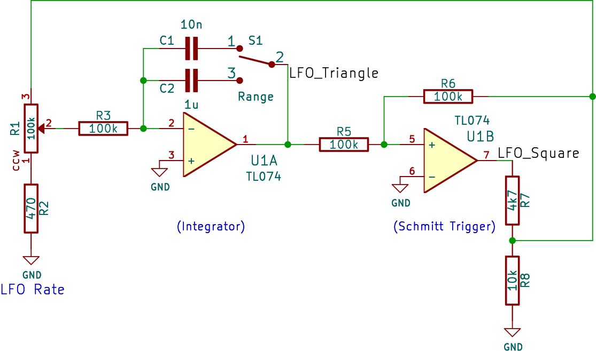
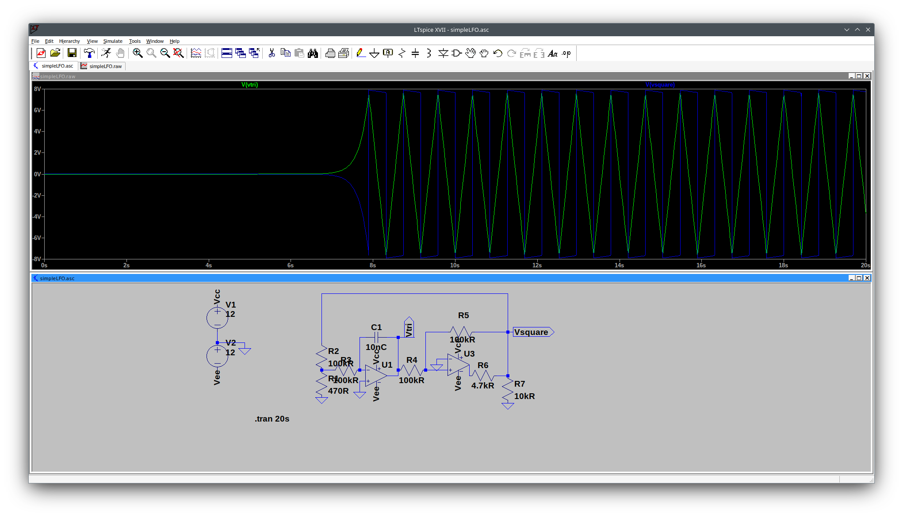

Hallo zusammen,

heute möchte ich mit Ihnen den
https://www.davidhaillant.com/category/electronic-projects/simple/simple-lfo/[einfachen LFO von David Haillant] besprechen.

Es war das allererste Modul, mit dem ich in die Welt des Selbstbaus eingetaucht bin.

Recht einfach und für den Einstieg nicht zu kompliziert...

Wenn Sie vor mathematisch tiefgehenden Erklärungen nicht zurückschrecken (ich tue das manchmal),
finden Sie die Details https://www.electronics-tutorials.ws/opamp/opamp_6.html[hier (Integrator)]
und hier (Schmitt-Trigger).

Einen tieferen Einstieg aus Elektronik-Sicht gibt es
https://service.projektlabor.tu-berlin.de/wordpress/wp-content/uploads/sites/19/2017/05/Dreiecksgenerator_Marten_Folien.pdf[hier].

link:./simpleLFO.asc[Hier ist meine Umsetzung der Simple-LFO-Schaltung].

Und hier die grafische Darstellung der Schaltung:

Zu guter Letzt die https://www.davidhaillant.com/wp/wp-content/uploads/lfo-with-pot-20160207.asc[Originaldateien von David Haillant]
und https://www.davidhaillant.com/wp/wp-content/uploads/pot.zip[hier das Potentiometer].
