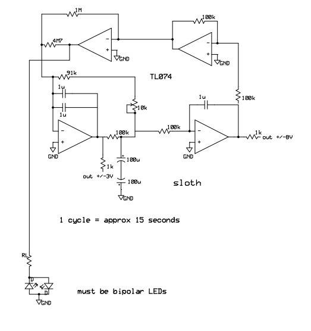
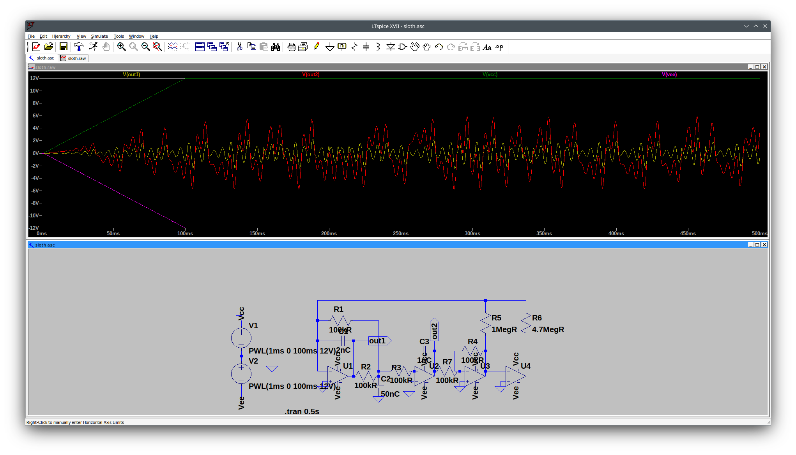

Hallo zusammen,

heute setze ich die Reihe über die Simulation von Synthesizer-Modulen mit LTspice fort.

Wir wollen das https://www.nonlinearcircuits.com/modules/p/4hp-sloth-chaos[Sloth-Modul von NLC] analysieren.

Beginnen wir mit dem Schaltplan:

Direkt darunter sehen Sie eine Nachbildung des Schaltplans in LTspice, allerdings ohne das bzw. die Potentiometer.

Wichtig ist hier, dass wir beim vierten Operationsverstärker eine Offsetspannung
von 1 µV hinzufügen mussten, damit er funktioniert.
Außerdem müssen wir das Einschalten der Versorgungsspannung simulieren. Dazu geben wir die Spannungsquelle
als stückweise lineare Funktion (PWL) mit den Wertepaaren (t0, v0, t1, v1) an, hier 1 ms 0 V 100 ms 12 V.

Hier die Datei zum Ausprobieren:

link:./sloth.asc[sloth.asc]

Das war es für heute, bis zum nächsten Blogbeitrag.
