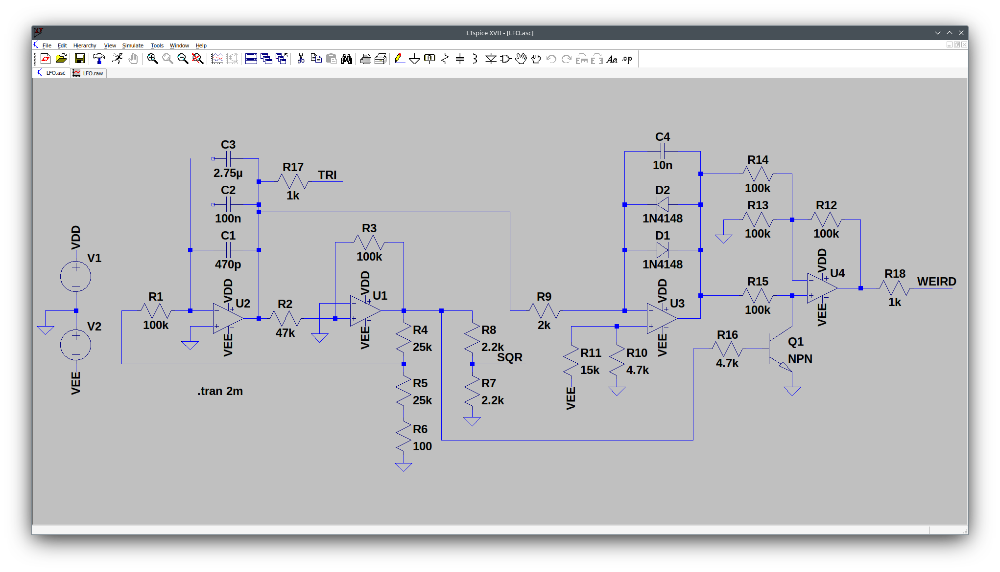
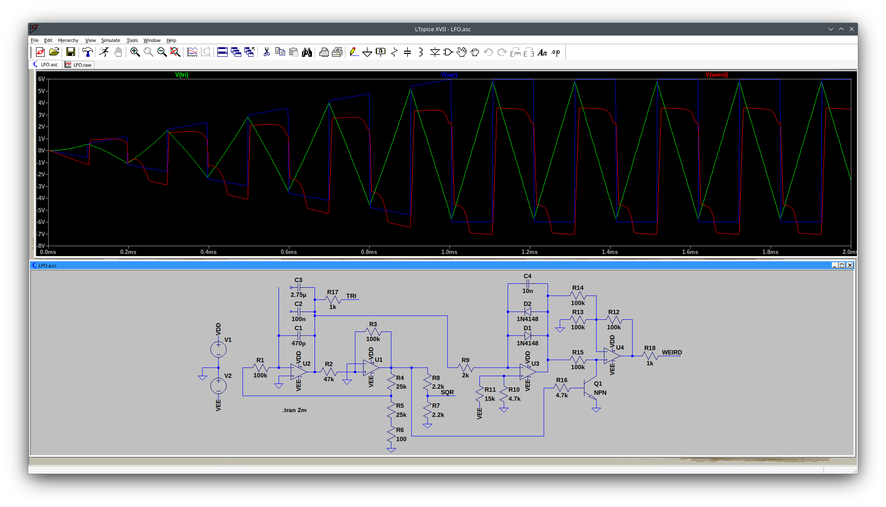

Hallo zusammen,

heute setze ich die Reihe über die Simulation von Synthesizer-Modulen mit LTspice fort.

Wir beginnen mit einem Modul von Etsy, das wir zerlegen und per Reverse Engineering nachvollziehen, damit
wir es mit Verpolungsschutzdioden nachbauen können...

Wir wollen https://www.etsy.com/de-en/listing/983875302/lfo-eurorack-module-full-kit[dieses Modul] analysieren.

Beginnen wir mit den Platinen:

[cols="2"]
|===
a| image::./lfo_front.jpg[Platine Vorderseite]
a| image::./lfo_back.jpg[Platine Rückseite]
|===

Zunächst wollen wir beide Seiten der Platine per Reverse Engineering erfassen, um eine neue Platine zu entwerfen, diesmal mit
Verpolungsschutzdioden, und zwar nach dem Schaltplan in LTspice. Hier ist auch der Download-Link für die LTspice-Datei:

link:./LFO.asc[LTspice-Datei]

Zuallererst der Link zu https://www.modwiggler.com/forum/viewtopic.php?t=292778[diesem Beitrag im ModWiggler-Forum], der mir geholfen hat, diese Idee umzusetzen und meine nachgebaute Schaltung zu prüfen.
Ohne https://www.modwiggler.com/forum/memberlist.php?mode=viewprofile&u=3566a[Synthiq] hätte ich es nicht geschafft.

[cols="2"]
|===
a| image::./kicad_lfo_front.png[Platine Vorderseite]
a| image::./kicad_lfo_back.png[Platine Rückseite]
|===

(Fortsetzung folgt, sobald die bestellten Platinen da sind.)

Und hier die Stückliste (BoM):
----
"Reference","Value","Footprint","Datasheet","Qty","DNP","Exclude from BOM","Exclude from Board"
"C1,C4","100nFC","Capacitor_THT:C_Disc_D4.7mm_W2.5mm_P5.00mm","~","2","","",""
"C2,C5","2.2µFC_Polarized","Capacitor_THT:CP_Radial_D5.0mm_P2.00mm","~","2","","",""
"C3,C7","10µFC_Polarized","Capacitor_THT:CP_Radial_D5.0mm_P2.00mm","~","2","","",""
"C8","470pFC","Capacitor_THT:C_Disc_D9.0mm_W2.5mm_P5.00mm","~","1","","",""
"D1","1N4148","Diode_THT:D_DO-41_SOD81_P2.54mm_Vertical_AnodeUp","https://assets.nexperia.com/documents/data-sheet/1N4148_1N4448.pdf","1","","",""
"D2","LED","LED_THT:LED_D5.0mm","~","1","","",""
"D3","1N5817","Diode_THT:D_DO-201AD_P3.81mm_Vertical_AnodeUp","http://www.vishay.com/docs/88525/1n5817.pdf","1","","",""
"D4","1N5817","Diode_THT:D_DO-41_SOD81_P10.16mm_Horizontal","http://www.vishay.com/docs/88525/1n5817.pdf","1","","",""
"J1","PJ398SM-12 (Tri)","Connector_Audio:Jack_3.5mm_QingPu_WQP-PJ398SM_Vertical_CircularHoles","","1","","",""
"J2","PJ398SM-12 (square)","Connector_Audio:Jack_3.5mm_QingPu_WQP-PJ398SM_Vertical_CircularHoles","","1","","",""
"J3","PJ398SM-12 (weird)","Connector_Audio:Jack_3.5mm_QingPu_WQP-PJ398SM_Vertical_CircularHoles","","1","","",""
"J4","Conn_02x05_Odd_Even","Connector_PinSocket_2.54mm:PinSocket_2x05_P2.54mm_Vertical","~","1","","",""
"Q1","BC547","Package_TO_SOT_THT:TO-92_Inline","https://www.onsemi.com/pub/Collateral/BC550-D.pdf","1","","",""
"R1","100R","Resistor_THT:R_Axial_DIN0204_L3.6mm_D1.6mm_P5.08mm_Horizontal","~","1","","",""
"R2,R4,R7","2.2kR","Resistor_THT:R_Axial_DIN0204_L3.6mm_D1.6mm_P5.08mm_Horizontal","~","3","","",""
"R3,R5","4.7kR","Resistor_THT:R_Axial_DIN0204_L3.6mm_D1.6mm_P5.08mm_Horizontal","~","2","","",""
"R6,R9","1kR","Resistor_THT:R_Axial_DIN0204_L3.6mm_D1.6mm_P5.08mm_Horizontal","~","2","","",""
"R8","15kR","Resistor_THT:R_Axial_DIN0204_L3.6mm_D1.6mm_P5.08mm_Horizontal","~","1","","",""
"R10,R11,R14,R15,R16","100kR","Resistor_THT:R_Axial_DIN0204_L3.6mm_D1.6mm_P5.08mm_Horizontal","~","5","","",""
"R12","47kR","Resistor_THT:R_Axial_DIN0204_L3.6mm_D1.6mm_P5.08mm_Horizontal","~","1","","",""
"R13","100kR","Resistor_THT:R_Axial_DIN0204_L3.6mm_D1.6mm_P2.54mm_Vertical","~","1","","",""
"RV1","R_Potentiometer","Potentiometer_THT:Potentiometer_Alpha_RD901F-40-00D_Single_Vertical","~","1","","",""
"SW1","SW_SPDT","100SP1T1B4M2QE:SW_100SP1T1B4M2QE","~","1","","",""
"U1","TL084","Package_DIP:DIP-14_W7.62mm_Socket_LongPads","http://www.ti.com/lit/ds/symlink/tl081.pdf","1","","",""
----

