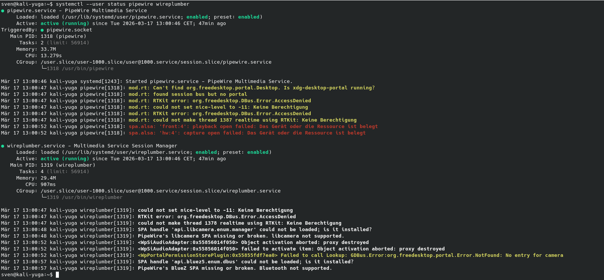

== Bildschirmfreigabe in Zoom, Google Meet oder Discord funktioniert nicht – und wie man das löst

Wenn Sie **Debian 12 (Bookworm)** oder eine ähnlich moderne Linux-Distribution verwenden, kennen Sie vielleicht dieses ärgerliche Problem: Sie wollen Ihren Bildschirm im Browser oder in einer Kommunikations-App freigeben, und nichts passiert – oder Sie erhalten eine kryptische Fehlermeldung wie `Failed to connect PipeWire context`.

Die Ursache ist meist eine fehlende Verbindung zwischen Ihrer Desktop-Sitzung und dem Multimedia-Framework **PipeWire**.

=== Das Problem: Warum es scheitert
Moderne Linux-Desktops verwenden aus Sicherheitsgründen **Wayland**, das für die Bildschirmfreigabe ein sogenanntes „Portal“ benötigt. Wenn der PipeWire-Dienst oder der Sitzungsmanager (**WirePlumber**) in Ihrer Benutzersitzung nicht richtig läuft, kann das Portal Ihren Monitor nicht „sehen“.

Der häufigste Fehler? Der Versuch, das Problem als `root` zu beheben. PipeWire ist ein **Dienst auf Benutzerebene** und muss von Ihrem normalen Benutzerkonto aus verwaltet werden.

=== Die Lösung: Die Verbindungen wiederherstellen

Mit den folgenden Schritten setzen Sie Ihren PipeWire-Stack zurück. **Wichtig:** Verwenden Sie für diese Befehle kein `sudo`!

. **Zu Ihrem normalen Benutzer wechseln**
Achten Sie darauf, dass Ihre Eingabeaufforderung Ihren Benutzernamen zeigt (z. B. `sven@kali-yuga:~$`) und nicht `root#`.

. **Dienste neu laden und aktivieren**
Führen Sie die folgenden Befehle aus, damit die Dienste bei jeder Anmeldung automatisch starten:

[source,bash]
----
systemctl --user daemon-reload
systemctl --user enable --now pipewire pipewire-pulse wireplumber
----

. **Den Sitzungsmanager neu starten**
Wenn es immer noch hakt, erzwingen Sie einen Neustart der Komponenten:

[source,bash]
----
systemctl --user restart pipewire pipewire-pulse wireplumber
----

=== Fehlerbehebung: Der „Bus“-Fehler
Wenn Sie `Failed to connect to bus: Operation not permitted` sehen, versuchen Sie die Befehle wahrscheinlich noch als `root` auszuführen. Verlassen Sie die Root-Shell und versuchen Sie es erneut als normaler Benutzer.

=== Dauerhaft wirksam
Durch die Option `enable` bleiben diese Einstellungen auch nach einem Neustart erhalten. Die Bildschirmfreigabe sollte jetzt in Zoom, Discord und Google Meet problemlos funktionieren.

[TIP]
====
Wenn Sie einen Chromium-basierten Browser verwenden, rufen Sie `chrome://flags/#enable-webrtc-pipewire-capturer` auf und setzen Sie die Option auf **Enabled**, um das beste Ergebnis zu erzielen.
====

---

Den Status können Sie mit folgendem Befehl prüfen. Die Ausgabe sollte ungefähr so aussehen wie unten (grün = aktiv):

[source,bash]
----
systemctl --user status pipewire pipewire-pulse wireplumber
----

