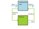
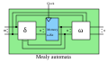
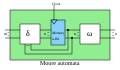
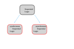



== Sequential Logic

Complementary to Combinatorial logic, sequential logic contains some type of memory,
making the behaviour state-dependent. We need to feed it a clock signal.

=== Mealy and Moore Automata (synchronous)
There are two different types of finite automata in the digital logic.
Those are:

. The mealy automata, which is dependent on the input and the state
. The moore automata, which is only dependent on the state

=== Synchronous and Asynchronous sequential Logic

There are two different types of sequential logic: synchronous sequential logic,
where all storage elements are controlled by one common clock, and asynchronous logic,
which works without any clock and reacts immediately to changes at its inputs.

When we add a clock to the automaton shown above, the asynchronous automaton becomes
a synchronous one. How such automata are designed is shown in the chapter about
link:/pages/14_automata/[finite state machines].