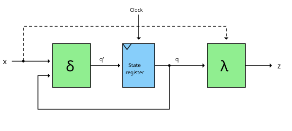
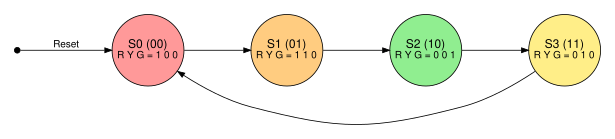
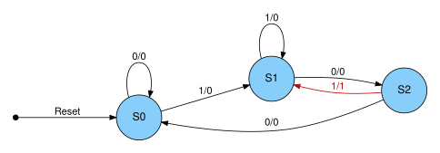
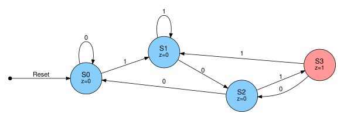



== Finite State Machines

In the link:/pages/11_sequential_logic/[post about sequential logic] we already briefly met
the Mealy and the Moore automata. In the link:/pages/12_clocks_and_registers/[last post] we then
got to know the building blocks we need to actually build them: flip-flops and registers.
In this post the author wants to put both together and show how a finite state machine
(FSM) is designed - from the idea, over the state diagram, down to the circuit.

Why do we need this? Because state machines are everywhere: in every traffic light,
in every vending machine, in every protocol like UART or SPI - and, as we will see at the end,
in the control unit of a CPU.

=== What is a finite state machine?

A finite state machine is a circuit which can be in exactly one of a finite number of *states*
at any point in time. It consists of:

. a set of states, one of them being the *start state*
. the *inputs* x
. the *outputs* z
. the *next-state function* δ, which determines the next state from the current state and the inputs
. the *output function* λ, which determines the outputs

In hardware, this looks as follows:

The green blocks are combinational logic, as we know it from part 1. The blue block is
the state register, built from D-flipflops, as described in the last post. With every clock edge
the register takes over the next state q' calculated by δ. The current state q is fed back
to δ - this feedback is what gives the circuit its memory.

The dashed connection from the input x directly to the output logic λ only exists
in Mealy machines. This brings us to the difference between the two types.

=== Mealy vs. Moore

[cols="a,a,a" width="100%"]
|===
| | *Moore machine* | *Mealy machine*
| output depends on | the current state only | the current state *and* the inputs
| output function | \(z = \lambda(q)\) | \(z = \lambda(q, x)\)
| reaction to an input | one clock cycle later | immediately, in the same clock cycle
| output stable during the clock cycle | yes | no - changes as soon as the input changes
| number of states | usually more | usually fewer
|===

The Moore machine is the more robust variant: its outputs only change with the clock edge
and are stable for a whole clock cycle. The Mealy machine reacts faster and often needs fewer
states, but its outputs can produce short spikes (glitches), if the inputs change in the middle
of a clock cycle.

A special case of the Moore machine is the *Medvedev machine*: here the outputs are directly
the outputs of the state register, the output function λ is omitted completely.
A synchronous counter, whose outputs are simply its counter bits, is such a Medvedev machine.

=== From the idea to the circuit

The design of a state machine always follows the same steps:

. describe the behaviour and draw the *state diagram*
. derive the *state table* from the diagram
. choose a *state encoding*, i.e. assign a bit pattern to every state
. derive the *boolean equations* for the next state and the outputs
. implement the equations with gates and D-flipflops

The steps 4 and 5 are exactly what we did in part 1 with
link:/pages/01_boolean_algebra/[boolean algebra]. Let's see this using an example.

=== Example 1: A traffic light (Moore)

A German traffic light cycles through four phases: red, red-yellow, green, yellow - and then back to red.
Each phase becomes a state, the three lamps red (R), yellow (Y) and green (G) are the outputs.
Since the lamps only depend on the current phase, this is a classical Moore machine.

With four states we need two flipflops \(Q_1 Q_0\). We number the states in their order as binary numbers:

[width="70%"]
|===
| State | Phase | \(Q_1 Q_0\) | Next state \(Q_1' Q_0'\) | R | Y | G
| S0 | red | 00 | 01 | 1 | 0 | 0
| S1 | red-yellow | 01 | 10 | 1 | 1 | 0
| S2 | green | 10 | 11 | 0 | 0 | 1
| S3 | yellow | 11 | 00 | 0 | 1 | 0
|===

==== The next state

Looking at the columns \(Q_1 Q_0\) and \(Q_1' Q_0'\), we see that the machine simply counts upwards:
00, 01, 10, 11, 00, ... The equations are:

\[Q_0' = \overline{Q_0}\]

\[Q_1' = Q_1 \oplus Q_0\]

So we need just one inverter and one link:/pages/02_xor/[XOR gate]. In contrast to the
asynchronous counter of the last post, here both flipflops are clocked by the same clock signal -
this is a *synchronous* counter.

==== The outputs

The output equations can be read directly from the table:

\[R = \overline{Q_1}\]

\[Y = Q_0\]

\[G = Q_1 \cdot \overline{Q_0}\]

Red is on in both states with \(Q_1 = 0\), yellow in both states with \(Q_0 = 1\), and green only in state S2.
The whole traffic light therefore consists of two D-flipflops, two inverters, one XOR and one AND gate.

The well-chosen encoding is no coincidence: with another assignment of bit patterns to the states
the equations would become longer. The choice of the state encoding has a direct influence on the size of the circuit.

NOTE: Real traffic lights stay in the green phase much longer than in the red-yellow phase.
For this, the machine gets an additional input T (time elapsed) from a timer: as long as T = 0,
the machine stays in its current state. In hardware this is a multiplexer in front of each flipflop,
which chooses between the current state q and the next state q'.

=== Example 2: A sequence detector (Mealy and Moore)

The difference between Mealy and Moore can best be seen with a second example.
Our machine receives one bit x per clock cycle and should output z = 1, whenever the bit sequence *101*
has been received. Overlapping sequences count too: the input 10101 contains the sequence twice.

==== As a Mealy machine

We need three states: S0 (nothing useful received yet), S1 (last bit was a 1) and S2 (last bits were 10).
The edges are labelled with input/output:

[width="70%"]
|===
| State | x = 0 | x = 1
| S0 | S0 / 0 | S1 / 0
| S1 | S2 / 0 | S1 / 0
| S2 | S0 / 0 | S1 / *1*
|===

If the machine is in state S2 and receives a 1, the output is 1 - in the same clock cycle.
The machine then jumps to S1, since the final 1 can already be the beginning of the next sequence.

==== As a Moore machine

Since the output of a Moore machine may only depend on the state, we need an additional state S3,
which means "101 received". The output is written in the states:

[width="70%"]
|===
| State | x = 0 | x = 1 | z
| S0 | S0 | S1 | 0
| S1 | S2 | S1 | 0
| S2 | S0 | S3 | 0
| S3 | S2 | S1 | *1*
|===

So the Moore machine needs one state more, and its output only reacts one clock cycle later -
but for that it is stable for a full clock cycle.

=== State encoding

In the traffic light example we simply numbered the states as binary numbers. There are other variants:

[width="100%"]
|===
| Encoding | Example for 4 states | Flipflops for n states | Properties
| binary | 00, 01, 10, 11 | \(\lceil \log_2 n \rceil\) | fewest flipflops
| gray code | 00, 01, 11, 10 | \(\lceil \log_2 n \rceil\) | only one bit changes per transition
| one-hot | 0001, 0010, 0100, 1000 | n | simple logic, popular in FPGAs
|===

With one-hot encoding exactly one flipflop is set per state. This needs more flipflops,
but the logic for the next state and the outputs often becomes very simple. Since FPGAs have plenty of flipflops,
synthesis tools often choose this encoding automatically.

=== Pitfalls

There are a few things to watch out for:

. *Reset:* After switching on, the flipflops contain random values. A reset signal is needed,
  which puts the machine into a defined start state.
. *Unused states:* The Mealy sequence detector has three states, but two flipflops can store four.
  The unused pattern 11 must lead back to a valid state - otherwise the machine might get stuck there forever.
. *Asynchronous inputs:* If an input (e.g. a push button) is not synchronized to the clock,
  it can change just at the clock edge and put the flipflop into an undefined (metastable) state.
  The remedy is a synchronizer consisting of two flipflops in series in front of the machine.

=== Outlook: The control unit as a state machine

In the following page link:/pages/15_risc_v/[RISC-V post] we will see that every instruction passes through the phases
fetch, decode, execute, memory access and write back. In a *multi-cycle CPU*, which uses one clock cycle per phase,
the control unit is exactly such a state machine: every phase is a state, and the outputs are the control signals
for multiplexers, ALU, register file and memory. The opcode of the instruction is the input which determines,
which state follows.

In our first CPU we take the simpler path: in a single-cycle CPU all phases are executed in one clock cycle,
and the control unit becomes pure combinational logic. We will look at this in the next post.

Further reading: David Money Harris and Sarah L. Harris, 'Digital Design and Computer Architecture - RISC-V Edition',
chapter 3, covers state machines in detail.

(Created by Claude AI)