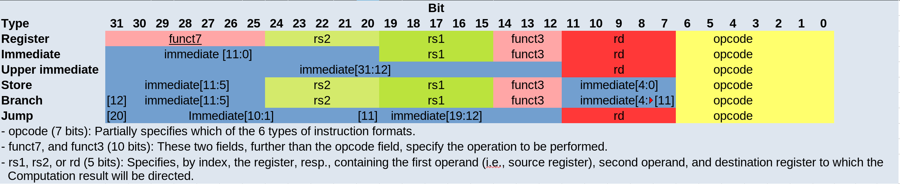
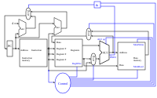



== Digital design meets computer architecture

So far we have looked at the individual building blocks of a processor: logic gates,
adders and the ALU in part 1, and flip-flops, registers and memory in part 2.
In this chapter we combine these building blocks into a simple CPU.
Before we can do that, we have to decide *which* instructions this CPU should understand at all.
This decision is called the **instruction set architecture** (ISA).
It is the interface between software and hardware: the programmer (or compiler)
only sees the instructions, and the hardware has to be able to execute them.

== RISC vs. CISC and the RISC-V architecture

Processors can roughly be divided into two groups by their instruction set:
reduced instruction set computers (RISC) and complex instruction set computers (CISC).
Typical RISC architectures are ARM and RISC-V, which are widespread especially in embedded systems
and mobile devices. The x86 architecture (x86, x86_64) of today's PCs and servers, on the other hand, is a CISC architecture;
modern x86 processors, however, internally break their complex instructions down into simpler, RISC-like micro-operations.

The idea of a reduced instruction set is to avoid big, complex instructions and many different
addressing modes (as typically found in x86). Instead:

* All instructions have the same length (32 bits for RISC-V).
* Only dedicated load and store instructions access memory; all arithmetic instructions work
  on registers only. This is known as a **load/store architecture**.
* The instruction formats are simple and regular.

This makes instructions easy to decode, and their execution can be split into uniform steps –
an important prerequisite for pipelining and high clock rates.
Every instruction passes through the same phases:
'Instruction fetch -> Decode and register read -> Execute -> Memory access -> Write back'.

RISC-V is an open, royalty-free standard for such an instruction set architecture.
Most of this post is based on the book
'Computer Organization and Design – RISC-V Edition: The Hardware/Software Interface'
by David A. Patterson and John L. Hennessy.

== RISC-V assembler

Here we introduce the RISC-V assembler.
The subset shown here is a bit bigger than the one we will implement further down the line.
For example, we use the immediate instruction `addi`, which lets us load constants into registers.

The following example program counts from 0 to 10 in a loop and writes the current counter value
to data memory (at address 4) after each step:

----
        addi x1, x0, 0       # x1 = 0   (counter)
        addi x2, x0, 1       # x2 = 1   (step)
        addi x3, x0, 10      # x3 = 10  (end value)

loop:
        add  x1, x1, x2      # x1 = x1 + x2
        sw   x1, 4(x0)       # memory[x0 + 4] = x1
        bne  x1, x3, loop    # while x1 != x3: jump to loop

done:
        j    done            # endless loop: the program is finished
----

A few remarks:

* In RISC-V, register `x0` is hard-wired to the value 0. So `addi x2, x0, 1` simply means
  "load the constant 1 into x2".
* `bne` (branch if not equal) is the counterpart of `beq` (branch if equal). Our minimal
  implementation only supports `beq`, but it could be extended to `bne` with little effort.
* RISC-V has no instruction to halt the processor (like `HLT` on x86). A program ends
  either with a system call (`ecall`), with `ebreak` (handing control to a debugger) or – as here –
  with an endless loop. `j done` is a so-called pseudo-instruction, which the assembler translates into `jal x0, done`.

If you want to try the program yourself, you can use a RISC-V simulator such as Ripes, RARS or Venus.
Ripes even shows the data path we discuss further below.

The instructions we use follow these formats:

[options="header"]
|==================
| Type | Notation | Example | Meaning
| Register (R-type) | `instr rd, rs1, rs2` | `add x1, x1, x2` | rd = rs1 + rs2
| Immediate (I-type) | `instr rd, rs1, imm` | `addi x2, x0, 1` | rd = rs1 + imm
| Load (I-type) | `lw rd, offset(rs1)` | `lw x5, 8(x6)` | rd = memory[rs1 + offset]
| Store (S-type) | `sw rs2, offset(rs1)` | `sw x1, 4(x0)` | memory[rs1 + offset] = rs2
| Branch (B-type) | `instr rs1, rs2, label` | `beq x1, x3, loop` | if rs1 = rs2: jump to label
|==================

Here `rd` stands for the destination register, `rs1` and `rs2` for the source registers
and `imm` for a constant value encoded directly in the instruction (immediate).
Store and branch instructions have no destination register: they write to memory or change the program counter, respectively.

For load and store instructions, `rs1` holds a base address. The offset is a displacement in bytes
that is added to this base address; the sum is the memory address being accessed.
The size of the value read or written, on the other hand, is determined by the instruction itself:
`lw`/`sw` (load/store word) transfer a 32-bit word, i.e. 4 bytes; for single bytes or half-words
there are separate instructions such as `lb`/`sb` and `lh`/`sh`.

An overview of the bit fields of the different instruction formats is given below:

== A minimal implementation

The minimal working subset of a RISC-V implementation contains the following instructions:

* the arithmetic-logical instructions `add`, `sub`, `and` and `or` [R-type]
* the memory instructions load word (`lw`) and store word (`sw`) [I-type and S-type]
* the conditional branch instruction branch if equal (`beq`) [B-type]

We will see how the chosen instruction set architecture affects key performance aspects such as
clock rate and cycles per instruction (CPI).
We will also see that the different instruction types only differ in the later phases
of execution.

For every instruction the first two steps are identical:

  1. The program counter (PC) holds the address of the current instruction. This address is sent to the
     instruction memory, which returns the instruction.

  2. One or two registers are read from the register file; the register numbers are contained in the fields
     of the instruction. `lw` and `addi` read only one register (`rs1`), all other instructions in our subset
     read two (`rs1` and `rs2`).

The next steps depend on the instruction type, but still use the same resources.
R-type instructions use the ALU to compute the result, memory instructions use it to compute
the address, and branch instructions use it for the equality test.
Only after the ALU do the different instruction types really differ.

This abstract schematic does not explain all cases yet, however: for example, it does not show how the ALU knows
which operation to perform, or when the register file is written.
For that we need an extended schematic that also shows the control.

== The execution phases for the different instruction types

We start with the five classic phases of a RISC processor
and show what happens in each phase for typical instructions:

Instruction fetch (IF) -> Decode and register read (ID) -> Execute (EX) -> Memory access (MEM) -> Write back (WB)

[options="header"]
|==================
| Type | Instruction | Fetch (IF) | Decode (ID) | Execute (EX) | Memory access (MEM) | Write back (WB)
| Register | `add`, `sub`, `and`, `or` | fetch instruction, compute PC + 4 | decode instruction, read rs1 and rs2 | ALU computes rs1 op rs2 | – | write result to rd
| Load | `lw` | fetch instruction, compute PC + 4 | decode instruction, read rs1 | ALU computes address rs1 + offset | read word from data memory | write loaded word to rd
| Store | `sw` | fetch instruction, compute PC + 4 | decode instruction, read rs1 and rs2 | ALU computes address rs1 + offset | write rs2 to data memory | –
| Branch | `beq` | fetch instruction, compute PC + 4 | decode instruction, read rs1 and rs2 | ALU compares rs1 and rs2; second adder computes target PC + offset | – | PC = target if equal, otherwise PC + 4
|==================

So in the fetch phase, *every* instruction initially only computes PC + 4.
Whether a branch is taken instead is only known for `beq` after the ALU has compared the two registers.
A multiplexer then selects between PC + 4 and the branch target as the new value of the program counter.

In our first, simple implementation all five phases are completed within a single clock cycle
(single-cycle processor). Splitting execution into phases still helps understanding –
and it is the foundation of pipelining, where several instructions are processed in different phases at the same time.

=== The instruction part

To explain a CPU on this abstract level, we need a few more concepts.
An **instruction** is stored in memory and is accessible under a specific address.
An **address** in RISC-V (in its 32-bit variant RV32) is a 32-bit value pointing to a specific byte
in memory.
The **program counter (PC)** is a register that holds the address of the current instruction in instruction memory.
The program counter is connected to the first adder, which adds the constant 4 to it:
an instruction is 32 bits = 4 bytes long, so the next instruction is located 4 addresses further on.

If the instruction is a branch instruction, a second adder adds the offset contained in the instruction to the
program counter. This is how **jumps** are created: if the branch condition is met, this result is loaded
into the program counter instead of PC + 4.

=== The data path

The data path shows elements we are already familiar with: the ALU and the two memory blocks –
the register file on the left and the data memory on the right.
The first input of the ALU is connected to the first read port of the register file (`rs1`).
The second input receives either the value of the second read port (`rs2`) or a constant from the instruction,
such as the offset for `lw` and `sw`.
Depending on the instruction, the ALU result is used as the value for the register file or as the address for data memory;
for `lw`, the value read from data memory is written back to the register file.

=== The control part

So far, the control part is the most black-boxed element in our schematics.
We already know how multiplexers work, and we can already see the feedback path
through which a branch affects the program counter.
What is still open is the central question: how do the multiplexers, the ALU, the register file and the data memory know
what to do for a particular instruction?
The answer is the control unit, which derives the appropriate control signals from the instruction's opcode.

NOTE: To be continued: in the next chapter we take a detailed look at the control unit
and trace our example program clock cycle by clock cycle through the CPU.
