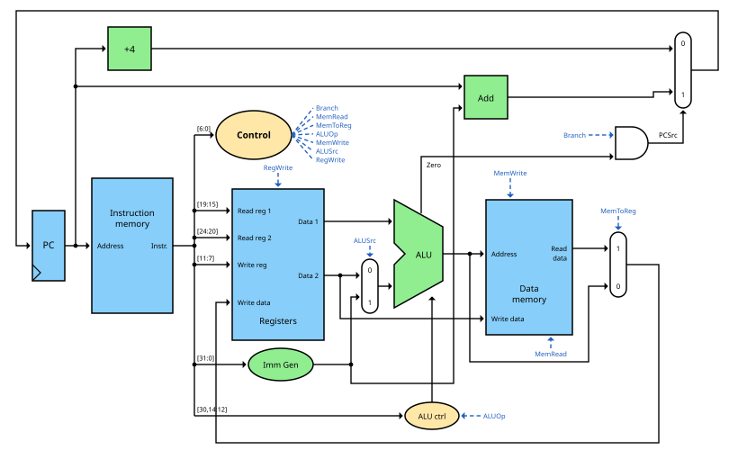



== The Control Unit

At the end of the link:/pages/15_risc_v/[RISC-V post] one question remained open:
how do the multiplexers, the ALU, the register file and the data memory know what to do
for a particular instruction? In this post the author wants to answer this question by
building the last missing piece of our CPU - the control unit.

In the link:/pages/14_automata/[post about finite state machines] we have seen that the control unit
of a multi-cycle CPU is a state machine. Our first CPU is a single-cycle CPU, which executes every
instruction within one clock cycle. Here the control unit needs no state at all: it is pure
combinational logic, as we know it from part 1. Its input is the instruction, its outputs are the
control signals.

=== The instruction as input

Every RISC-V instruction is 32 bits long. The fields of the instruction are always located at the
same positions, independent of the instruction format:

[width="100%"]
|===
| Bits | 31..25 | 24..20 | 19..15 | 14..12 | 11..7 | 6..0
| Field | funct7 | rs2 | rs1 | funct3 | rd | opcode
|===

This regularity is a big advantage: the register file can already read rs1 and rs2, while the control unit
is still decoding the instruction - even if it later turns out that one of them is not needed.

The control unit mainly looks at the lowest 7 bits, the *opcode*. For our minimal subset these are:

[width="70%"]
|===
| Instruction(s) | Type | Opcode
| `add`, `sub`, `and`, `or` | R-type | 0110011
| `lw` | I-type | 0000011
| `sw` | S-type | 0100011
| `beq` | B-type | 1100011
|===

The fields funct3 and funct7 distinguish instructions with the same opcode, e.g. `add` from `sub`.
We will need them later for the ALU control.

=== The data path with control

The following picture shows our complete single-cycle CPU. It extends the data path from the
last post by the control unit, the ALU control, the immediate generator and three multiplexers.
The control signals are drawn in blue: they leave the control unit on the right and are drawn
at their destinations as short stubs with the same names, so the picture stays readable.

Instruction memory and data memory are two separate memories here. This is necessary,
since within a single clock cycle we have to read an instruction *and* access the data memory.

=== The control signals

[width="100%"]
|===
| Signal | acts on | if 0 | if 1
| RegWrite | register file | nothing happens | the value at "Write data" is written into register rd
| ALUSrc | multiplexer in front of the ALU | 2nd operand = register rs2 | 2nd operand = constant from the immediate generator
| MemRead | data memory | nothing happens | the word at the address is read
| MemWrite | data memory | nothing happens | rs2 is written to the address
| MemToReg | multiplexer behind the data memory | the ALU result is written back | the value read from memory is written back
| Branch | AND gate in front of the PC multiplexer | PC = PC + 4 | PC = branch target, if the ALU reports Zero = 1
| ALUOp (2 bit) | ALU control | see below | see below
|===

=== The main control table

Now we can determine for every instruction which value each control signal must have.
This table is the heart of the control unit:

[width="100%"]
|===
| Instruction | RegWrite | ALUSrc | MemToReg | MemRead | MemWrite | Branch | ALUOp
| R-type | 1 | 0 | 0 | 0 | 0 | 0 | 10
| `lw` | 1 | 1 | 1 | 1 | 0 | 0 | 00
| `sw` | 0 | 1 | X | 0 | 1 | 0 | 00
| `beq` | 0 | 0 | X | 0 | 0 | 1 | 01
|===

The X stands for "don't care": for `sw` and `beq` the value of MemToReg does not matter,
because RegWrite = 0 and nothing is written into the register file anyway.
Such don't cares give us freedom to make the logic smaller.

Let's go through the rows:

* *R-type:* both operands come from registers (ALUSrc = 0), the ALU result (MemToReg = 0) is written into rd (RegWrite = 1).
  The ALU operation results from funct3 and funct7 (ALUOp = 10).
* *lw:* the ALU adds the base register and the offset (ALUSrc = 1, ALUOp = 00), the data memory is read
  (MemRead = 1) and the value read is written into rd (MemToReg = 1, RegWrite = 1).
* *sw:* the address is calculated like for `lw`, but rs2 is written to the data memory (MemWrite = 1).
* *beq:* the ALU subtracts rs2 from rs1 (ALUOp = 01). If the result is zero, both registers are equal and the branch is taken (Branch = 1).

==== From the table to the gates

How do we turn this table into a circuit? The easiest way is a decoder - as in our
link:/pages/06_priority_encoder_and-decoder/[excursion about decoders] - which recognizes the four opcodes
and activates exactly one of the four lines R, LW, SW and BR. Then every control signal is simply an OR
of the lines in which it is 1:

\[RegWrite = R + LW\]

\[ALUSrc = LW + SW\]

\[MemToReg = MemRead = LW\]

\[MemWrite = SW\]

\[Branch = BR\]

\[ALUOp_1 = R \qquad ALUOp_0 = BR\]

So the complete main control consists of a decoder for 7 bits and two OR gates.
In real processors this is often implemented as a PLA (programmable logic array) or simply
described in a hardware description language and left to the synthesis tool.

=== The ALU control

The ALU from link:/pages/05_alu/[part 1] is controlled by the signals Ainvert, Binvert and Operation.
Together they form 4 control bits. For our instructions we need:

[width="60%"]
|===
| Function | Ainvert | Binvert | Operation | ALU control
| and | 0 | 0 | 00 | 0000
| or | 0 | 0 | 01 | 0001
| add | 0 | 0 | 10 | 0010
| sub | 0 | 1 | 10 | 0110
|===

The ALU control generates these 4 bits from the 2-bit ALUOp of the main control and,
for R-type instructions, from funct7 (only bit 30 of the instruction matters) and funct3:

[width="100%"]
|===
| ALUOp | funct7 | funct3 | Instruction | Operation | ALU control
| 00 | X | X | `lw`, `sw` | add | 0010
| 01 | X | X | `beq` | sub | 0110
| 10 | 0000000 | 000 | `add` | add | 0010
| 10 | 0100000 | 000 | `sub` | sub | 0110
| 10 | 0000000 | 111 | `and` | and | 0000
| 10 | 0000000 | 110 | `or` | or | 0001
|===

Why two stages? The main control only has to make a rough decision ("address calculation",
"comparison" or "look at funct"), and the ALU control does the fine decoding. Both blocks remain small,
and each of them has only a few inputs. This principle of multi-level decoding keeps the logic small
and fast.

=== The immediate generator

Some instructions contain a constant (immediate). The immediate generator extracts it from the instruction
bits and extends it to 32 bits. Depending on the format, the bits are located at different positions:

[width="100%"]
|===
| Format | Used by | Bits of the constant
| I-type | `lw`, `addi` | imm[11:0] = inst[31:20]
| S-type | `sw` | imm[11:5] = inst[31:25], imm[4:0] = inst[11:7]
| B-type | `beq`, `bne` | imm[12] = inst[31], imm[11] = inst[7], imm[10:5] = inst[30:25], imm[4:1] = inst[11:8], imm[0] = 0
|===

That looks a bit confusing at first, but it has a reason: wherever possible, a bit of the constant is located at
the same position in all formats. And the sign bit is *always* inst[31]. This way the sign extension
can start immediately, before the format is even known.

For branches, the lowest bit imm[0] is always 0, since branch targets are always at an even byte address.
It is therefore not stored in the instruction at all - this doubles the range of the branch.

The *sign extension* fills the upper bits with copies of the sign bit. This way, a negative offset like -8
remains negative after the extension (link:/pages/04_signs/[two's complement] says hello).

=== The branch decision

For a branch the ALU computes rs1 - rs2. Its Zero output is 1, if the result is 0 - i.e. if both
registers are equal. At the same time, the second adder calculates the branch target PC + offset.
The multiplexer in front of the PC is controlled by:

\[PCSrc = Branch \cdot Zero\]

Only if the instruction is a branch *and* the registers are equal, the branch target is loaded into the PC.
In all other cases the PC simply moves on to PC + 4.

=== One instruction on its way through the CPU

Let's follow the instruction `lw x5, 8(x6)` through the picture above:

. The PC sends the address of the instruction to the instruction memory, which returns the instruction.
  At the same time, the first adder calculates PC + 4.
. The control unit recognizes the opcode 0000011 and sets RegWrite = 1, ALUSrc = 1, MemToReg = 1,
  MemRead = 1, MemWrite = 0, Branch = 0 and ALUOp = 00.
. The register file reads x6 (rs1). The immediate generator delivers the constant 8.
. Since ALUSrc = 1, the ALU receives x6 and 8. The ALU control sees ALUOp = 00 and selects addition.
. The ALU result x6 + 8 is the address for the data memory, which delivers the word stored there.
. Since MemToReg = 1, this word arrives at "Write data" of the register file.
. Branch = 0, so PCSrc = 0, and PC + 4 is waiting at the input of the PC.

All of this happens within one clock cycle, as pure combinational logic. Only with the next
rising clock edge, the new values are taken over: the register file writes x5, and the PC takes over PC + 4.
This is exactly the behaviour of the D-flipflops from the link:/pages/12_clocks_and_registers/[post about clocks and registers].

=== Extending the CPU: addi and bne

Our example program from the RISC-V post uses two instructions which our minimal CPU cannot execute yet:
`addi` and `bne`. Let's extend the CPU - this shows nicely how the control unit grows with the instruction set.

==== addi

`addi` has its own opcode 0010011 and the I-format, like `lw`. It needs the constant as second ALU operand
(ALUSrc = 1) and writes the ALU result into rd (MemToReg = 0, RegWrite = 1). The decoder gets a fifth line IMM:

\[RegWrite = R + LW + IMM\]

\[ALUSrc = LW + SW + IMM\]

But which ALUOp? One might think of ALUOp = 10 (look at funct), since funct3 = 000 for `addi`.
But this would be a trap: with `addi` there is no funct7 field - the upper bits belong to the constant.
For `addi x5, x5, -1` the constant consists only of ones, so bit 30 is 1 as well, and the ALU control
would select subtraction! x5 - (-1) would give x5 + 1 instead of x5 - 1.
So we choose ALUOp = 00, and the ALU always adds.

==== bne

`bne` has the same opcode as `beq` (1100011), they only differ in funct3: 000 for `beq` and 001 for `bne`.
The lowest bit of funct3 (inst[12]) thus tells us whether the branch should be taken on equality or on inequality.
We extend the branch decision by an XOR gate:

\[PCSrc = Branch \cdot (Zero \oplus inst_{12})\]

For `beq` (inst[12] = 0) the Zero signal passes unchanged, for `bne` (inst[12] = 1) it is inverted.
The link:/pages/02_xor/[XOR] works here as a controllable inverter - a trick we will meet again and again.

==== And the j?

Our program ends with `j done`, a pseudo instruction for `jal x0, done`. `jal` would need another opcode
and an additional path for writing PC + 4 into rd. But we don't need it: `beq x0, x0, done` has exactly the same
effect, since x0 is always equal to itself. The branch is therefore always taken.

=== Our example program, clock by clock

With these extensions, our CPU can now execute the example program. The program is located from address 0x00 on:

----
0x00:        addi x1, x0, 0       # x1 = 0   (counter)
0x04:        addi x2, x0, 1       # x2 = 1   (step)
0x08:        addi x3, x0, 10      # x3 = 10  (end value)
0x0C: loop:  add  x1, x1, x2      # x1 = x1 + x2
0x10:        sw   x1, 4(x0)       # memory[4] = x1
0x14:        bne  x1, x3, loop    # while x1 != x3: jump to loop (offset -8)
0x18: done:  beq  x0, x0, done    # endless loop (offset 0)
----

The control signals for the instructions used:

[width="100%"]
|===
| Instruction | RegWrite | ALUSrc | MemToReg | MemRead | MemWrite | Branch | ALUOp | PCSrc
| `addi` | 1 | 1 | 0 | 0 | 0 | 0 | 00 | 0
| `add` | 1 | 0 | 0 | 0 | 0 | 0 | 10 | 0
| `sw` | 0 | 1 | X | 0 | 1 | 0 | 00 | 0
| `bne` | 0 | 0 | X | 0 | 0 | 1 | 01 | 1, if x1 ≠ x3
| `beq x0, x0` | 0 | 0 | X | 0 | 0 | 1 | 01 | 1 (always)
|===

And this is what happens clock cycle by clock cycle:

[width="100%"]
|===
| Clock | PC | Instruction | Effect | Next PC
| 1 | 0x00 | `addi x1, x0, 0` | x1 = 0 | 0x04
| 2 | 0x04 | `addi x2, x0, 1` | x2 = 1 | 0x08
| 3 | 0x08 | `addi x3, x0, 10` | x3 = 10 | 0x0C
| 4 | 0x0C | `add x1, x1, x2` | x1 = 1 | 0x10
| 5 | 0x10 | `sw x1, 4(x0)` | memory[4] = 1 | 0x14
| 6 | 0x14 | `bne x1, x3, loop` | 1 ≠ 10: branch taken | 0x0C
| 7 | 0x0C | `add x1, x1, x2` | x1 = 2 | 0x10
| ... | ... | ... | ... | ...
| 31 | 0x0C | `add x1, x1, x2` | x1 = 10 | 0x10
| 32 | 0x10 | `sw x1, 4(x0)` | memory[4] = 10 | 0x14
| 33 | 0x14 | `bne x1, x3, loop` | 10 = 10: branch not taken | 0x18
| 34 | 0x18 | `beq x0, x0, done` | branch always taken | 0x18
| 35 | 0x18 | `beq x0, x0, done` | ... | 0x18
|===

After 33 clock cycles the counting is done, and the CPU circles in the endless loop at address 0x18.
In clock cycle 6, for example, the ALU computes 1 - 10 = -9, so Zero = 0. Since inst[12] = 1 for `bne`,
Zero ⊕ inst[12] = 1, and with Branch = 1 we get PCSrc = 1: the PC jumps back to 0x14 + (-8) = 0x0C.

If you want to see this live, load the program into the simulator Ripes and select the single-cycle processor:
there you can watch the control signals switch from instruction to instruction.

=== The limits of the single-cycle CPU

Our CPU works - but it is not fast. The clock period must be long enough for the slowest instruction.
With typical example values (as used by Patterson and Hennessy) we get:

[width="100%"]
|===
| Instruction | Instruction memory | Register read | ALU | Data memory | Register write | Total
| R-type | 200 ps | 100 ps | 200 ps | - | 100 ps | 600 ps
| `lw` | 200 ps | 100 ps | 200 ps | 200 ps | 100 ps | *800 ps*
| `sw` | 200 ps | 100 ps | 200 ps | 200 ps | - | 700 ps
| `beq` | 200 ps | 100 ps | 200 ps | - | - | 500 ps
|===

The clock period is therefore 800 ps, determined by `lw` - even though a `beq` would be done after 500 ps.
Every instruction "waits" for the slowest one.

=== Outlook

This is where the series ends for now - but this is exactly where computer architecture really starts.
Here are the most important next steps, which you will find in the literature:

* *Multi-cycle CPU:* every phase gets its own clock cycle, and an instruction only uses as many cycles as it needs.
  The control unit becomes a state machine - exactly as described in the post about finite state machines.
* *Pipelining:* the phases are separated by registers, and up to five instructions are processed at the same time,
  like on an assembly line. In the ideal case one instruction finishes every 200 ps instead of every 800 ps.
* *Hazards:* with pipelining, problems arise: an instruction needs a result that is not yet written back (data hazard),
  or it is not clear yet whether a branch will be taken (control hazard). Forwarding and branch prediction help here.
* *Caches:* real main memory is much slower than 200 ps. Small, fast buffer memories close to the CPU hide this.
* *Interrupts and exceptions:* the CPU must be able to interrupt the current program, e.g. when a key is pressed
  or a division by zero occurs.

If you want to build the CPU yourself, a hardware description language and an FPGA are the next step.
The author has written some link:/posts/web/21-fpga-beginners-0/[posts about getting started with FPGAs].

=== Conclusion

From the first logic gate to a CPU that runs a program: this was the path of this series.
In part 1 we got to know the combinational building blocks - gates, boolean algebra, adders and the ALU.
In part 2 the memory was added - flipflops, registers, memory and state machines - and finally all of this
was combined into a working RISC-V CPU.

Further reading:

* David A. Patterson and John L. Hennessy, 'Computer Organization and Design - RISC-V Edition', chapter 4
* David Money Harris and Sarah L. Harris, 'Digital Design and Computer Architecture - RISC-V Edition', chapter 7
* Noam Nisan and Shimon Schocken, 'The Elements of Computing Systems' (the book behind nand2tetris)

(Created with Claude AI)
