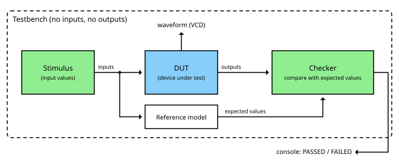
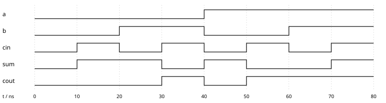
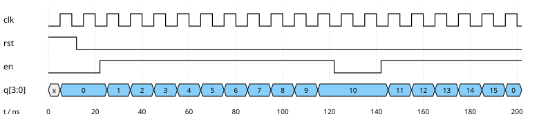



== Simulation and Testbenches

In the link:/pages/21_hdl/[last chapter] we saw that an HDL description can be used for documentation,
simulation and synthesis. In this chapter we look at simulation - and at the question of how we can be sure
that a circuit does what it should, before it even exists.

Why is this so important? With software, a bug can be fixed with a new release. With hardware it is different:
a faulty chip that has already been manufactured cannot be patched, a new manufacturing run (a so-called respin)
costs a lot of money and months of time. Even with FPGAs, which can be reprogrammed, debugging on the real hardware
is tedious, since we can only observe the few signals that are connected to a pin.
In a simulation, on the other hand, we can see *every* signal at *every* point in time.

That is why in chip development often more effort goes into verification than into the design itself.

=== How a simulator works

A simulator does not execute the circuit like a program, line by line. Instead, it simulates the behaviour
of the hardware over time. Most HDL simulators work *event-driven*:

. The simulator manages a simulation time, which has nothing to do with the real time on the computer.
. Whenever a signal changes, this is an *event*.
. The simulator then re-evaluates all parts of the circuit that depend on this signal.
  This can trigger new events, which are processed in turn.
. When there are no more events at the current point in time, the simulator jumps to the next point in time
  at which something happens.

This is how the simulator reproduces the fact that in real hardware all parts work at the same time:
every gate reacts to its inputs, no matter in which order it appears in the source code.

==== Four values instead of two

In part 1 a signal was either 0 or 1. A Verilog simulator knows four values:

[width="70%"]
|===
| Value | Meaning
| 0 | logical zero
| 1 | logical one
| x | unknown - e.g. a flip-flop that has not been reset yet, or two drivers working against each other
| z | high impedance - the signal is not driven at all (e.g. a tri-state output that is switched off)
|===

The value x is very useful when debugging: if a signal shows x in the simulation, something is not initialized
or not connected - a mistake that would lead to random behaviour in real hardware.

=== The testbench

To simulate a circuit, we need someone who applies values to its inputs and looks at its outputs.
In the laboratory this would be a signal generator and an oscilloscope. In the simulation this job is done
by a *testbench* - another Verilog module that surrounds the circuit to be tested, the *device under test* (DUT):

A testbench typically consists of:

* *Stimulus:* generates the input values for the DUT - and, for sequential circuits, the clock and the reset.
* *DUT:* the circuit we want to test. It is used inside the testbench exactly as it would be used in a larger design.
* *Reference model and checker:* compute the expected values and compare them with the actual outputs of the DUT.

In contrast to the DUT, the testbench itself has no inputs and outputs - it is the complete "world" in which the DUT lives.
It also doesn't need to be synthesizable: it may use delays, loops and text output, which do not exist in real hardware.

=== A first testbench

Let's test the full adder from the last chapter. The simplest testbench applies all possible input combinations
one after the other and prints the results:

[source,verilog]
----
`timescale 1ns / 1ps

module full_adder_tb;
    // signals that drive the inputs of the DUT
    reg  a, b, cin;
    // signals that observe the outputs of the DUT
    wire sum, cout;

    // the device under test (DUT)
    full_adder dut (
        .a(a), .b(b), .cin(cin),
        .sum(sum), .cout(cout)
    );

    integer i;
    initial begin
        $dumpfile("full_adder.vcd");
        $dumpvars(0, full_adder_tb);

        // apply all 8 input combinations
        for (i = 0; i < 8; i = i + 1) begin
            {a, b, cin} = i;
            #10;
            $display("a=%b b=%b cin=%b -> cout=%b sum=%b", a, b, cin, cout, sum);
        end
        $finish;
    end
endmodule
----

Let's go through the most important parts:

* *`timescale 1ns / 1ps*: one time unit in this file is 1 ns, the simulator calculates with a precision of 1 ps.
* *reg and wire:* the testbench drives the inputs of the DUT itself, so they are declared as `reg`.
  The outputs are only observed, so they are `wire` signals.
* *Instantiation:* `full_adder dut (...)` inserts the full adder into the testbench. `.a(a)` connects the port `a`
  of the full adder with the signal `a` of the testbench.
* *initial:* a block that runs exactly once at the start of the simulation - it only exists in simulation.
* *{a, b, cin} = i:* the three inputs are combined into a 3-bit number, so the loop counts through all combinations from 000 to 111.
* *#10:* wait 10 time units, i.e. 10 ns. Only now does the simulator calculate the outputs of the DUT.
* *$display, $dumpfile, $dumpvars, $finish:* system tasks of the simulator for text output, for recording the waveform
  and for ending the simulation.

The output of the simulation is exactly the truth table of the full adder from part 1:

----
a=0 b=0 cin=0 -> cout=0 sum=0
a=0 b=0 cin=1 -> cout=0 sum=1
a=0 b=1 cin=0 -> cout=0 sum=1
a=0 b=1 cin=1 -> cout=1 sum=0
a=1 b=0 cin=0 -> cout=0 sum=1
a=1 b=0 cin=1 -> cout=1 sum=0
a=1 b=1 cin=0 -> cout=1 sum=0
a=1 b=1 cin=1 -> cout=1 sum=1
----

=== Reading waveforms

Even more useful than the text output is the *waveform*. Thanks to `$dumpvars`, the simulator records every change
of every signal in a VCD file (Value Change Dump). A waveform viewer such as GTKWave or Surfer displays these changes
over time - just like an oscilloscope or a logic analyzer:

The time runs from left to right. Every 10 ns the testbench applies a new input combination,
and we can directly see how sum and cout react. For example at 30 ns: b and cin are 1, a is 0 -
so sum is 0 and cout is 1.

=== Self-checking testbenches

For eight combinations, we can check the output by eye. But that does not scale: an 8-bit adder has
\(2^{17} = 131072\) input combinations. Therefore, a good testbench checks the results itself.
For this, we need a *reference model* - a second, independent description of the expected behaviour.
For the full adder this is simple: the sum of three bits is a 2-bit number.

[source,verilog]
----
`timescale 1ns / 1ps

module full_adder_tb;
    reg  a, b, cin;
    wire sum, cout;
    integer i;
    integer errors = 0;

    full_adder dut (.a(a), .b(b), .cin(cin), .sum(sum), .cout(cout));

    initial begin
        for (i = 0; i < 8; i = i + 1) begin
            {a, b, cin} = i;
            #10;
            // reference model: the sum of three bits is a 2-bit number
            if ({cout, sum} !== a + b + cin) begin
                $display("ERROR: a=%b b=%b cin=%b -> got %b%b", a, b, cin, cout, sum);
                errors = errors + 1;
            end
        end
        if (errors == 0) $display("PASSED: all 8 combinations correct");
        else             $display("FAILED: %0d errors", errors);
        $finish;
    end
endmodule
----

The operator `!==` compares including the values x and z - an output that is x is reported as an error.
If we build in a mistake on purpose, e.g. `cout = (a & b) | (cin & a)`, the testbench finds it immediately:

----
ERROR: a=0 b=1 cin=1 -> got 00
FAILED: 1 errors
----

Testing all combinations (*exhaustive testing*) is only possible for small circuits. For a 32-bit ALU with two operands
there are \(2^{64}\) combinations - even at a billion tests per second, this would take more than 500 years.
In practice, we therefore combine:

* *corner cases:* 0, 1, the largest and smallest value, overflow, all bits set, ...
* *random tests:* many randomly generated inputs, which are checked against the reference model.
* *directed tests:* specifically constructed sequences that exercise a certain function.

=== Testing sequential circuits

For a sequential circuit, the testbench also has to generate the clock and the reset. Our device under test is a
4-bit counter with a synchronous reset and an enable input:

[source,verilog]
----
module counter (
    input  wire       clk,
    input  wire       rst,
    input  wire       en,
    output reg  [3:0] q
);
    always @(posedge clk) begin
        if (rst)
            q <= 4'd0;
        else if (en)
            q <= q + 4'd1;
    end
endmodule
----

We will look at the details of `always @(posedge clk)` in the chapter about sequential logic in Verilog.
For now it is enough to know: with every rising clock edge, the counter is reset or incremented by one,
if en = 1 - exactly like the counter from the link:/pages/12_clocks_and_registers/[chapter about clocks and registers].

The testbench generates a clock with a period of 10 ns, releases the reset, switches the counter on, pauses it
for two clock cycles and lets it continue:

[source,verilog]
----
`timescale 1ns / 1ps

module counter_tb;
    reg        clk = 0;
    reg        rst = 1;
    reg        en  = 0;
    wire [3:0] q;

    counter dut (.clk(clk), .rst(rst), .en(en), .q(q));

    // clock: period 10 ns (100 MHz)
    always #5 clk = ~clk;

    initial begin
        $dumpfile("counter.vcd");
        $dumpvars(0, counter_tb);

        #12 rst = 0;      // release reset after the first rising edge
        #10 en  = 1;      // start counting
        #100 en = 0;      // pause for two clock cycles
        #20 en  = 1;      // continue
        #60;
        $finish;
    end

    // print the counter value after every rising clock edge
    always @(posedge clk)
        $strobe("t=%0d ns  rst=%b en=%b q=%0d", $time, rst, en, q);
endmodule
----

The line `always #5 clk = ~clk;` is the clock generator: every 5 ns the clock is inverted, which results in a period of 10 ns.
Note that the input changes (at 12, 22, 122 and 142 ns) do *not* happen at a clock edge. This is good practice:
in real hardware, inputs must also be stable for a short time before and after the edge (setup and hold time).

The waveform shows the behaviour of the counter:

We can read a lot from it:

* At the very beginning, q is *x*: the flip-flops have not been reset yet. Only with the first rising edge at 5 ns
  does the reset take effect.
* After en has been switched on at 22 ns, the counter counts up with every rising edge.
* Between 122 and 142 ns en = 0, and the counter holds its value 10.
* At 195 ns the counter overflows from 15 to 0 - a 4-bit number cannot hold more.

NOTE: *Try it yourself:* the example only needs the free simulator Icarus Verilog and a waveform viewer.
`iverilog -o sim counter_tb.v counter.v` compiles the design, `vvp sim` runs the simulation and writes `counter.vcd`,
and `gtkwave counter.vcd` displays the waveform.

=== Simulators

Besides Icarus Verilog, which we use in this series, there are other simulators:

[width="100%"]
|===
| Simulator | Type | Properties
| Icarus Verilog | open source, event-driven | easy to install, good for learning and small designs
| Verilator | open source, cycle-based | translates Verilog into C++, extremely fast, ideal for large designs like whole CPUs
| GHDL | open source | simulator for VHDL
| Questa, Xcelium, VCS | commercial | the simulators of the chip industry, with full SystemVerilog and UVM support
|===

=== Verification and test - two different things

Finally an important distinction. Everything we did in this chapter is *verification*: we check whether our *design*
is correct. But even a correct design can fail in the real world: during manufacturing of a chip, a tiny particle of dust
can break a connection or short two wires. Finding such manufacturing defects is the job of *testing*.

So that a finished chip can be tested at all, testability has to be planned into the design from the beginning
(design for testability). Two common techniques:

* *Scan chains:* in a special test mode, all flip-flops of a chip are connected to form one long shift register.
  This way, arbitrary states can be shifted in and the results shifted out - every flip-flop becomes accessible from the outside.
* *Boundary scan (JTAG):* a standardized interface (IEEE 1149.1), with which the pins of a chip can be controlled and read
  from the outside, for example to test the solder joints on a circuit board. Today JTAG is also the usual interface
  for programming and debugging microcontrollers and FPGAs.

=== Summary

* A simulator reproduces the behaviour of hardware over time, event by event.
* A testbench surrounds the device under test, generates the input values and checks the outputs.
* Self-checking testbenches with a reference model find errors automatically.
* Waveforms show every signal at every point in time - the most important tool for debugging.

In the next chapter we use these tools to describe the combinational circuits from part 1 in Verilog -
and of course to test them right away.

(Created with Claude AI)