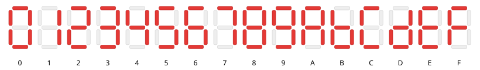
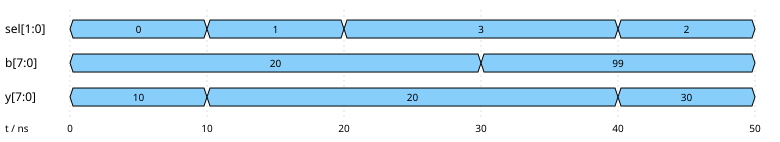



== Combinational Logic in Verilog

In the link:/pages/22_simulation/[last chapter] we already described a combinational circuit in Verilog:
the full adder, with two `assign` statements. For a single full adder that is enough.
For bigger circuits we need a few more tools: multi-bit signals, a way to describe a truth table
in a readable form, and a way to build big circuits from small ones.

In this chapter we learn these tools with two new circuits: a *7-segment decoder*, which turns a number into the
pattern for a digit display, and a *ripple-carry adder*, which we build from our full adders.
At the end we look at the most common mistake when describing combinational logic.

=== Vectors and numbers

So far all our signals were a single bit. In Verilog, a signal can also be a *vector* of several bits:

[source,verilog]
----
wire [3:0] value;   // 4 bits: value[3] (MSB) ... value[0] (LSB)
wire [6:0] seg;     // 7 bits
----

The most important operations on vectors:

[width="100%"]
|===
| Notation | Meaning | Example
| `value[2]` | a single bit (bit select) | the third bit from the right
| `value[3:2]` | several bits (part select) | the two upper bits
| `{a, b}` | concatenation - puts signals side by side | `{cout, sum}` is a 2-bit number
| `{4{x}}` | replication | the bit x four times
|===

Numbers are written with their width and base: `4'hA` is the 4-bit number A (hexadecimal, i.e. 10),
`7'b0111111` is a 7-bit binary number and `8'd200` is the decimal number 200 with 8 bits.
Writing the width explicitly avoids surprises - Verilog quietly cuts off or extends numbers of the wrong width.

=== Two ways to describe combinational logic

We already know the first way: a continuous assignment with `assign`. It describes a wire that is permanently
connected to the result of an expression - exactly like a gate whose output always follows its inputs.

The second way is an `always` block:

[source,verilog]
----
always @(*) begin
    // statements
end
----

The `@(*)` means: execute the block again whenever *any* of the signals read in it changes.
The block therefore behaves like combinational logic as well. Inside it, we may use `if`, `case` and other statements,
which makes complex logic much more readable than one long boolean expression.

One thing confuses almost every beginner: a signal that is assigned inside an `always` block must be declared as `reg`.
Despite the name, a `reg` is *not* automatically a register. In an `always @(*)` block it becomes ordinary
combinational logic - the name only means that the signal is assigned in a procedural block.

=== Example 1: A 7-segment decoder

A 7-segment display consists of seven bars, called a to g:

To show a digit, a specific combination of segments has to light up. For an 8 all seven are on, for a 1 only b and c.
Our decoder receives a 4-bit number from 0 to F and outputs the seven segment signals. This is a combinational circuit
with 4 inputs and 7 outputs - in other words, seven truth tables with 16 rows each.

With `assign` we would have to derive and simplify seven boolean equations. With a `case` statement we can write down
the truth table directly:

[source,verilog]
----
// 7-segment decoder for the hexadecimal digits 0..F
// segment order: seg = {g, f, e, d, c, b, a}, 1 = segment on
module seven_seg (
    input  wire [3:0] value,
    output reg  [6:0] seg
);
    always @(*) begin
        case (value)
            4'h0: seg = 7'b0111111;
            4'h1: seg = 7'b0000110;
            4'h2: seg = 7'b1011011;
            4'h3: seg = 7'b1001111;
            4'h4: seg = 7'b1100110;
            4'h5: seg = 7'b1101101;
            4'h6: seg = 7'b1111101;
            4'h7: seg = 7'b0000111;
            4'h8: seg = 7'b1111111;
            4'h9: seg = 7'b1101111;
            4'hA: seg = 7'b1110111;
            4'hB: seg = 7'b1111100;
            4'hC: seg = 7'b0111001;
            4'hD: seg = 7'b1011110;
            4'hE: seg = 7'b1111001;
            4'hF: seg = 7'b1110001;
            default: seg = 7'b0000000;
        endcase
    end
endmodule
----

Every line of the `case` statement is one row of the truth table: for the input `4'h2`, the segments g, e, d, b and a light up -
that is a 2. The bits of `seg` are ordered from g (bit 6) to a (bit 0).

==== From the table to hardware

Who turns this table into hardware? The synthesis tool - and what it builds depends on the *target*:

* For a *chip* (ASIC), the tool derives boolean equations from the table, simplifies them - exactly the work we did by hand
  with link:/pages/01_boolean_algebra/[boolean algebra] in part 1 - and builds them from the gates of the manufacturer's
  cell library.
* An *FPGA* has no individual gates at all. It consists of thousands of small *lookup tables* (LUTs): tiny memories
  that store the truth table of a function with a few inputs - on many FPGAs, 4 inputs and thus 16 bits.
  For a LUT, it does not matter how complicated the function is: it simply looks up the result.

Our decoder shows this nicely: every segment is a function of exactly 4 inputs. On a Lattice iCE40 FPGA,
Yosys therefore needs exactly *7 LUTs* - one per segment, each storing one column of our truth table.
Boolean simplification is not even necessary.

We will look at how LUTs work and how an FPGA is built in the chapter _From Code to Chip_.

NOTE: Many real displays are *common anode*: a segment lights up when its signal is 0, not 1.
For those displays, the output is simply inverted: `assign seg_n = ~seg;`.

==== Testing the decoder

The testbench applies all 16 values one after another:

[source,verilog]
----
`timescale 1ns / 1ps

module seven_seg_tb;
    reg  [3:0] value;
    wire [6:0] seg;
    integer i;

    seven_seg dut (.value(value), .seg(seg));

    initial begin
        $dumpfile("seven_seg.vcd");
        $dumpvars(0, seven_seg_tb);
        for (i = 0; i < 16; i = i + 1) begin
            value = i;
            #10;
            $display("value=%h  seg(gfedcba)=%b", value, seg);
        end
        $finish;
    end
endmodule
----

Instead of reading 16 rows of zeros and ones, we let a small script draw the segment patterns
from the simulation output. This is the result of the simulation:

All 16 digits look right - including the lower-case b and d, which are needed so that they cannot be
confused with 8 and 0.

=== Example 2: Hierarchy - a ripple-carry adder

Real designs are not one big module, but many small modules that are put together - just like in part 1,
where we built an adder from full adders. In Verilog, we can use a module inside another module.
This is called *instantiation*, and we already did it in the testbench of the last chapter.

A 4-bit adder consists of four full adders, where the carry output of each stage is connected to the carry input
of the next stage:

[source,verilog]
----
// 4-bit ripple-carry adder, built from four full adders
module ripple_adder4 (
    input  wire [3:0] a,
    input  wire [3:0] b,
    input  wire       cin,
    output wire [3:0] sum,
    output wire       cout
);
    wire [3:1] c;   // internal carries between the stages

    full_adder fa0 (.a(a[0]), .b(b[0]), .cin(cin),  .sum(sum[0]), .cout(c[1]));
    full_adder fa1 (.a(a[1]), .b(b[1]), .cin(c[1]), .sum(sum[1]), .cout(c[2]));
    full_adder fa2 (.a(a[2]), .b(b[2]), .cin(c[2]), .sum(sum[2]), .cout(c[3]));
    full_adder fa3 (.a(a[3]), .b(b[3]), .cin(c[3]), .sum(sum[3]), .cout(cout));
endmodule
----

Each line creates one full adder with its own name (`fa0` to `fa3`). The internal wires `c[1]` to `c[3]` connect the carries.
Since the carry "ripples" from stage to stage, this circuit is called a *ripple-carry adder*.

==== Parameters and generate

For 4 bits, writing four lines is still fine. For 32 bits it would be tedious and error-prone.
Verilog has two tools for this: a *parameter* makes the width configurable, and a *generate loop* creates
the instances automatically:

[source,verilog]
----
// N-bit ripple-carry adder, the full adders are generated in a loop
module ripple_adder #(
    parameter N = 8
) (
    input  wire [N-1:0] a,
    input  wire [N-1:0] b,
    input  wire         cin,
    output wire [N-1:0] sum,
    output wire         cout
);
    wire [N:0] c;   // c[0] = carry in, c[N] = carry out
    assign c[0] = cin;
    assign cout = c[N];

    genvar i;
    generate
        for (i = 0; i < N; i = i + 1) begin : stage
            full_adder fa (
                .a(a[i]), .b(b[i]), .cin(c[i]),
                .sum(sum[i]), .cout(c[i+1])
            );
        end
    endgenerate
endmodule
----

A 32-bit adder is now just `ripple_adder #(.N(32)) add32 (...)`.

==== Loops describe copies, not steps

This loop looks like a loop in any programming language - but it does something completely different.
It is *not* executed while the circuit is running. It is resolved *before* simulation or synthesis
and simply produces N full adders, exactly as if we had written them by hand. For N = 4, Yosys generates these
four instances:

----
ripple_adder/stage[0].fa
ripple_adder/stage[1].fa
ripple_adder/stage[2].fa
ripple_adder/stage[3].fa
----

This is the same circuit as the hand-written 4-bit adder above. The name `stage` behind the `begin` becomes part
of the instance names - and under exactly these names we will find the full adders in the waveform viewer later.

The same applies to a `for` loop *inside* an `always @(*)` block. This module computes the parity of 8 bits,
i.e. whether an odd number of bits is set:

[source,verilog]
----
// even parity over 8 bits: p = 1 if an odd number of bits is set
module parity8 (
    input  wire [7:0] d,
    output reg        p
);
    integer i;

    always @(*) begin
        p = 1'b0;
        for (i = 0; i < 8; i = i + 1)
            p = p ^ d[i];
    end
endmodule
----

It reads like eight steps one after another. But the synthesis tool unrolls the loop into *7 XOR gates*,
which all work at the same time. There is no counter `i` in the hardware, and nothing is executed eight times.

Compare this with the testbenches from the last chapter: there, a `for` loop with `#10` really runs step by step
through simulated time - because testbenches are never turned into hardware. The same syntax therefore has two meanings:
in a testbench, a loop costs *time*; in a circuit, it costs *area*.

[NOTE]
.For software developers
====
In synthesizable Verilog, a loop means *replication in space*, not *repetition in time*.
The closest analogies from software are the C preprocessor, C++ templates or loop unrolling by a compiler:
everything happens before the program - here: the circuit - runs. What none of these analogies capture:
all copies work *simultaneously*. This has some consequences:

* The number of iterations must be known before synthesis. A loop that runs three times for one input value
  and seven times for another does not exist in hardware.
* For the same reason, there is no `break` that depends on data.
* More iterations do not take longer - they need more hardware.
====

==== Testing the adder

For an 8-bit adder, we can still test all combinations - these are the \(2^{17} = 131072\) combinations
from the last chapter. The reference model is again simply the `+` operator:

[source,verilog]
----
`timescale 1ns / 1ps

module ripple_adder_tb;
    localparam N = 8;

    reg  [N-1:0] a, b;
    reg          cin;
    wire [N-1:0] sum;
    wire         cout;
    integer i, j, k;
    integer errors = 0;

    ripple_adder #(.N(N)) dut (.a(a), .b(b), .cin(cin), .sum(sum), .cout(cout));

    initial begin
        // exhaustive test: 256 * 256 * 2 = 131072 combinations
        for (i = 0; i < (1 << N); i = i + 1)
            for (j = 0; j < (1 << N); j = j + 1)
                for (k = 0; k < 2; k = k + 1) begin
                    a = i; b = j; cin = k;
                    #1;
                    if ({cout, sum} !== a + b + cin) begin
                        if (errors < 10)
                            $display("ERROR: %0d + %0d + %0d = %0d", a, b, cin, {cout, sum});
                        errors = errors + 1;
                    end
                end
        if (errors == 0) $display("PASSED: all %0d combinations correct", (1 << (2*N)) * 2);
        else             $display("FAILED: %0d errors", errors);
        $finish;
    end
endmodule
----

The simulation takes less than a second:

----
PASSED: all 131072 combinations correct
----

By the way: in a real design you would simply write `assign {cout, sum} = a + b + cin;`. What the synthesis tool
makes of it again depends on the target. For a chip, it knows many adder structures and picks one that is fast enough.
Many FPGAs, on the other hand, contain a dedicated *carry chain* - extra hardware just for carries. For an 8-bit `+`,
Yosys uses 8 LUTs and 8 carry cells (`SB_CARRY`) on the iCE40.

We build the adder ourselves here to practice hierarchy - and because it shows what is behind the `+`.
Its weakness is also visible: in the worst case the carry has to ripple through all N stages, so the delay grows
with the width. Faster adders, such as the carry-lookahead adder from the link:/pages/03_binary_system/[chapter about
the binary system], calculate the carries in parallel.

=== The classic pitfall: unintended latches

There is one mistake that almost everyone makes when starting with Verilog. Let's look at a multiplexer that selects
one of three 8-bit inputs:

[source,verilog]
----
// WRONG: 3-to-1 multiplexer - the case for sel = 2'b11 is missing
module mux3 (
    input  wire [1:0] sel,
    input  wire [7:0] a, b, c,
    output reg  [7:0] y
);
    always @(*) begin
        case (sel)
            2'b00: y = a;
            2'b01: y = b;
            2'b10: y = c;
        endcase
    end
endmodule
----

The code compiles without errors. But `sel` has 2 bits and thus four possible values - and for `2'b11`, no value is
assigned to `y`. The simulation shows what happens:

Between 20 and 40 ns, sel = 3. The output keeps the value 20 - even when input b changes to 99 at 30 ns.
The combinational circuit has suddenly got a memory.

==== Why does this happen?

The reason is a rule that Verilog shares with software: *a `reg` keeps its value until something new is assigned to it.*
The `always @(*)` block runs again whenever an input changes. If sel = 3, none of the three branches applies,
nothing happens to `y` - and `y` still holds the value from the last run.

The synthesis tool has to build hardware that behaves exactly like that. It builds what we *described*, not what we *meant*.
And we described: for sel = 3, `y` depends on what happened *before*. Purely combinational logic cannot do that -
its output only depends on the current inputs. As soon as something depends on the past, we need storage.

Which kind of storage? Let's look at the behaviour:

* for sel = 0, 1 or 2, `y` follows the selected input *immediately*, without waiting for a clock,
* for sel = 3, `y` *holds* its value.

A *latch* is a simple storage element that is controlled by the level of a signal, not by a clock edge:
as long as it is enabled, its output follows the input, otherwise it holds its last value.
The RS circuit from the link:/pages/12_clocks_and_registers/[chapter about clocks and flip-flops]
is such a latch. We will look at the difference between latches and flip-flops in detail in the next chapter.

So our multiplexer becomes exactly that: a latch whose data input is the multiplexer and whose enable is
"one of the three cases applies", i.e. sel ≠ 3. We can also write this behaviour like this:

[source,verilog]
----
y = (sel != 2'b11) ? mux(a, b, c) : y;   // pseudo code, not synthesizable Verilog
----

`y` depends on itself. This feedback is exactly what turns two NAND gates into an RS latch in chapter 12,
and what gives a state machine its memory in link:/pages/14_automata/[chapter 14] - only here, nobody wanted it.

==== What the synthesis tool does

Yosys reports this in its log:

----
Latch inferred for signal `\mux3.\y' ...
----

and the synthesized circuit contains 8 latches (`$_DLATCH_N_`), one per output bit.
On an FPGA it gets even worse: the iCE40 has no latch cells at all. Yosys therefore builds each latch
from LUTs with a feedback loop - 16 LUTs instead of a clean multiplexer. Such loops cause timing problems
and are hard to analyse. And above all: nobody wanted this memory.

==== The fix

Every output must get a value on *every* path through the `always` block.
Either with a `default` branch:

[source,verilog]
----
// RIGHT: every path assigns a value to y
module mux3 (
    input  wire [1:0] sel,
    input  wire [7:0] a, b, c,
    output reg  [7:0] y
);
    always @(*) begin
        case (sel)
            2'b00:   y = a;
            2'b01:   y = b;
            2'b10:   y = c;
            default: y = 8'h00;
        endcase
    end
endmodule
----

or by assigning a default value at the beginning of the block, which is then overwritten where needed:

[source,verilog]
----
always @(*) begin
    y = 8'h00;           // default value
    case (sel)
        2'b00: y = a;
        2'b01: y = b;
        2'b10: y = c;
    endcase
end
----

Now `y` is defined for every value of `sel` and only depends on the current inputs - no feedback, no memory,
and Yosys no longer generates any latches. This is also why our 7-segment decoder has a `default` branch,
although all 16 values are covered: it is a good habit that protects against this mistake.

To remember: *if a combinational block does not assign a value on some path, we have described "keep the old value" -
and keeping means storing.*

The rules for combinational `always` blocks in short:

. Use `always @(*)`, so that no input is forgotten.
. Assign a value to every output on every path - with `default` or a default value at the beginning.
. Use the blocking assignment `=`. (We will meet the non-blocking assignment `\<=` in the next chapter, for flip-flops.)

NOTE: *Try it yourself:* with Yosys you can check any module for latches:
`yosys -p "read_verilog mux3_latch.v; synth -top mux3; stat"` prints the cells of the synthesized circuit.
If `$_DLATCH_` appears, a path is missing.

=== Summary

* Vectors, concatenation and sized numbers are the basic building blocks for multi-bit signals.
* Combinational logic can be described with `assign` or with an `always @(*)` block; `case` statements describe truth tables directly.
* What the synthesis tool builds depends on the target: gates on a chip, lookup tables on an FPGA.
* Modules can be instantiated inside other modules; `parameter` and `generate` make them configurable.
* Loops in synthesizable code are resolved before synthesis: they create copies of hardware, not steps in time.
* An `always @(*)` block in which an output is not assigned on every path creates an unintended latch.

In the next chapter we turn to sequential logic: flip-flops, registers, counters - and the traffic light from the chapter
about finite state machines.

(Created with Claude AI)
