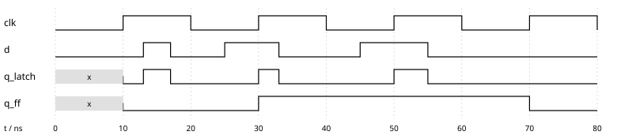
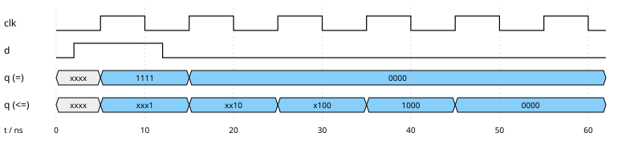
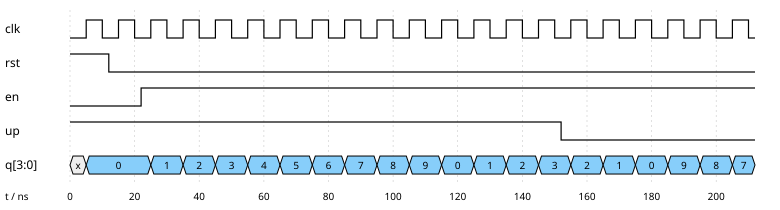
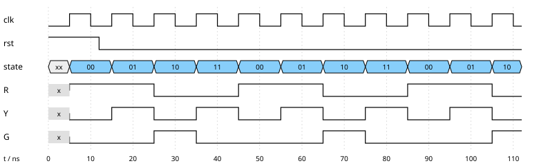



== Sequential Verilog

In the link:/pages/23_combinational_verilog/[last chapter] we discussed the language features of Verilog to describe purely combinational logic...
We did this starting with a simple seven-segment decoder (code and testbench), continuing with the ripple-carry-adder as a second example
and ending with the latch trap we discussed.
In this chapter we take the leap from purely combinational Verilog logic to sequential logic... This adds another set of language features we 
already had a peek at...

[TIP]
====
All examples of this chapter are in the folder `24_sequential_verilog` of our repository link:https://github.com/wehrend/hdl-training[hdl-training],
which we cloned in link:/pages/21_hdl/[chapter 21]: `00-latch-vs-flipflop`, `01-shift-register`, `02-counter`, `03-traffic-light`, `04-sequence-detector`.
If you cloned it earlier, `git pull` fetches the latest version. The README of the repository lists the command to simulate each example.
====

=== Example 1: D-Flipflop vs. latch

We started explaining the differences between D-Flipflops and latches in link:/pages/12_clocks_and_registers/[chapter 12]. 

[source,verilog]
----
include::d_ff.v[]
----

The difference between a D-Flipflop and a latch is that a D-Flipflop is edge-triggered
(meaning it changes its output value only on positive clock edges),
while a latch is level-triggered,
meaning its output value changes every time, as long as the en(able) input is active.

[source,verilog]
----
include::d_latch.v[]
----

As can be seen in line 9 of the testbench shown below, the en(able) input is connected to the clock of the testbench, while for the D-flipflop
the clock also goes into the clock input.
Thus, both the flipflop and the latch receive the same signals, but react to different time spans: the latch reacts
during the whole time frame, while the flipflop only changes on edges...

*Inputs never change on edges.* 

This has two reasons. In *real hardware*, the input of a flipflop must be stable shortly before and after the edge
(setup and hold times; see chapter 22). If it changes exactly at the edge, the result is unpredictable.
In a *simulation*, the result would be ambiguous as well: if two events occur at the same time, the result depends on the order
in which the simulator processes them. This is called a race condition.

[source,verilog]
----
include::latch_vs_ff_tb.v[]
----

*$monitor*: This system function is called once and then remains active. As soon as one of the listed signals changes, it outputs a line—at most
one per time step. That is why the lines shown above appear. Unlike $display, which outputs exactly once when it is called, $monitor monitors
continuously.

==== The waveform 

Next, we have a look at the waveforms. The clock is high from 10-20ns, 30-40ns, 50-60ns and finally 70-80ns. During these times the latch is open.

Initially, both outputs (the one from the latch and the flipflop) are in the state x, meaning unknown...

The latch only gets a value when it opens at 10 ns; the flipflop takes the value on the positive edge, also at 10 ns. After that, both are zero.

// At 13 and 17 ns, the latch follows d, but the flip-flop does not: The clock is 1, so the latch is open. d jumps to 1 at 13 ns, and the latch follows immediately. At 17 ns, d drops back to 0, and the latch follows again. The flip-flop has set its value at 10 ns and ignores everything until the next rising edge; it remains 0. A short pulse at the input therefore passes through the latch but not the flip-flop.

// 25 and 45 ns, both hold: d becomes 1, but the clock is 0. The latch is closed, and there is no edge for the flip-flop. Neither reacts.

// 30, 50, and 70 ns: the flip-flop samples on the edge. At 30 ns, the clock rises; d has been 1 for 25 ns, so the flip-flop samples the 1. The latch opens at the same moment and also displays 1. The same thing happens at 50 ns. At 70 ns, d = 0; the flip-flop now samples the 0 after holding 1 for 40 ns.

// At 33 and 55 ns, the latch drops to 0, while the flip-flop holds 1: The clock is still high, and the latch is still open. d drops to 0, and the latch follows immediately. The flip-flop has sampled the 1 at the edge and retains it until the next rising edge at 50 or 70 ns. This is the most obvious difference in the diagram: Between 33 and 40 ns, as well as between 55 and 70 ns, the two outputs show different values, even though they see the same d and the same clock signal.

In summary: The flip-flop checks only four times—at 10, 30, 50, and 70 ns—and holds the value in between. The latch monitors the signal the entire time the clock is at 1.

=== Example 2: Shift register

Both of the following Verilog sources should describe the same hardware, a 4-bit shift register, but there is a trap:

The reason is that the assignment syntax "=" does not work but must be replaced by "<="; you can ask an LLM of your choice for the concrete reasons.

The first one shows a non-blocking shift register - the one we want to have most of the time, while the second version
is blocking...

[source,verilog]
----
include::shift_reg.v[]
----

[source,verilog]
----
include::shift_reg_blocking.v[]
----

As the waveform of the testbench shows, the results of the first and the second version are quite different...

[source,verilog]
----
include::shift_reg_tb.v[]
----

=== Example 3: A counter

[source,verilog]
----
include::counter_updown.v[]
----

==== Introducing Parameters

As you can see above, this time we introduce parameters to the code:

First we handle the bit width *WIDTH*, second the modulo counter *MOD*.

This parameterisation eases the implementation of fine-tunable circuits.
We know the bit width from the example with the ripple-carry adder.

The modulo-10 counter, for example, is used in the 7-segment display.

==== Priority of conditions

The reset "if (rst)" is checked first, so it always takes effect, no matter whether en is 0 or 1.
Only after that comes "else if (en)": without enable, the counter simply holds its value.
Since this happens in a clocked block, no latch is created, but a flipflop that keeps its value.

==== Synchronous Reset

Because the reset sits inside the "always @(posedge clk)" block, it only takes effect on a clock edge.
This is called a synchronous reset. The alternative is an asynchronous reset, which takes effect immediately,
independent of the clock: "always @(posedge clk or posedge rst)".

==== The conditional operator

The expression "(q == MOD - 1) ? 0 : q + 1" reads like in the programming language C: when the counter is at 9, it becomes 0,
otherwise it is incremented by one. Counting down works the same way: if the counter is 0, it becomes 9, otherwise it is decremented by one.
In hardware, "? :" becomes a multiplexer; for this counter, Yosys creates 6 $_MUX_ cells.

==== Overflow in both directions

The counter from link:/pages/22_simulation/[chapter 22] overflows from 15 to 0, as it cannot hold more than 4 bits. 
Here, the overflow from 9 to 0 and from 0 to 9 is described explicitly.

==== What happens for the values 10 to 15?

After a reset, they never occur. Should the counter miscount into such a value, it recovers by itself: 
Upwards it goes from 12 to 13,14,15 back to zero, downwards it goes from 11 and 10 to 9. This is exactly the "pitfall of unused states" described in
link:/pages/14_automata/[chapter 14], here solved (but only for real hardware, after 1 to 6 clock cycles).

==== The testbench

[source,verilog]
----
include::counter_updown_tb.v[]
----

When the counter is instantiated with #(.WIDTH(4), .MOD(10)), the parameters are overridden: this is how a parameterised module
is configured when it is embedded. The clock has a period of 10 ns, so the rising edges occur at 5, 15, 25 … ns.
The stimuli follow one another with relative # delays: the reset ends at 12 ns, en goes to 1 at 22 ns, up goes to 0 at 152 ns,
and the simulation ends at 212 ns. Because $strobe sits in an "always @(posedge clk)" block, it prints one line per rising edge,
with the value that has settled at the end of that time step.

In the waveform, q is unknown (x) for the first 5 ns, until the first edge with active reset sets it to 0.
Without a reset, the simulation would stay at x forever: x + 1 is x again, and so is the comparison with 9.
From 25 ns on, the counter counts up from 1 to 9, wraps from 9 to 0 at 115 ns and continues to 3.
From 155 ns on it counts down, wraps from 0 to 9 at 185 ns and ends at 7. Only the values 0 to 9 ever appear.

==== Synchronous instead of asynchronous

The binary counter from link:/pages/12_clocks_and_registers/[chapter 12] was asynchronous: Every Flipflop was clocked by the output of the previous stage. 
Here, all Flipflops are connected to the same clock, so they switch concurrently. This is the way counters in modern circuits are wired. 

==== What Yosys synthesizes

33 cells, including 4 × $_SDFFE_PP0P_: Those are flipflops with internal synchronous reset and enable. So Yosys recognizes the structure "if (rst) … else if (en)"
and generates the appropriate Flipflops. The remaining cells are used by the increment and decrement logic, the comparison and the selection.

=== Example 4: A traffic light

Let's build the traffic light example from link:/pages/14_automata/[chapter 14] into a concrete description of the schematic based on Verilog.

The traffic light is the Moore automaton from chapter 14: four states (red, red-yellow, green, yellow), binary coded as 00, 01, 10, 11,
and all three outputs depend only on the state. In chapter 14 we derived the boolean equations by hand:
Q0' = ¬Q0, Q1' = Q1 ⊕ Q0, R = ¬Q1, Y = Q0, G = Q1 · ¬Q0. The result was "two D-flipflops, two inverters, one XOR gate and one AND gate".
Yosys confirms this: traffic_light_eq.v is synthesized to 2 flipflops, 2 inverters, 1 XOR and 1 ANDNOT (an AND with one inverted input).

[source,verilog]
----
include::traffic_light_eq.v[]
----

==== Two different models

The traffic_light_eq.v above writes the equations directly in Verilog. The two flipflops q1 and q0 sit in a clocked block with <=,
and the outputs are three assign statements, exactly the boolean equations from chapter 14.
This is compact, but you have to derive the boolean equations yourself, and for big automata this quickly becomes confusing.

[source,verilog]
----
include::traffic_light.v[]
----

==== traffic_light.v: The common style with named states

Here, localparam gives names to the states: RED, RED_YELLOW, GREEN and YELLOW. In contrast to a normal parameter,
a localparam is only valid inside its module and cannot be overridden from outside.

The module consists of three blocks, and they correspond exactly to the blocks of the block diagram from chapter 14.
The state register is an "always @(posedge clk)" block with <=, the blue block in the diagram.
The transition logic δ is an "always @(*)" block with a case statement that computes next from state.
The output logic λ is another "always @(*)" block with case that computes R, Y and G from state alone, which makes it a Moore automaton.
This is the rule of thumb from the shift register in its purest form: <= in clocked blocks, = in combinational blocks.

The big advantage: there are no boolean equations to derive. The automaton is described just like in the state diagram,
and the synthesis tool derives the equations itself.

==== Testbench and Waveform

[source,verilog]
----
include::traffic_light_tb.v[]
----

===== The Testbench

This testbench works differently from the previous ones: It not only stimulates a circuit, but also compares two
implementations with each other. To do this, both modules are instantiated side by side. `by_hand` is `traffic_light_eq.v` with the
equations from Chapter 14, and `named` is `traffic_light.v` with the named states. Both receive the same `clk` and `rst` signals,
and their outputs are connected to separate lines. Apart from clk and rst, the traffic light has no inputs, so there is nothing else
to trigger: The reset ends at 12 ns, after which the automaton continues running on its own driven by the clock.

The comparison is performed after every rising edge, but only after #1. By that point, the non-blocking assignments
have been processed in both modules. A comparison exactly on the edge would again result in a race condition, as we saw in Example 1.
Using {r_eq, y_eq, g_eq}, the three outputs are combined into a 3-bit value, allowing them
to be compared in a single step.

For the comparison, we use !== instead of !=. The difference lies in how x is handled: !== performs an exact comparison, including x.
If one implementation returns x and the other returns a valid value, this counts as an error. With !=, the result would be x itself,
and the if statement wouldn’t even be triggered.

For the output, the testbench uses named.state to access the internal state of the instance named, even though state is not a port at all.
Such a hierarchical name only works in simulation. At the end, there is no longer a view of the output, but rather a
verdict: PASSED or FAILED, along with the number of discrepancies.

*Note:* The testbench only checks whether both implementations output the same value; it does not check whether the output is valid.
Without a reset, both remain at x the entire time, and for !==, x equals x. The testbench still reports PASSED.

===== The Waveform

The waveform shows clk, rst, and state, as well as the outputs R (Red), Y (Yellow), and G (Green) of the named instance.

In the first 5 ns, `state` is still `xx`, and R, Y, and G are also unknown. Before the first edge, the flip-flops still
have no value, just like with the counter. The first rising edge at 5 ns occurs while reset is active and sets `state` to 00,
i.e., red. At 12 ns, rst goes low, and starting with the next edge at 15 ns, the state changes with each clock cycle—that is, every 10 ns:
from red (00) to red-yellow (01) and green (10) to yellow (11) and back to red. By the end of the simulation
at 112 ns, this cycle runs through just under three times.

It is notable that R, Y, and G change only in conjunction with `state`, that is, only at the edges. This is a hallmark of the
Moore automaton: The outputs depend exclusively on the state and not directly on an input. The values also match
the equations from Chapter 14. R = ¬Q1 is set in states 00 and 01, Y = Q0 in 01 and 11, and G = Q1 · ¬Q0 only in 10.

However, this is not yet a real traffic light, because each phase lasts exactly one clock cycle here. For phases of varying lengths,
you would also need a counter that waits for a specific amount of time in each state.

==== One-hot: What Yosys Does with traffic_light.v

If you synthesize traffic_light.v with Yosys, the resulting circuit is not the one from Chapter 14. Yosys recognizes the
state machine and re-encodes it using what’s known as one-hot encoding. In this process, each state gets its own flip-flop,
and exactly one of them is set at any given time: 00 becomes 0001, 10 becomes 0010, 01 becomes 0100, and 11 becomes 1000.

The result is 13 cells, including 4 flip-flops instead of 2. By comparison, `traffic_light_eq.v` requires only 6 cells.
Using `synth -nofsm` disables the recoding; Yosys then retains the binary encoding and ends up with 11 cells
and 2 flip-flops.

Why does Yosys do this? Although one-hot encoding requires more flip-flops, the logic for each individual state is simpler and therefore
faster. On FPGAs, which have many flip-flops anyway, this is often the better choice; more on this in Chapter 27.
It’s important to note that the encoding is not specified in the Verilog code. The code describes the behavior; the encoding is chosen
by the synthesis tool.

(Created with Claude AI)