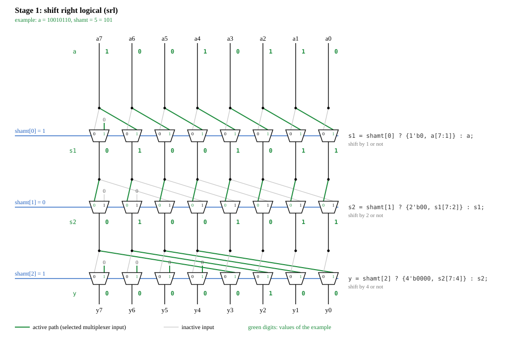



In the last chapter, link:/pages/24_sequential_verilog/[chapter 24] we explained the creation and 
implementation of sequential logic written in the HDL (Hardware Description Language) Verilog.

In this chapter we go deeper down the rabbit hole and see how multiplication and division of integers are
realised in hardware:

For multipliers and divisors that are powers of two this is easy, as it just means shifting bits to the left - which is multiplication, 
or to the right, which is division. More complex cases are handled and discussed later - for now let's look at shifting.

== Barrel Shifter

image:./barrel_shifter_files/arithmetic_shift.svg[width="100%"]

=== Shift right logical 

[source,verilog]
----
include::./barrel_shifter_files/shifter1_srl.v[Shift-right-logical]
----

=== Shift right arithmetic

[source,verilog]
----
include::./barrel_shifter_files/shifter2_sra.v[Shift-right-arithmetic]
----

image:./barrel_shifter_files/barrel_shifter_stage2_sra.svg[width="100%"]

=== Shift left logical

[source,verilog]
----
include::./barrel_shifter_files/shifter3_sll.v[Shift-left-logical]
----

image:./barrel_shifter_files/barrel_shifter_stage3_sll.svg[width="100%"]

=== The Shifter Testbench

[source,verilog]
----
include::./barrel_shifter_files/shifter_tb.v[Shifter-Testbench]
----