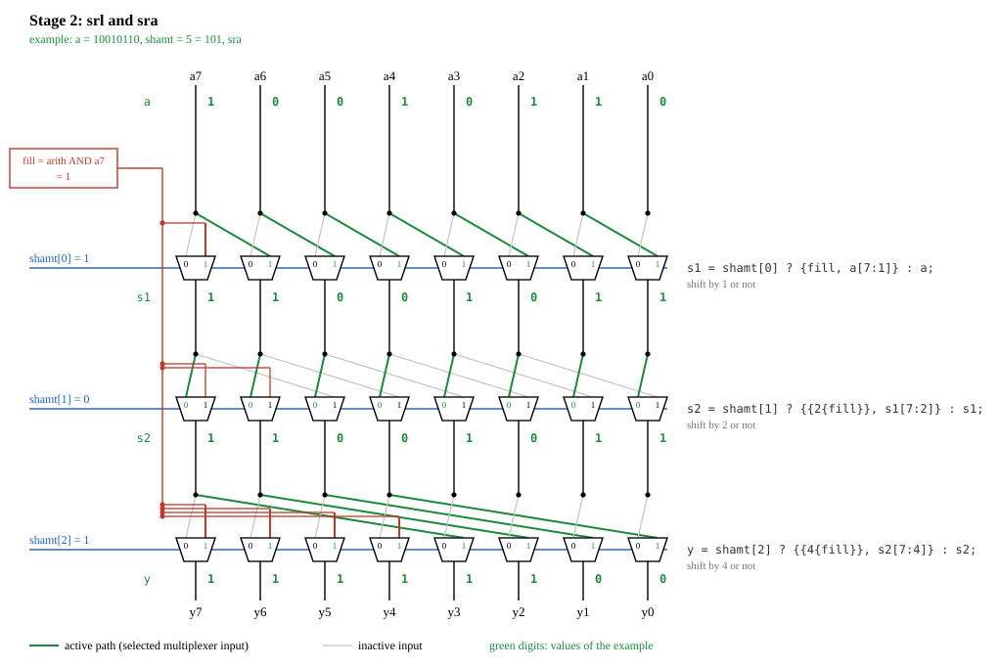
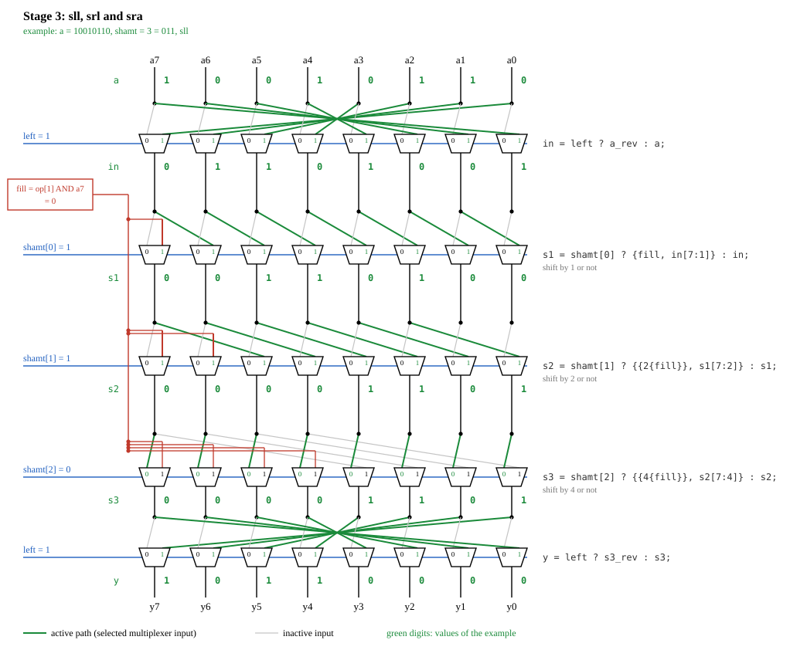



In the last chapter, link:/pages/24_sequential_verilog/[chapter 24] we explained the creation and 
implementation of sequential logic written in the HDL (Hardware Description Language) Verilog.

In this chapter we go deeper down the rabbit hole and see how multiplication and division of integers are
realised in hardware:

For multipliers and divisors that are powers of two this is easy, as it just means shifting bits to the left - which is multiplication, 
or to the right, which is division. More complex cases are handled and discussed later - for now let's look at shifting.

== Barrel Shifter

image:./barrel_shifter_files/arithmetic_shift.svg[width="100%"]

=== sll, srl, sra

[width="100%" cols="1,2,1,2,1,1",options="header"]
|================
| command | name                   | direction | shifted in                       | input      | result
| `sll`   | shift left logical     | left      | zeros from the right             | `00101101` | `01011010`
| `srl`   | shift right logical    | right     | zeros from the left              | `11011001` | `01101100`
| `sra`   | shift right arithmetic | right     | copies of the sign bit from the left | `11011001` | `11101100`
|================

[IMPORTANT]
.Why no shift left arithmetic (sla) ? 
====
The difference between “logical” and “arithmetic” lies solely in what is shifted into the space that becomes available.

When shifting to the right, space becomes available on the left—that is, where the sign bit is located. There are two reasonable options: zeros for unsigned numbers (srl) or copies of the sign bit for signed numbers (sra).

When shifting left, space is freed up on the right, at the least significant bit. A 0 is always correct there, regardless of whether the number has a sign or not. Even in two’s complement, “multiply by 2” simply means “shift everything one place to the left, with a 0 on the right”:

====

=== Shift right logical 

[source,verilog]
----
include::./barrel_shifter_files/shifter1_srl.v[Shift-right-logical]
----

image:./barrel_shifter_files/barrel_shifter_stage1_srl.svg[width="100%"]

=== Shift right arithmetic

[source,verilog]
----
include::./barrel_shifter_files/shifter2_sra.v[Shift-right-arithmetic]
----

=== Shift left logical

[source,verilog]
----
include::./barrel_shifter_files/shifter3_sll.v[Shift-left-logical]
----

=== The Shifter Testbench

[source,verilog]
----
include::./barrel_shifter_files/shifter_tb.v[Shifter-Testbench]
----
