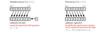
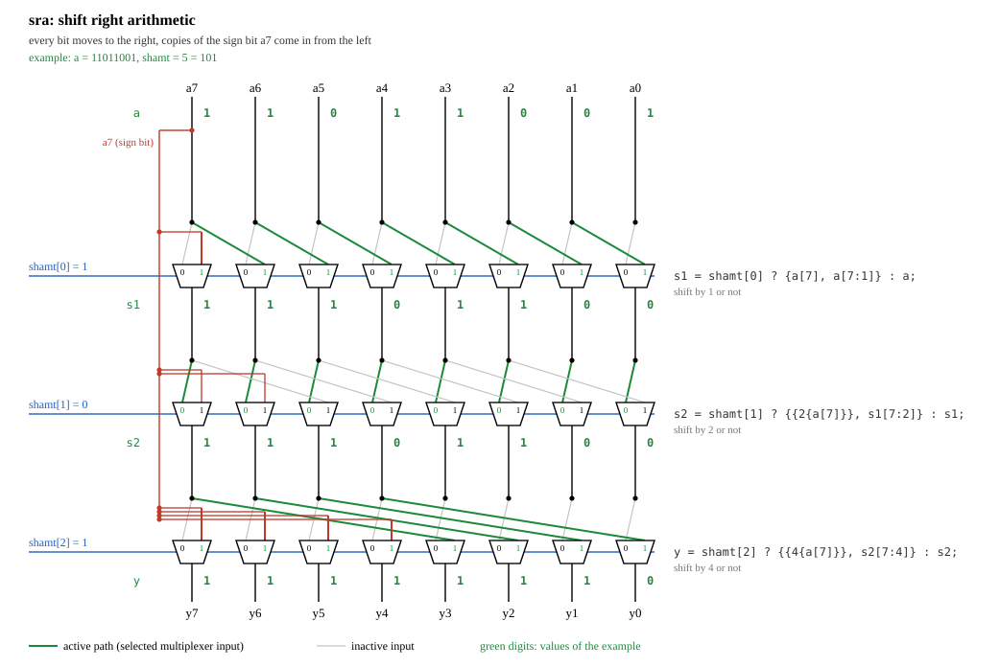
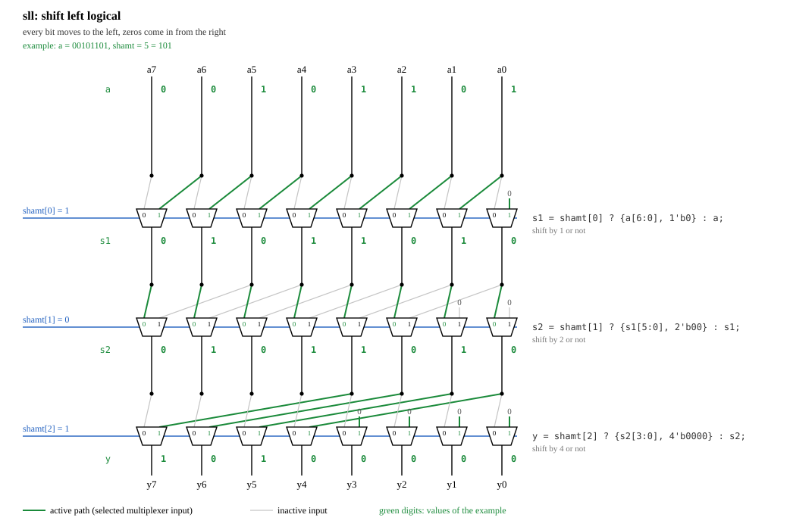
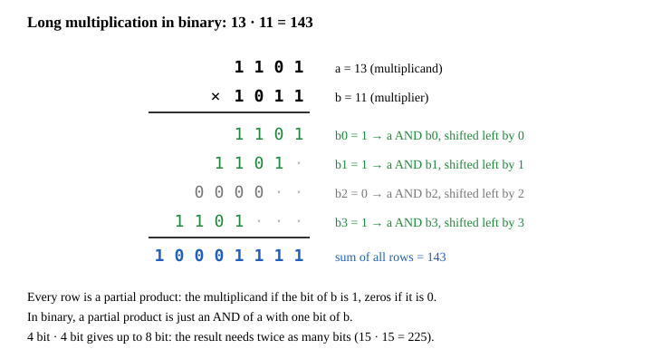



In the last chapter, link:/pages/24_sequential_verilog/[chapter 24] we explained the creation and 
implementation of sequential logic written in the HDL (Hardware Description Language) Verilog.

In this chapter we go deeper down the rabbit hole and see how multiplication and division of integers are
realised in hardware:

For multipliers and divisors that are powers of two this is easy, as it just means shifting bits to the left - which is multiplication, 
or to the right, which is division. More complex cases are handled and discussed later - for now let's look at shifting.

== Shifting and Barrel Shifter

[NOTE]
.Why `>>>` and not `>>`?
====
Verilog has two right shift operators:

* `>>` is the *logical* shift: it always shifts in zeros. `8'b11011001 >> 1` gives `8'b01101100`.
* `>>>` is the *arithmetic* shift: it shifts in copies of the sign bit, but only if the value is signed.
  `$signed(8'b11011001) >>> 1` gives `8'b11101100`, which is -20.

For an unsigned value, `>>>` behaves exactly like `>>`. That is why the value has to be marked as signed,
either with `$signed()` or by declaring it as `reg signed` or `wire signed`.

In C and Java, `>>` on a signed number is usually an arithmetic shift as well. Verilog makes the
difference explicit. For the left shift there is `<<<` too, but it does exactly the same as `<<`.
====

== The shift commands (sll, srl, sra)

[width="100%" cols="1,2,1,2,1,1",options="header"]
|================
| command | name                   | direction | shifted in                       | input      | result
| `sll`   | shift left logical     | left      | zeros from the right             | `00101101` | `01011010`
| `srl`   | shift right logical    | right     | zeros from the left              | `11011001` | `01101100`
| `sra`   | shift right arithmetic | right     | copies of the sign bit from the left | `11011001` | `11101100`
|================

[IMPORTANT]
.Why no shift left arithmetic (sla)?
====
The difference between “logical” and “arithmetic” lies solely in what is shifted into the space that becomes available.

When shifting to the right, space becomes available on the left—that is, where the sign bit is located. There are two reasonable options: zeros for unsigned numbers (srl) or copies of the sign bit for signed numbers (sra).

When shifting left, space is freed up on the right, at the least significant bit. A 0 is always correct there, regardless of whether the number has a sign or not. Even in two’s complement, “multiply by 2” simply means “shift everything one place to the left, with a 0 on the right”:

....
 -3 = 11111101   << 1  =  11111010 = -6
  5 = 00000101   << 1  =  00001010 = 10
....

So an sla would produce exactly the same bits as sll. It would just be a second name for the same operation.

If the result does not fit into the range of numbers, the sign flips:

....
100 = 01100100   << 1  =  11001000 = -56   (instead of 200)
....

This is an overflow, just like with add. Keeping the sign bit fixed would not help either: 200 simply does not fit into 8 bits with a sign.

====

=== The Barrel Shifter
What if we had hardware that shifts bits to the left or to the right by an arbitrary number of positions?

This is exactly what a barrel shifter does; its functionality is explained below, command by command...

A barrel shifter can shift the bits by the amount of shamt, so for 1, 2, 4 or a combination of these amounts.

=== Shift right logical 

- srl: shift right logical

- every bit moves to the right, zeros come in from the left

[source,verilog]
----
include::./barrel_shifter_files/srl.v[Shift-right-logical]
----

image:./barrel_shifter_files/shifter_srl.svg[width="100%"]

=== Shift right arithmetic

- sra: shift right arithmetic

- every bit moves to the right, copies of the sign bit a7 come in from the left

[source,verilog]
----
include::./barrel_shifter_files/sra.v[Shift-right-arithmetic]
----

=== Shift left logical

- sll: shift left logical

- every bit moves to the left, zeros come in from the right

[source,verilog]
----
include::./barrel_shifter_files/sll.v[Shift-left-logical]
----

=== All three commands together

Next we want hardware that combines all three different commands.

[source,verilog]
----
include::./barrel_shifter_files/shifter_all.v[Shift-all]
----

image:./barrel_shifter_files/shifter_all.svg[width="100%"]

=== The Shifter Testbench

The testbench checks all four circuits at once: the three single shifters for sll, srl and sra,
and the combined shifter, which is instantiated three times, once for each value of op.

[source,verilog]
----
include::./barrel_shifter_files/shifters_tb.v[Shifter-Testbench]
----

First, it prints one example to read: a = 10010110 shifted by 3, which gives 10110000 for sll,
00010010 for srl and 11110010 for sra.

Then it runs through every possible input: all 256 values of a and all 8 shift amounts, 2048 combinations in total.
For each of them, it compares the outputs with the result of the Verilog operators `<<`, `>>` and `>>>`.
If all outputs match, the testbench reports PASSED. Because every combination is tested, PASSED means
that the circuits are correct for every input, not just for a few examples.

[WARNING]
.A trap in the testbench
====
The expected values are first stored in their own registers (exp_sll, exp_srl, exp_sra) and only then compared.
This looks unnecessary, but it is not. In a comparison like

  y_sra !== $signed(a) >>> shamt

Verilog evaluates the whole expression as unsigned, because y_sra is unsigned. Then `>>>` shifts in zeros
instead of the sign bit, and the testbench reports errors for every negative number, although the circuit is correct.
Writing `$signed(a) >>> shamt` into a register of its own first avoids this.
====

== Multiplier 

=== Long Multiplication

=== Array-Multiplier 

image:./multiplier_files/array_multiplier.svg[width="100%",Array Multiplier]

[source,verilog]
----
include::./multiplier_files/array_multiplier.v[Array-Multiplier]
----

[source,verilog]
----
include::./multiplier_files/array_multiplier_tb.v[Array-Multiplier Testbench]
----

=== Sequential Multiplier 

[source,verilog]
----
include::./multiplier_files/seq_multiplier.v[Sequential-Multiplier]
----

[source,verilog]
----
include::./multiplier_files/seq_multiplier_tb.v[Sequential-Multiplier Testbench]
----

image:./multiplier_files/seq_multiplier.svg[width="100%",Sequential Multiplier]

image:./multiplier_files/seq_multiplier_waveform.svg[width="100%",Sequential Multiplier Waveform]

== Divider

(To be continued)
