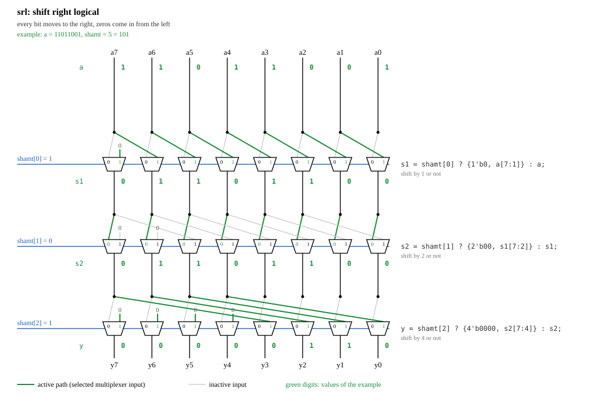
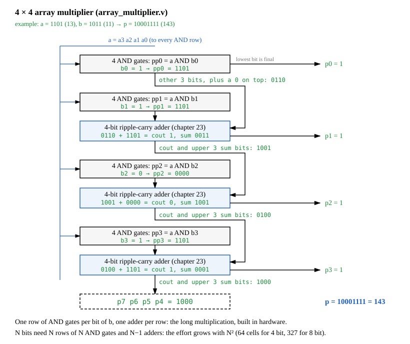
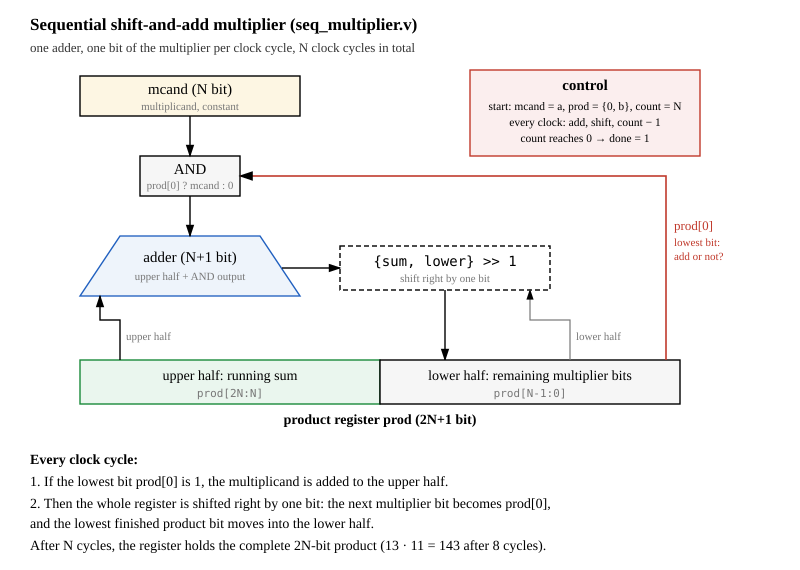
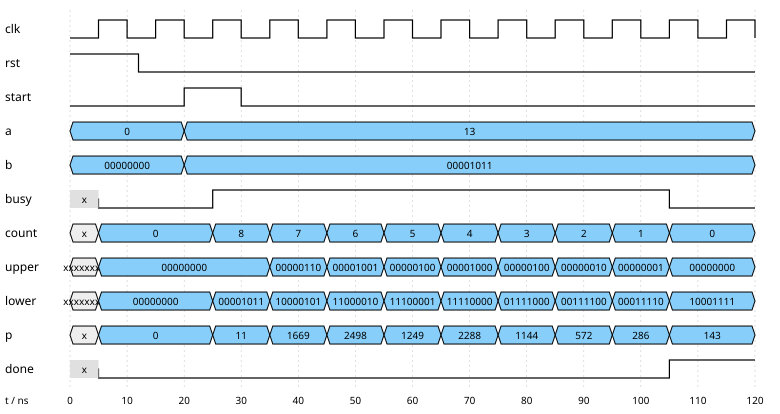
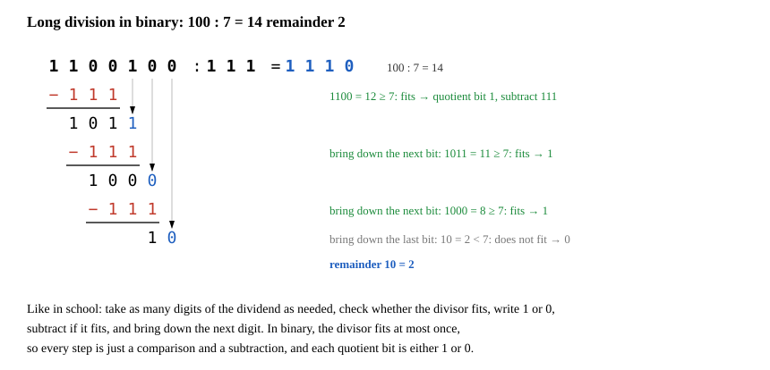
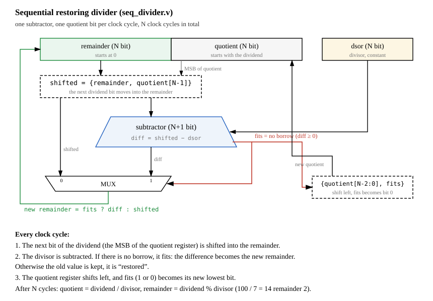



In the last chapter, link:/pages/24_sequential_verilog/[chapter 24] we explained the creation and 
implementation of sequential logic written in the HDL (Hardware Description Language) Verilog.

In this chapter we go deeper down the rabbit hole and see how multiplication and division of integers are
realised in hardware:

For multipliers and divisors that are powers of two this is easy, as it just means shifting bits to the left - which is multiplication, 
or to the right, which is division. More complex cases are handled and discussed later - for now let's look at shifting.

[TIP]
====
All examples of this chapter are in the folder `25_arithmetic_units` of our repository link:https://github.com/wehrend/hdl-training[hdl-training],
which we cloned in link:/pages/21_hdl/[chapter 21]: `00-barrel-shifter`, `01-array-multiplier`, `02-shift-add-multiplier`, `03-divider`.
If you cloned it earlier, `git pull` fetches the latest version. The README of the repository lists the command to simulate each example.
====

== Shifting and Barrel Shifter

image:./barrel_shifter_files/arithmetic_shift.svg[width="100%"]

[NOTE]
.Why `>>>` and not `>>`?
====
Verilog has two right shift operators:

* `>>` is the *logical* shift: it always shifts in zeros. `8'b11011001 >> 1` gives `8'b01101100`.
* `>>>` is the *arithmetic* shift: it shifts in copies of the sign bit, but only if the value is signed.
  `$signed(8'b11011001) >>> 1` gives `8'b11101100`, which is -20.

For an unsigned value, `>>>` behaves exactly like `>>`. That is why the value has to be marked as signed,
either with `$signed()` or by declaring it as `reg signed` or `wire signed`.

In C and Java, `>>` on a signed number is usually an arithmetic shift as well. Verilog makes the
difference explicit. For the left shift there is `<<<` too, but it does exactly the same as `<<`.
====

== The shift commands (sll, srl, sra)

[width="100%" cols="1,2,1,2,1,1",options="header"]
|================
| command | name                   | direction | shifted in                       | input      | result
| `sll`   | shift left logical     | left      | zeros from the right             | `00101101` | `01011010`
| `srl`   | shift right logical    | right     | zeros from the left              | `11011001` | `01101100`
| `sra`   | shift right arithmetic | right     | copies of the sign bit from the left | `11011001` | `11101100`
|================

[IMPORTANT]
.Why no shift left arithmetic (sla)?
====
The difference between “logical” and “arithmetic” lies solely in what is shifted into the space that becomes available.

When shifting to the right, space becomes available on the left—that is, where the sign bit is located. There are two reasonable options: zeros for unsigned numbers (srl) or copies of the sign bit for signed numbers (sra).

When shifting left, space is freed up on the right, at the least significant bit. A 0 is always correct there, regardless of whether the number has a sign or not. Even in two’s complement, “multiply by 2” simply means “shift everything one place to the left, with a 0 on the right”:

....
 -3 = 11111101   << 1  =  11111010 = -6
  5 = 00000101   << 1  =  00001010 = 10
....

So an sla would produce exactly the same bits as sll. It would just be a second name for the same operation.

If the result does not fit into the range of numbers, the sign flips:

....
100 = 01100100   << 1  =  11001000 = -56   (instead of 200)
....

This is an overflow, just like with add. Keeping the sign bit fixed would not help either: 200 simply does not fit into 8 bits with a sign.

====

=== The Barrel Shifter
What if we had hardware that shifts bits to the left or to the right by an arbitrary number of positions?

This is exactly what a barrel shifter does; its functionality is explained below, command by command...

A barrel shifter can shift the bits by the amount of shamt, so for 1, 2, 4 or a combination of these amounts.

=== Shift right logical 

- srl: shift right logical

- every bit moves to the right, zeros come in from the left

[source,verilog]
----
include::./barrel_shifter_files/srl.v[Shift-right-logical]
----

=== Shift right arithmetic

- sra: shift right arithmetic

- every bit moves to the right, copies of the sign bit a7 come in from the left

[source,verilog]
----
include::./barrel_shifter_files/sra.v[Shift-right-arithmetic]
----

image:./barrel_shifter_files/shifter_sra.svg[width="100%"]

=== Shift left logical

- sll: shift left logical

- every bit moves to the left, zeros come in from the right

[source,verilog]
----
include::./barrel_shifter_files/sll.v[Shift-left-logical]
----

image:./barrel_shifter_files/shifter_sll.svg[width="100%"]

=== All three commands together

Next we want hardware that combines all three different commands.

[source,verilog]
----
include::./barrel_shifter_files/shifter_all.v[Shift-all]
----

image:./barrel_shifter_files/shifter_all.svg[width="100%"]

=== The Shifter Testbench

The testbench checks all four circuits at once: the three single shifters for sll, srl and sra,
and the combined shifter, which is instantiated three times, once for each value of op.

[source,verilog]
----
include::./barrel_shifter_files/shifters_tb.v[Shifter-Testbench]
----

First, it prints one example to read: a = 10010110 shifted by 3, which gives 10110000 for sll,
00010010 for srl and 11110010 for sra.

Then it runs through every possible input: all 256 values of a and all 8 shift amounts, 2048 combinations in total.
For each of them, it compares the outputs with the result of the Verilog operators `<<`, `>>` and `>>>`.
If all outputs match, the testbench reports PASSED. Because every combination is tested, PASSED means
that the circuits are correct for every input, not just for a few examples.

[WARNING]
.A trap in the testbench
====
The expected values are first stored in their own registers (exp_sll, exp_srl, exp_sra) and only then compared.
This looks unnecessary, but it is not. In a comparison like

  y_sra !== $signed(a) >>> shamt

Verilog evaluates the whole expression as unsigned, because y_sra is unsigned. Then `>>>` shifts in zeros
instead of the sign bit, and the testbench reports errors for every negative number, although the circuit is correct.
Writing `$signed(a) >>> shamt` into a register of its own first avoids this.
====

== Multiplier

Multiplying by a power of two is a single shift. But every number is a sum of powers of two,
so every multiplication is a sum of shifts:

\[ x \cdot 10 = x \cdot (8 + 2) = (x \ll 3) + (x \ll 1) \]

This is the basic idea of all multipliers: for every bit of the multiplier that is 1, the multiplicand
is shifted to the position of this bit and added.

=== Long Multiplication

image:./multiplier_files/long_multiplication.svg[Long Multiplication,width="100%"]

Binary multiplication works exactly like long multiplication in school, only simpler.
Every bit of the multiplier b produces one row, a partial product: if the bit is 1, the row is the multiplicand a,
if it is 0, the row is all zeros. Each row is shifted one position further to the left. At the end, all rows are added.

In binary, a partial product is nothing but an AND: every bit of a is ANDed with one bit of b.
And the result needs twice as many bits as the inputs: 4 bit times 4 bit gives up to 8 bit, because 15 · 15 = 225.

=== Array Multiplier

The array multiplier builds the long multiplication directly in hardware: one row of AND gates for every bit of b,
and one adder for every row after the first. For the adders, we reuse the ripple-carry adder from
link:/pages/23_combinational_verilog/[chapter 23] (ripple_adder.v and full_adder.v), with its parameter N set to the width of the multiplier.

The figure follows our example 13 · 11. In every row, the lowest bit of the sum is already final:
it does not change anymore, because all following rows are shifted further to the left.
So it leaves the array as one bit of the product (p0 to p3), and only the remaining bits, together with the carry,
move on to the next row. After the last row, these remaining bits are the upper half of the product.

[source,verilog]
----
include::./multiplier_files/array_multiplier.v[]
----

The Verilog code describes this structure with two generate loops: the first creates the partial products pp[i] = a & {N{b[i]}},
the second creates one adder per row. Since the code only says how the rows are connected, the same module works for any N.

[source,verilog]
----
include::./multiplier_files/array_multiplier_tb.v[]
----

The testbench prints our example (13 · 11 = 143) and then compares all 256 combinations of two 4-bit numbers with the Verilog
operator `*`. If all of them match, it reports PASSED.

The array multiplier delivers the result within one clock cycle, but it has two drawbacks.
First, its size grows with the square of N: N rows of N AND gates and N−1 adders. Yosys synthesizes the 4-bit version
into 64 cells, the 8-bit version already into 327. A 32-bit version would be huge.
Second, the signals have to ripple through all adders one after another. This long path limits the clock frequency.

=== Sequential Multiplier

The sequential multiplier solves the size problem the other way round: instead of N adders side by side,
it uses one single adder N times, one bit of the multiplier per clock cycle.

The trick is the product register. Its upper half holds the running sum, its lower half the multiplier bits that have not been
processed yet. In every clock cycle, two things happen:

. If the lowest bit prod[0] is 1, the multiplicand is added to the upper half.
. Then the whole register is shifted right by one bit.

The shift brings the next multiplier bit to position 0, and at the same time it moves the lowest finished bit of the product
into the lower half. After N cycles, all multiplier bits have been used up, and the register holds the complete product.
The upper half has one extra bit, because the addition can produce a carry.

[source,verilog]
----
include::./multiplier_files/seq_multiplier.v[]
----

Here, the sequential logic from link:/pages/24_sequential_verilog/[chapter 24] comes into play. A pulse on start loads
the multiplicand, puts the multiplier into the lower half and sets a counter to N. While busy is 1, the circuit adds and shifts
in every clock cycle and counts down. When the counter runs out, done goes to 1 and the product p is valid.

[source,verilog]
----
include::./multiplier_files/seq_multiplier_tb.v[]
----

The testbench uses a task to start a multiplication and to wait for done. It runs our example first and then all 65,536 combinations
of two 8-bit numbers, which takes a few seconds. For the waveform, it shows the two halves of the product register as the
signals upper and lower.

The waveform shows the multiplication 13 · 11, with b = 00001011. At 25 ns, start loads the register, and the counter starts at 8.
From 35 ns on, one step follows every clock edge. In the first two steps, the lowest bit is 1: the multiplicand 13 is added,
and the register is shifted. In the third step, the lowest bit is 0, so it is only shifted. You can watch the bits of b
moving out of lower to the right, while the finished product bits move in from the left.
After 8 steps, at 105 ns, done goes to 1: upper is 00000000, lower is 10001111, and p is 143.

=== Space versus time

[width="100%",cols="2,1,1,1",options="header"]
|===
| | array multiplier | sequential multiplier |
| cells (8 bit) | 327 | 113 (30 of them flipflops) |
| clock cycles per multiplication | 1 | 8 |
| size grows with | N² | N |
|===

This is a basic principle of hardware design: area can be traded for time.
The barrel shifter was the "everything at once" kind of circuit, the sequential multiplier is the first "step by step" one.
Real CPUs use faster methods, such as Booth encoding, Wallace trees or pipelining, but they are all built on these two ideas.

[NOTE]
.What about signed numbers?
====
Both multipliers work with unsigned numbers. Interestingly, the lower N bits of the product are the same for signed and unsigned numbers.
That is why RISC-V has only one instruction mul for the lower half. Only the upper half differs,
so there are three instructions for it: mulh (signed · signed), mulhu (unsigned · unsigned) and mulhsu (signed · unsigned).
====

== Divider

Division is the inverse of multiplication: instead of shifting and adding, we shift and subtract.

=== Long Division

Again, we start with the method from school. Take as many digits of the dividend as needed until the divisor fits,
write a 1 into the quotient, subtract the divisor and bring down the next digit. If the divisor does not fit, write a 0
and just bring down the next digit.

In binary, this is even simpler than in decimal: the divisor fits either once or not at all.
So there is no guessing how many times it fits, every step is just a comparison and a subtraction,
and every quotient bit is either 1 or 0. In our example, 1100100 (100) divided by 111 (7) gives 1110 (14), with the remainder 10 (2).

=== Sequential Divider

The sequential divider does exactly these steps, one quotient bit per clock cycle. It needs three registers:
the divisor, which stays constant, the remainder, which starts at 0, and the quotient register,
which starts with the dividend. In every clock cycle:

. The next bit of the dividend, the MSB of the quotient register, is shifted into the remainder from the right.
  This is "bringing down the next digit".
. The divisor is subtracted from this shifted value. If there is no borrow, the difference is not negative: the divisor fits.
  Then the difference becomes the new remainder. If it does not fit, the remainder keeps its old value, it is "restored".
  That is why this method is called restoring division.
. The quotient register is shifted left, and the result of the comparison, fits, becomes its new lowest bit.

So the quotient register serves two purposes at the same time: on the left, the dividend bits are shifted out,
and on the right, the quotient bits are shifted in. After N cycles, all dividend bits are used up, and the register
holds the complete quotient. The remainder register holds the remainder.

[source,verilog]
----
include::./divider_files/seq_divider.v[]
----

The control is the same as in the sequential multiplier: start loads the registers and sets the counter to N,
busy is 1 while the circuit is working, and done signals that quotient and remainder are valid.
The subtraction uses N+1 bits, so that the borrow appears in the top bit diff[N]: if it is 0, the divisor fits.

[source,verilog]
----
include::./divider_files/seq_divider_tb.v[]
----

The testbench divides 100 by 7 and 42 by 0 first, and then checks all 65,536 combinations of two 8-bit numbers
against the Verilog operators `/` and `%`.

image:./divider_files/seq_divider_waveform.svg[Sequential Divider Waveform,width="100%"]

The waveform shows the division 100 : 7. At 25 ns, start loads the quotient register with the dividend 01100100.
From 35 ns on, one step follows every clock edge. In the first four steps, the remainder grows to 0, 1, 3 and 6 while the
dividend bits move in, but 7 never fits, so the quotient bits are 0. In the fifth step, at 75 ns, the remainder would be 12:
the divisor fits, the remainder becomes 12 − 7 = 5, and a 1 moves into the quotient register.
After 8 steps, at 105 ns, done goes to 1: the quotient register holds 00001110 (14), the remainder is 2.

[NOTE]
.Division by zero
====
What happens if the divisor is 0? The circuit needs no special case for this: 0 always "fits", so every quotient bit
becomes 1, and nothing is ever subtracted from the remainder. The result is a quotient of all ones (255)
and the dividend as the remainder, so 42 : 0 gives 255 remainder 42.

This is exactly what RISC-V specifies for the instructions divu and remu: dividing by zero raises no exception,
the quotient is all ones and the remainder is the dividend. The program has to check for a zero divisor itself.
====

=== Signed division

Our divider works with unsigned numbers only. For signed numbers, a CPU usually divides the absolute values
and corrects the sign afterwards. Two details are worth knowing:

* *Rounding:* RISC-V's div rounds towards zero, like C does: −7 / 2 = −3, with the remainder −1.
  The arithmetic shift from the beginning of this chapter rounds down instead: −7 >>> 1 = −4.
  So for negative numbers, a division by 2 is not the same as an arithmetic shift right.
* *Overflow:* The smallest number divided by −1 does not fit: in 8 bits, −128 / −1 would be +128.
  RISC-V defines the result as −128, with the remainder 0.

== Clock cycles compared

How long do our circuits need? With N = 8 bits, the testbenches show:

[width="100%",cols="3,2,2,2",options="header"]
|===
| circuit | clock cycles (8 bit) | clock cycles (32 bit) | size grows with
| barrel shifter | 1 | 1 | N · log~2~ N
| array multiplier | 1 | 1 | N²
| sequential multiplier | 8 (+1 to load) | 32 (+1) | N
| sequential divider | 8 (+1 to load) | 32 (+1) | N
|===

The combinational circuits deliver their result within one clock cycle, but the longer the path through the adders,
the slower that clock cycle has to be. The sequential circuits need one cycle per bit, plus one cycle in which start loads the registers.
In the waveforms, start loads at 25 ns, and done goes to 1 at 105 ns: eight steps of 10 ns each.

Real processors make the same trade-off:

* The Arm Cortex-M0+, a small microcontroller core, can be built with either of our two kinds of multiplier:
  a single-cycle multiplier, or a 32-cycle multiplier that needs less area. The chip designer chooses.
* The Cortex-M0+ has no divide instruction at all. The RP2040 therefore adds a divider next to each of its two cores,
  which needs 8 clock cycles for a 32-bit division.
* A desktop processor like Intel's Skylake multiplies two 64-bit numbers with a latency of 3 clock cycles.
  A 64-bit division takes between about 35 and 89 cycles, depending on the values.

[NOTE]
Multiplication has become fast everywhere, division has not. The reason is visible in our circuits: the partial products
of a multiplication are all independent of each other, so they can be calculated at the same time and added in a tree.
In a division, every step needs the remainder of the step before: whether the divisor fits can only be decided
once the previous subtraction is done. Fast dividers do several bits per cycle, but they cannot do all bits at once.
That is why compilers replace a division by a constant with a multiplication whenever they can,
and why the shift from the beginning of this chapter is still the fastest way to divide by a power of two.

(Created with Claude AI)