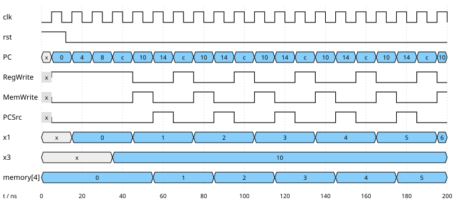



== The CPU in Verilog

In part 2 we designed a complete single-cycle RISC-V CPU on paper: the link:/pages/16_datapath/[data path] in chapter 16
and the link:/pages/17_cpu_control/[control unit] in chapter 17. At the end of chapter 17 we traced our counter program
clock by clock through a table - by hand.

In the chapters since then we collected the tools to do this with a computer: modules and signals
(link:/pages/21_hdl/[chapter 21]), testbenches and waveforms (link:/pages/22_simulation/[chapter 22]),
vectors, hierarchy and `generate` (link:/pages/23_combinational_verilog/[chapter 23]), flip-flops and registers
(link:/pages/24_sequential_verilog/[chapter 24]), and arithmetic in hardware (link:/pages/25_arithmetic_units/[chapter 25]).

Now we put everything together. We describe the CPU in Verilog and let the simulator execute the counter program.
At the end, the simulator prints the same table we filled in by hand in chapter 17.

[TIP]
====
All examples of this chapter are in the folder `26_cpu_verilog` of our repository link:https://github.com/wehrend/hdl-training[hdl-training],
which we cloned in link:/pages/21_hdl/[chapter 21]: `00-register-file`, `01-alu`, `02-control`, `03-cpu`.
If you cloned it earlier, `git pull` fetches the latest version. The README of the repository lists the command to simulate each example.
====

=== The plan: block by block

We could write the whole CPU in one file and simulate it. If it does not count to 10, we would have a problem:
the error could be anywhere. That is why we build the CPU in four steps, and every block gets its own testbench
before it is used:

[width="100%",options="header"]
|===
| Step | Block | Designed in | Files
| 1 | Register file | link:/pages/16_datapath/[chapter 16] | `regfile.v`
| 2 | ALU | link:/pages/05_alu/[chapter 05] | `alu_cell.v`, `alu.v`
| 3 | Control unit, ALU control, immediate generator | link:/pages/17_cpu_control/[chapter 17] | `control.v`, `alu_control.v`, `imm_gen.v`
| 4 | Memories and the complete CPU | chapters 16 and 17 | `instr_mem.v`, `data_mem.v`, `cpu.v`
|===

This is how chips are developed in practice as well: first every block is tested on its own (unit test),
then the assembled system (integration test). If the integration test fails, we at least know that the blocks
themselves are correct, and the error must be in the wiring between them.

=== Step 1: The register file

The register file holds the 32 registers x0 to x31, each 32 bits wide. In chapter 16 we drew it with three ports:

* two *read ports*: the register numbers rs1 and rs2 go in, the contents rd1 and rd2 come out,
* one *write port*: if RegWrite is 1, the value wd is written into register rd.

Reading is combinational: as soon as rs1 changes, rd1 shows the new register after a short delay.
Writing happens on the rising clock edge, like with every register from chapter 24.
And register x0 is special: it always reads as 0, writing to it has no effect.

[source,verilog]
----
include::./register_files/regfile.v[]
----

==== A new language feature: arrays

So far, a signal was either a single bit or a vector like `wire [31:0] a`. The line

[source,verilog]
----
reg [31:0] regs [0:31];
----

declares an *array*: 32 elements (the range after the name), each of them a vector of 32 bits (the range before the name).
`regs[5]` is the complete register x5, and `regs[5][31]` would be its sign bit. The index does not have to be a constant:
`regs[rs1]` selects the register whose number is currently at rs1. In hardware, this is a large multiplexer
with 32 inputs of 32 bits each - and since we have two read ports, we get two of them.

==== Why is x0 checked when reading?

The write block refuses to write register 0 (`rd != 0`). So regs[0] is never written at all - but this also means
that it is never initialized, and in simulation it contains `x`. That is why the read ports check for register 0 themselves
and deliver a constant 0. In hardware, regs[0] does not even have to exist: the synthesis tool notices that
it is never written and removes it.

==== The testbench

[source,verilog]
----
include::./register_files/regfile_tb.v[]
----

The testbench first writes the value i · 3 into every register i. For x0 it tries to write 0xDEAD instead.
New values are applied on the falling edge (`@(negedge clk)`), so they are stable at the rising edge.
As in chapter 22, the inputs change away from the clock edge. Then all registers are read on both ports at the same time: port 1 counts up
from x0, port 2 counts down from x31. Finally the testbench checks that nothing is written while we = 0.

----
x0 = 0 (0xDEAD was written, x0 stays 0), x7 = 21
PASSED
----

=== Step 2: The ALU

The ALU from link:/pages/05_alu/[chapter 05] is a chain of identical 1-bit cells. This is exactly what Verilog's
hierarchy and `generate` are made for (link:/pages/23_combinational_verilog/[chapter 23]).
We start with a single cell:

[source,verilog]
----
include::./alu_files/alu_cell.v[]
----

Everything in this cell is known from part 1:

* The two XOR gates are *controllable inverters*: if ainvert = 1, the cell works with the inverted a. The same for b.
* `sum` and `cout` form a full adder.
* The `case` statement is the multiplexer at the output, controlled by the two Operation bits.
* The input `less` is only used for slt; we will see in a moment where its value comes from.

==== From the cell to the 32-bit ALU

[source,verilog]
----
include::./alu_files/alu.v[]
----

The `generate` loop creates 32 copies of the cell and connects the carry output of every cell
to the carry input of the next one, via the vector c. The four control bits are split up into Ainvert,
Binvert and Operation. This gives us the following operations:

[width="70%",options="header"]
|===
| ctrl | Ainvert | Binvert | Operation | Function
| 0000 | 0 | 0 | 00 | and
| 0001 | 0 | 0 | 01 | or
| 0010 | 0 | 0 | 10 | add
| 0110 | 0 | 1 | 10 | sub
| 0111 | 0 | 1 | 11 | slt
| 1100 | 1 | 1 | 00 | nor
| 1101 | 1 | 1 | 01 | nand
|===

Four lines deserve a closer look:

* `assign c[0] = binvert;` - a subtraction is a - b = a + ~b + 1 in link:/pages/04_signs/[two's complement].
  Binvert inverts b in every cell, and since Binvert is also the carry into the first cell, it provides the + 1 as well.
* `assign overflow = c[N-1] ^ c[N];` - an overflow occurs if the carry into the sign bit differs from the carry out of it.
* `assign is_less = sum[N-1] ^ overflow;` - for slt the ALU computes a - b. If the result is negative, a < b.
  The sign bit of the sum tells us this - unless the subtraction overflowed, then the sign bit is wrong and the XOR corrects it.
  This value goes to the `less` input of cell 0. All other cells get a 0, so the result is either 1 or 0.
* `assign zero = ~|result;` - the `|` in front of a vector is a *reduction operator*: it ORs all bits of the vector together.
  The `~` inverts the result. So zero is 1 exactly when all 32 result bits are 0 - a NOR gate with 32 inputs.

The line with `is_less` might look like a loop: the result of the last cell goes back into the first cell.
But it is not one: is_less depends on `sum` of the last cell, and `sum` does not depend on `less` at all.
The signal simply runs through the carry chain once and then into the output multiplexer of cell 0.
A real combinational loop, in which a signal depends on itself, would be an error.

[NOTE]
.Why not simply write `a + b`?
====
In practice we would: `assign result = a + b;` is shorter, and the synthesis tool knows very well how to build an adder,
for example with the dedicated carry logic of an FPGA. Here we build the ALU from cells on purpose, because we want to see
that the circuit from part 1 actually works. In link:/pages/27_code_to_chip/[chapter 27] we will see what the synthesis tool makes of it.
====

==== The testbench

[source,verilog]
----
include::./alu_files/alu_tb.v[]
----

Testing all combinations, like we did for the 8-bit shifter in chapter 25, is not possible here:
with two 32-bit inputs, there are 2^64^ combinations. Instead, the testbench uses two kinds of values:

* *Edge values*: 0, 1, -1, the largest and the smallest number, and a few others. Most errors happen at the edges:
  at the carry from bit 30 into bit 31, at the overflow, at the transition from -1 to 0.
  Every operation is tested with all 64 pairs of these 8 values.
* *Random values*: 1000 random pairs per operation, generated with `$random`. They find errors nobody thought of.

Together with the four examples at the beginning, these are 4 + 7 · (64 + 1000) = 7452 tests.
Every result is compared with the Verilog operators `&`, `|`, `+`, `-` and `<`:

----
add: 1 + 1   = 2
sub: 1 - 10  = -9, zero = 0
sub: 10 - 10 = 0, zero = 1
slt: -2147483648 < 1 = 1 (overflow = 1)
PASSED: 7452 tests
----

The last example line is the interesting one: -2^31^ - 1 does not fit into 32 bits, the subtraction overflows,
and the sign bit of the result is 0. Without the overflow correction, slt would claim that -2^31^ is not less than 1.

=== Step 3: The control unit

In chapter 17 the control consisted of three blocks: the main control, the ALU control and the immediate generator.
In Verilog, each of them becomes a small module of pure combinational logic.

==== The main control

[source,verilog]
----
include::./control_files/control.v[]
----

This is the circuit from chapter 17, one to one: a decoder with one line per instruction type,
and every control signal is an OR of the lines in which it is 1. The line `imm` and its two ORs are the extension for `addi`
from chapter 17. ALUOp is built with a concatenation: `{r, br}` puts r into bit 1 and br into bit 0.

We could also have written the main control table as a `case` statement over the opcode, with one line per instruction.
The result after synthesis would be the same. The form chosen here has the advantage that the code looks like
the equations in chapter 17.

==== The ALU control

[source,verilog]
----
include::./alu_files/alu_control.v[]
----

The two-stage decoding from chapter 17: ALUOp makes the rough decision, and only for R-type instructions (ALUOp = 10)
funct3 and bit 30 are looked at. Note that there is a `default` in both `case` statements: as we learned in
link:/pages/23_combinational_verilog/[chapter 23], an `always @(*)` block in which an output is not assigned in every case
produces a latch.

The `addi` trap from chapter 17 is solved by the main control, not here: since `addi` gets ALUOp = 00,
the ALU control never looks at bit 30 of an `addi`, which belongs to the constant there.

==== The immediate generator

[source,verilog]
----
include::./other/imm_gen.v[]
----

Here the concatenation shows its strength. The table from chapter 17 can be written down almost literally:
`{inst[31:25], inst[11:7]}` puts the two parts of the S-type constant together.
`{20{inst[31]}}` is a *replication*: 20 copies of the sign bit. This is the sign extension in a single expression.

The B-type line is the strangest one: the bits of the constant come from four places in the instruction,
and a 0 is appended at the end because branch targets are always even. Counting the bits shows that it adds up:
19 + 1 + 1 + 6 + 4 + 1 = 32.

==== The testbench

[source,verilog]
----
include::./control_files/control_tb.v[]
----

The testbench feeds real machine instructions into all three blocks: the instructions of our counter program,
and a few more for `sub`, `and`, `or` and `lw`. The expected values are copied from the tables in chapter 17.
The last line tests the `addi` trap: in `addi x5, x5, -1` bit 30 is 1, and the ALU control must still choose addition.

----
addi x3,x0,10    RegWrite=1 ALUSrc=1 MemToReg=0 MemRead=0 MemWrite=0 Branch=0 ALUOp=00 ALUctrl=0010 imm=10
add x1,x1,x2     RegWrite=1 ALUSrc=0 MemToReg=0 MemRead=0 MemWrite=0 Branch=0 ALUOp=10 ALUctrl=0010 imm=2
sub x2,x1,x2     RegWrite=1 ALUSrc=0 MemToReg=0 MemRead=0 MemWrite=0 Branch=0 ALUOp=10 ALUctrl=0110 imm=1026
and x1,x1,x2     RegWrite=1 ALUSrc=0 MemToReg=0 MemRead=0 MemWrite=0 Branch=0 ALUOp=10 ALUctrl=0000 imm=2
or x1,x1,x2      RegWrite=1 ALUSrc=0 MemToReg=0 MemRead=0 MemWrite=0 Branch=0 ALUOp=10 ALUctrl=0001 imm=2
lw x5,8(x6)      RegWrite=1 ALUSrc=1 MemToReg=1 MemRead=1 MemWrite=0 Branch=0 ALUOp=00 ALUctrl=0010 imm=8
sw x1,4(x0)      RegWrite=0 ALUSrc=1 MemToReg=0 MemRead=0 MemWrite=1 Branch=0 ALUOp=00 ALUctrl=0010 imm=4
bne x1,x3,-8     RegWrite=0 ALUSrc=0 MemToReg=0 MemRead=0 MemWrite=0 Branch=1 ALUOp=01 ALUctrl=0110 imm=-8
beq x0,x0,0      RegWrite=0 ALUSrc=0 MemToReg=0 MemRead=0 MemWrite=0 Branch=1 ALUOp=01 ALUctrl=0110 imm=0
addi x5,x5,-1    RegWrite=1 ALUSrc=1 MemToReg=0 MemRead=0 MemWrite=0 Branch=0 ALUOp=00 ALUctrl=0010 imm=-1
PASSED
----

The immediate generator also delivers a value for R-type instructions (imm=2, imm=1026). It just interprets the
instruction as I-type. This does not matter: ALUSrc = 0, so the multiplexer in front of the ALU ignores it.
That is why the testbench only checks imm where ALUSrc or Branch is 1.

=== Step 4: The complete CPU

Two blocks are still missing: the memories. Then we can connect everything.

==== Instruction memory and data memory

[source,verilog]
----
include::./other/instr_mem.v[]
----

The instruction memory is an array of 64 words. `$readmemh` loads it from a text file with hexadecimal numbers
when the simulation starts - one instruction per line:

----
include::./other/program.hex[]
----

This is our counter program from chapters 15 and 17, translated into machine code. Everything after `//` is a comment.

The PC contains byte addresses: 0x00, 0x04, 0x08, ... But the memory is organized in words of 4 bytes.
That is why the address is divided by 4 by simply leaving out the two lowest bits: `addr[7:2]`.
Address 0x0C becomes word 3. Six address bits give 64 words - enough for our program.

[source,verilog]
----
include::./other/data_mem.v[]
----

The data memory works like the register file, just with one port: reading is combinational, writing happens
on the rising edge if MemWrite = 1. The `initial` loop sets all words to 0 at the beginning of the simulation,
so we do not see `x` in the waveform.

==== Connecting everything

[source,verilog]
----
include::./cpu_files/cpu.v[]
----

If you hold the picture from link:/pages/17_cpu_control/[chapter 17] next to this code, you will find every block and every wire.
The code is ordered like the phases of an instruction:

* *Instruction fetch:* the PC addresses the instruction memory, the first adder computes PC + 4.
* *Decode:* the instruction is cut into its fields. These are just wires, no logic: `inst[19:15]` *is* rs1.
* *Control:* main control and ALU control generate the control signals.
* *Register file and immediate:* the register file reads rs1 and rs2, the immediate generator extracts the constant.
* *Execute:* the multiplexer in front of the ALU selects the second operand, the ALU computes.
* *Memory access:* the ALU result is the address for the data memory, rs2 is the data to write.
* *Write back:* the multiplexer behind the memory selects what is written into rd.
* *Next PC:* the second adder computes the branch target, PCSrc selects the next PC.

All multiplexers are a single line with the conditional operator from chapter 24, for example
`alu_b = alu_src ? imm : rd2`. And the branch decision with the extension for `bne` is the formula from chapter 17:

\[PCSrc = Branch \cdot (Zero \oplus inst_{12})\]

In the whole module, there is only one `always` block: the PC. Together with the register file and the data memory,
it is the only part of the CPU that stores anything. Everything else is combinational logic between two clock edges -
this is exactly what "single-cycle" means.

The PC has a *synchronous reset*: as long as rst = 1, the PC is set to 0 at every rising edge.
Without a reset, the PC would start with `x`, and the CPU would fetch an instruction from an unknown address.

==== The testbench

[source,verilog]
----
include::./cpu_files/cpu_tb.v[]
----

The testbench does three things:

* It generates the clock and releases the reset after 12 ns.
* At every rising edge it prints one line: PC, instruction and what the instruction does.
  At the rising edge the new values are not stored yet (they are non-blocking assignments, see chapter 24),
  so we still see the instruction of this cycle and the value that is about to be written.
* After 35 clock cycles it checks the result: x1 and x3 must be 10, memory[4] must be 10, the PC must be at 0x18,
  and there must have been exactly 10 writes to the memory, with the values 1 to 10.

The testbench looks into the CPU with *hierarchical names*: `dut.rf.regs[1]` is element 1 of the array regs
in the instance rf inside the instance dut. This only works in simulation, a synthesis tool would reject it.
But for a testbench, it is very handy: we can watch any signal without having to lead it out of the CPU through ports.

[NOTE]
.Why the extra wires x1, x3 and mem4?
====
Most simulators, Icarus Verilog among them, do not write arrays into the VCD file automatically.
The wires `x1`, `x3` and `mem4` in the testbench are copies of single array elements, so they appear in the waveform.
====

==== The CPU counts to 10

----
clock  1  PC=0x00  inst=00000093  x1 = 0  ->  next PC=0x04
clock  2  PC=0x04  inst=00100113  x2 = 1  ->  next PC=0x08
clock  3  PC=0x08  inst=00a00193  x3 = 10  ->  next PC=0x0c
clock  4  PC=0x0c  inst=002080b3  x1 = 1  ->  next PC=0x10
clock  5  PC=0x10  inst=00102223  memory[4] = 1  ->  next PC=0x14
clock  6  PC=0x14  inst=fe309ce3  Zero=0 PCSrc=1  ->  next PC=0x0c
clock  7  PC=0x0c  inst=002080b3  x1 = 2  ->  next PC=0x10
...
clock 31  PC=0x0c  inst=002080b3  x1 = 10  ->  next PC=0x10
clock 32  PC=0x10  inst=00102223  memory[4] = 10  ->  next PC=0x14
clock 33  PC=0x14  inst=fe309ce3  Zero=1 PCSrc=0  ->  next PC=0x18
clock 34  PC=0x18  inst=00000063  Zero=1 PCSrc=1  ->  next PC=0x18
clock 35  PC=0x18  inst=00000063  Zero=1 PCSrc=1  ->  next PC=0x18
PASSED: counted to 10 in 33 clock cycles, CPU loops at 0x18
----

Compare this with the table at the end of chapter 17: it is the same, line by line.
In clock 6, `bne` sees Zero = 0 (1 - 10 is not 0) and jumps back to 0x0C. In clock 33, x1 = x3 = 10,
Zero = 1, and the branch is not taken. From clock 34 on, the CPU circles in the endless loop at 0x18.

Icarus prints one warning at the start: `program.hex` contains only 7 instructions, but the memory has 64 words.
That is fine, the rest of the instruction memory is never used.

The waveform shows the first 200 ns:

We can read a lot from it:

* Until the first rising edge at 5 ns, the PC is `x`. Only then the reset takes effect and sets it to 0.
* After the reset, the PC runs through 0, 4, 8 and then repeats the loop c, 10, 14 - every three clock cycles.
* RegWrite is 1 for `addi` and `add`, MemWrite for `sw`, PCSrc for the taken `bne`.
* x1 counts up with every loop iteration, and memory[4] follows one clock later - the `sw` comes after the `add`.

=== Simulation is not hardware (yet)

Our CPU works - in simulation. Can we now load it onto an FPGA? We tried it with the Lattice iCE40 HX1K, the FPGA
on the Nandland Go Board, which we will use in the next chapter. The result: the design needs more than three times
as many logic cells as the chip has.

The reason lies in the memories. Register file and data memory are read combinationally. The FPGA has fast block RAM,
but block RAM can only be read on a clock edge. So the synthesis tool builds our memories from single flip-flops
and huge multiplexers - more than 3000 flip-flops just for storage. In simulation, this makes no difference at all.

How to fix this, and what happens between the Verilog code and the chip - synthesis, place and route, timing analysis -
is the topic of link:/pages/27_code_to_chip/[chapter 27].

=== Try it yourself

. *Add `slt`.* The ALU can already compute slt (ctrl = 0111), but the ALU control does not know the instruction yet.
  `slt` is an R-type instruction with funct3 = 010. One additional line in `alu_control.v` is enough.
  Test it with a small program, for example:
+
----
00300093  // addi x1, x0, 3
ffb00113  // addi x2, x0, -5
0020a1b3  // slt  x3, x1, x2     3 < -5 ?  -> x3 = 0
00112233  // slt  x4, x2, x1    -5 <  3 ?  -> x4 = 1
00000063  // beq  x0, x0, 0
----
+
The negative number shows whether the comparison really is signed.
. *A different program.* Change `program.hex` so that the CPU adds up the numbers from 1 to 10 and stores the sum (55)
  in memory[8]. You need one more register and one more `add`. The machine code can be built by hand with the formats
  from link:/pages/15_RISC_V/[chapter 15], or with an assembler such as the one in the simulator Ripes.
. *Break it on purpose.* Change bit 30 to bit 29 in the `alu_control` instance in `cpu.v`, or swap two inputs of a multiplexer.
  Which testbench finds the error? How quickly can you find it in the waveform?
  (Hint for bit 29: does our counter program contain a `sub`? A test can only find errors in what it actually uses.)

=== Summary

* We built the single-cycle CPU from part 2 in Verilog, from four kinds of blocks: register file, ALU,
  control (main control, ALU control, immediate generator) and memories.
* Every block got its own testbench before it was used. The CPU testbench then only had to check the wiring.
* New language features: arrays (`reg [31:0] regs [0:31]`), the reduction operator (`~|result`), replication (`{20{inst[31]}}`),
  `$readmemh` for loading memory contents, and hierarchical names in testbenches.
* The CPU executes our counter program in 33 clock cycles - exactly as we predicted by hand in chapter 17.
* What works in simulation does not automatically fit onto a chip. That is the topic of the next chapter.

(Created with Claude AI)
